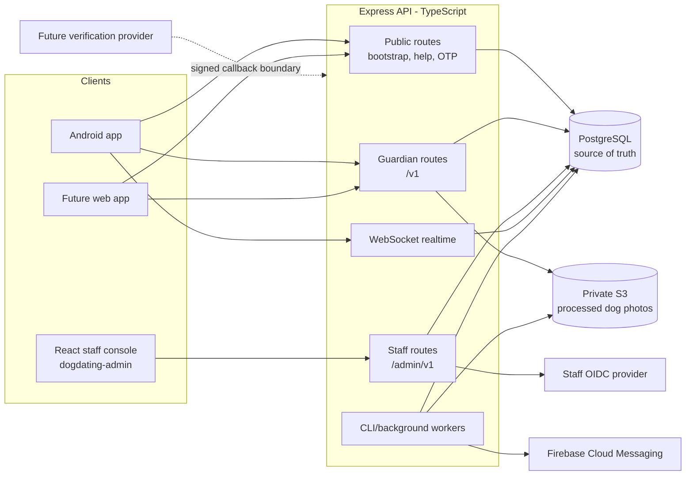
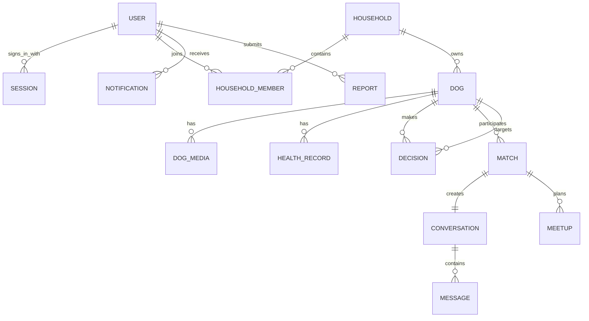
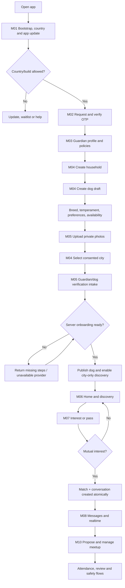
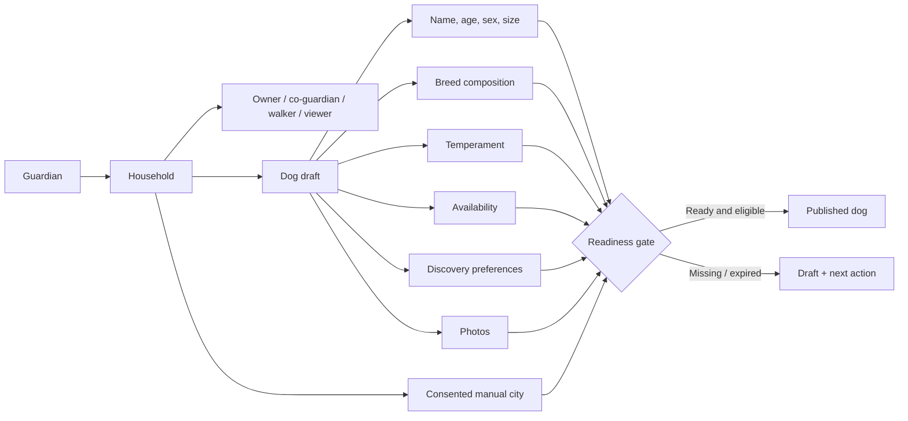
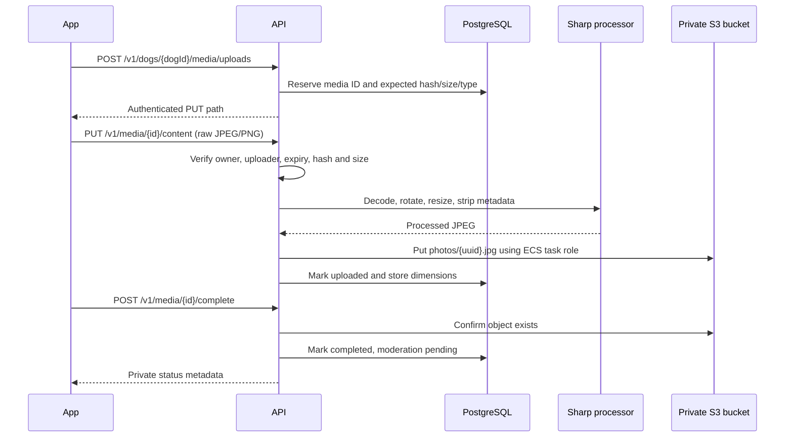
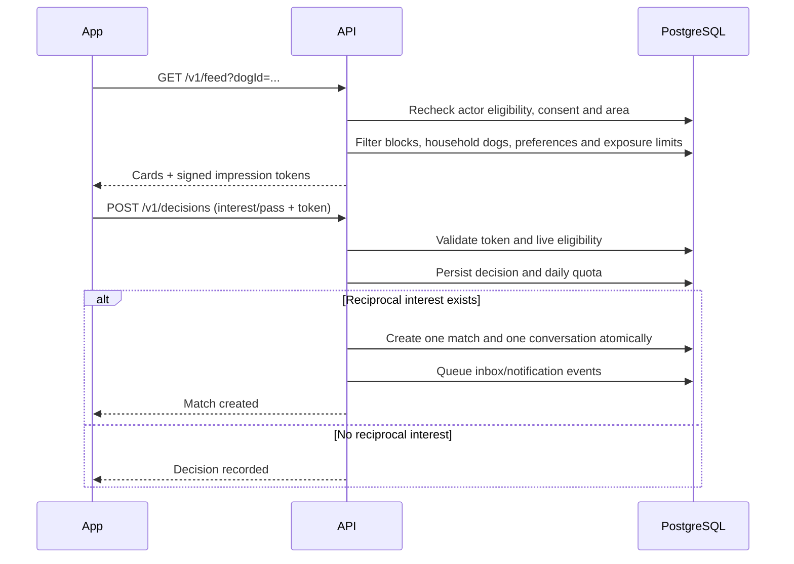
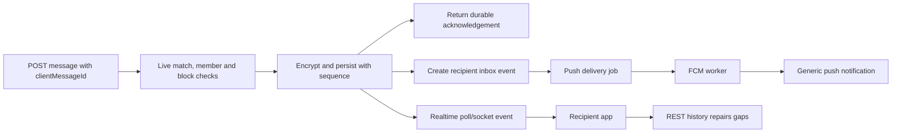
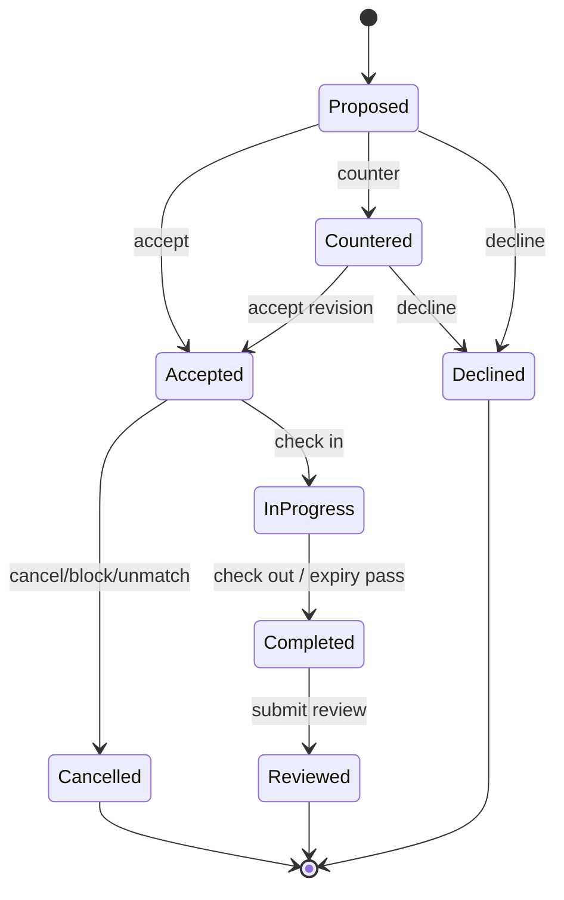
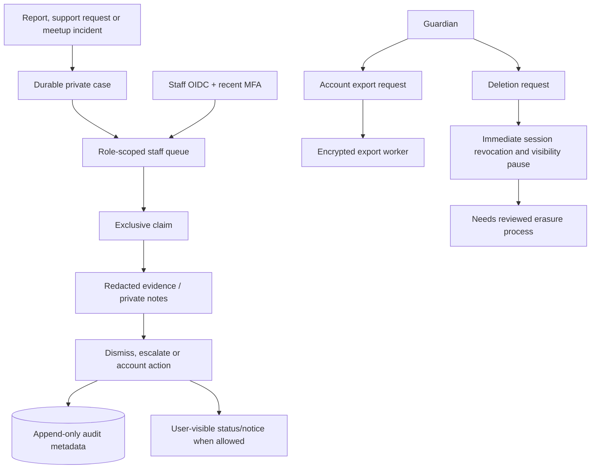
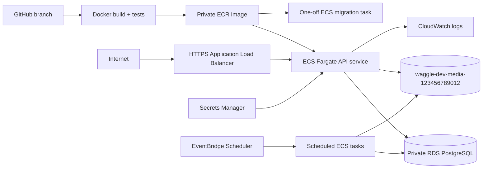

# Waggle app and API flows

Updated 29 October 2026. This is the quickest way to understand how the Waggle app, API modules, database and external services fit together.

Waggle is an India-first dog social and matching app. A guardian signs in, creates a household and dog profile, completes onboarding, discovers eligible dogs, expresses interest, matches, chats and can arrange a meetup. The current product scope is dog friendship, walks and playdates. Billing, country expansion, breeding introductions and owner dating remain planned.

## 1. System at a glance



PostgreSQL is authoritative for accounts, permissions, dogs, matches, messages and workflow state. S3 contains processed image bytes only; PostgreSQL stores the object key and metadata. Clients never receive AWS credentials.

## 2. Core data ownership



The important permission chain is:

```text
signed-in user → accepted household membership → role → dog/resource permission
```

An `owner` or `co_guardian` can edit a dog. A `walker` or `view_only` member has narrower access. Every request rechecks current membership, blocks and account state; possession of an ID never grants access.

## 3. Full app journey



Onboarding readiness is computed by the server from stored records. A client cannot skip requirements by sending a completion flag.

## 4. Login and session flow

```mermaid
sequenceDiagram
  participant App
  participant API
  participant DB as PostgreSQL
  participant SMS as SMS provider / dev sender

  App->>API: POST /v1/auth/otp/request
  API->>DB: Create hashed, expiring challenge
  API->>SMS: Deliver OTP
  API-->>App: 202 accepted
  App->>API: POST /v1/auth/otp/verify
  API->>DB: Lock challenge and check attempts/expiry
  API->>DB: Create user if new; create session
  API-->>App: Access token + rotating refresh token
  App->>API: Protected request with Bearer token
  API->>DB: Recheck session and account status
  API-->>App: Authorized response
```

In the explicitly configured development environment, any valid currently supported Indian phone number uses `000000` for normal sign-in after requesting a challenge. This lets testers create separate accounts. Expiry, one-use, resend and attempt limits still apply. Privacy and phone-change OTPs remain random. Production cannot enable the development sender.

Access tokens last 15 minutes. Refresh tokens rotate and belong to a 30-day family. Reusing an already rotated refresh token revokes the family.

## 5. Dog profile and onboarding flow



Profile edits that invalidate eligibility reset publication. Consent withdrawal, account restrictions, expired evidence, removed membership and blocks are enforced live.

## 6. Photo and S3 flow



The API currently receives the original bytes so it can validate and rewrite the image before S3 persistence. The bucket remains private. Approved-photo delivery and moderation are still pending, so clients receive status metadata rather than a public image URL.

## 7. Discovery, likes and matching



Discovery is currently city-only development behavior. It does not calculate or expose exact distance. Feed tokens authorize a decision for a specific viewer, actor dog and target dog for a short time; they never bypass live privacy checks.

## 8. Messaging and notifications



REST history is authoritative. WebSockets use a one-use short-lived ticket and provide development realtime delivery. Message bodies are encrypted at rest with the configured development key; the implementation does not claim end-to-end encryption. Production key management remains pending.

## 9. Meetup flow



Meetups use reviewed public places, revision checks and recorded participants. Blocks and unmatches cancel active meetups. Reminders and expiry processing require an externally scheduled worker.

## 10. Safety, privacy and staff operations



Staff APIs use a separate identity system and roles. Ordinary user JWTs cannot call `/admin/v1`. Account export has a scoped implementation; full legal erasure and retention processing remain pending.

The sibling `../dogdating-admin` React application now provides the staff shell, operations dashboard, role-scoped queues, audit browser, exact user-ID lookup and release overview. Development accepts a short-lived OIDC bearer token in session storage. Production sign-in redirect still requires the selected identity provider, Authorization Code + PKCE and hosted configuration.

## 11. Background and scheduled work

| Command | Responsibility | Deployment status |
| --- | --- | --- |
| `node dist/db/migrate.js` | Apply immutable SQL migrations under an advisory lock | Run once before each service release |
| `npm run media:cleanup` | Remove expired/abandoned photo objects | Implemented; scheduler pending |
| `npm run discovery:cleanup` | Remove expired discovery snapshots/exposure rows | Implemented; scheduler pending |
| `npm run push:deliver` | Lease and deliver FCM jobs | Adapter implemented; credentials/scheduler pending |
| `npm run privacy:exports` | Build scoped encrypted account exports | Implemented; scheduler pending |
| `npm run meetup:reminders` | Send reminders and expire meetup state | Implemented; scheduler pending |
| `npm run maintenance:run` | Run bounded maintenance under one advisory lock | Implemented; scheduler pending |
| `npm run verification:expire` | Revoke expired verification grants | Implemented; scheduler pending |

In AWS these should run as separate one-off or scheduled ECS tasks using the same immutable image and appropriate IAM/database permissions.

## 12. API module map

| Module | Main route families | State |
| --- | --- | --- |
| M01 App lifecycle | `/v1/health`, `/v1/ready`, `/v1/app/*`, `/v1/help/*`, `/v1/waitlist` | Implemented foundation |
| M02 Authentication | `/v1/auth/*` | Development OTP and sessions implemented; production SMS pending |
| M03 Onboarding | `/v1/me`, `/v1/me/onboarding*`, `/v1/me/consents*`, `/v1/me/preferences` | Implemented |
| M04 Households/dogs | `/v1/households*`, `/v1/dogs*`, `/v1/dog-transfers*` | Implemented foundation |
| M05 Media/verification | `/v1/media*`, dog media/health routes, `/v1/verifications*`, provider webhook | Private S3 persistence implemented; moderation/providers pending |
| M06 Discovery | `/v1/home`, `/v1/feed*`, discovery profiles/preferences | Development city-only flow implemented |
| M07 Connections | `/v1/decisions`, `/v1/likes*`, `/v1/matches*`, entitlements | Implemented |
| M08 Messaging | `/v1/conversations*`, `/v1/realtime/tickets`, WebSocket `/v1/realtime` | Development text/realtime implemented |
| M09 Notifications | notification preferences, devices, inbox | Durable inbox and FCM relay implemented; hosted provider setup pending |
| M10 Meetups | `/v1/places*`, `/v1/meetups*` | Two-party flow implemented |
| M11 Safety/privacy | blocks, reports, support, appeals, exports, deletion, incidents | Foundations implemented; full erasure pending |
| M12 Staff operations | `/admin/v1/*` | Role-scoped operations implemented; real IdP/staffing pending |
| M13-M16 | Billing, expansion and optional future modes | Not implemented |

## 13. AWS development deployment



Use `/v1/health` for process liveness and `/v1/ready` for database/schema readiness. Run migrations before updating the service. The S3 adapter uses the ECS task role; AWS access keys must never be stored in the app or environment files.

## 14. Where to read next

1. [Implementation ledger](IMPLEMENTATION.md) for delivered versus pending behavior.
2. [OpenAPI contract](openapi.yaml) for exact request and response schemas.
3. [Mobile/web handovers](handovers/README.md) for each module’s errors, examples, client behavior and wireframe.
4. [Runnable requests](requests.http) for manual API calls.
5. [Production readiness](PRODUCTION_READINESS.md) for launch blockers.
6. [Remaining work](REMAINING_WORK.md) for provider and operational dependencies.
7. [Deployment plan](DEPLOYMENT_PLAN.md) for AWS environment design.

The OpenAPI contract and module handovers are the client integration authority. This document explains how those contracts work together.
