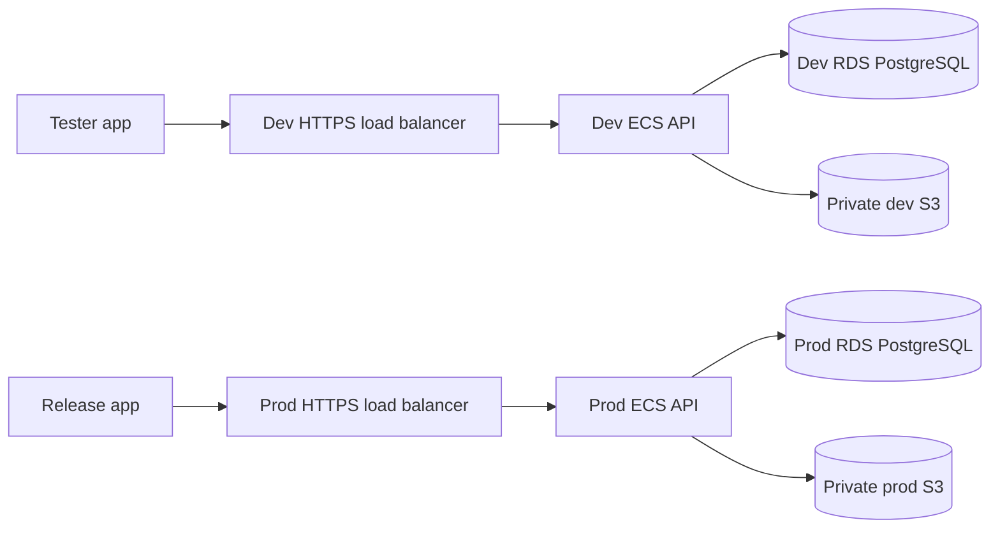

# Dev and production deployment plan

Updated 12 October 2026. This is a **proposed architecture and learning checklist**, not a deployed environment. No AWS account, domain, bucket, database, container registry or secret has been created for Waggle by this document. The current product status remains in [REMAINING_WORK.md](REMAINING_WORK.md) and [PRODUCTION_READINESS.md](PRODUCTION_READINESS.md).

## 1. The recommendation

Use **AWS Asia Pacific (Mumbai), `ap-south-1`**, for the first India deployment. Create one AWS account for `waggle-dev` and a separate account for `waggle-prod`. Each account gets its own API service, PostgreSQL database, private image bucket, secrets, logs and DNS name. AWS recommends separate accounts for production and nonproduction workloads; Mumbai is an available AWS region. This is an architecture choice for proximity and isolation, not a legal determination of data residency. [AWS account separation](https://docs.aws.amazon.com/wellarchitected/latest/security-pillar/aws-account-management-and-separation.html) · [AWS regions](https://docs.aws.amazon.com/global-infrastructure/latest/regions/aws-regions.html)

| Component | Development | Production |
| --- | --- | --- |
| API address | `https://api-dev.<your-domain>` | `https://api.<your-domain>` |
| Compute | ECS service on Fargate, one small task to start | Separate ECS service on Fargate, size and redundancy from load testing |
| Database | Private RDS for PostgreSQL; disposable synthetic data | Private RDS for PostgreSQL; backups and restore drills |
| Photos | Private S3 bucket `waggle-dev-photos-<unique-suffix>` | Different private S3 bucket `waggle-prod-photos-<unique-suffix>` |
| Secrets | Dev Secrets Manager secrets and IAM roles | Independent production secrets and roles |
| Authentication | `NODE_ENV=development`, development OTP sender; fixture number only | `NODE_ENV=production`, real SMS/DLT adapter required |
| Rollout | Testers and synthetic accounts only; limit access | No public traffic until launch gates pass |

The two environments use **the same source code and container image digest** when a release is promoted. Configuration, credentials and data remain separate. A development phone number or image must never be copied into production. Create different Android build flavors and iOS configurations so test builds call `api-dev` and release builds call `api`; do not make the mobile app choose production by editing a text field at runtime.

“Two servers” here means two isolated **environments**. ECS may replace a running container or add more than one task without changing the dev/prod boundary. Restrict hosted dev access with a VPN or an explicit load-balancer allowlist, and use synthetic data only. A hard-to-guess `api-dev` URL is not access control. A browser-based web client also needs a reviewed CORS allowlist or a same-origin proxy; the current Express app does not configure CORS.



An Application Load Balancer can serve HTTPS and WebSockets for this Express server. Use an ACM certificate and DNS records for each hostname. Put ECS tasks and RDS in private subnets; only the load balancer accepts public HTTPS. RDS accepts connections only from the API and migration task security group. Allow the task the outbound access it actually needs (for example, S3, Secrets Manager, ECR, OIDC and future providers). Network gateways/endpoints, load balancers and continuously running RDS/ECS tasks all affect cost. [ECS load balancing](https://docs.aws.amazon.com/AmazonECS/latest/developerguide/service-load-balancing.html) · [ALB WebSockets](https://docs.aws.amazon.com/elasticloadbalancing/latest/application/load-balancer-listeners.html)

### Before spending money

Use the [AWS Pricing Calculator](https://calculator.aws/) for **both** environments. Include Fargate CPU/memory and hours, RDS instance/storage/backups, ALB, NAT gateway or VPC endpoints, S3 storage/requests/egress, ECR, CloudWatch logs, Secrets Manager and DNS. Set account-level [AWS Budgets](https://docs.aws.amazon.com/cost-management/latest/userguide/create-cost-budget.html) alerts before creating services. Pricing is usage dependent; this plan makes no monthly-price claim. Dev can be stopped when testers are inactive, but account for RDS, ALB and other resources that may continue to cost money.

## 2. What the repository supports today

- Node.js 22+, TypeScript and Express. `npm run build` produces `dist/`; `npm start` runs `node dist/server.js`.
- `GET /v1/health` is liveness. `GET /v1/ready` checks database access and required migration `0038` as of this document. Use `/v1/ready` for load-balancer readiness.
- `npm run migrate` applies checked-in SQL with an advisory lock and checksums. A production image can also run compiled `node dist/db/migrate.js` **if the image contains the `migrations/` directory**. Run migrations as a separate one-off task before switching API traffic.
- The [CI workflow](../.github/workflows/ci.yml) runs typecheck, build, OpenAPI/handover checks and tests. It does not build/publish a container or deploy.
- The current photo API receives JPEG/PNG bytes at `PUT /v1/media/{id}/content`, checks hash/size/type, rewrites them to a JPEG without EXIF/GPS, then calls `PhotoStorage.put/get/remove`. `MEDIA_MODE=local` writes to `.local/media` and is rejected in production. There is **no S3 adapter or photo download endpoint**.
- `OTP_MODE=development` requires `NODE_ENV=development` and is rejected in production. With `OTP_MODE=disabled`, the default server does not construct the OTP auth service. A production API process can start for infrastructure smoke tests, but real user sign-in cannot work yet.
- `MESSAGE_KEY` and `DISCOVERY_MODE=development` are also forbidden in production. Production chat encryption/key management, approved media, verification and public discovery need their own implementations.

These are code-level gates in [config.ts](../src/config.ts) and [app.ts](../src/app.ts). Do not flip production to `NODE_ENV=development` to make blocked features run.

## 3. Build once, release to dev, then promote

1. Add a checked-in `Dockerfile` and `.dockerignore`. Build with Node 22 for the same CPU architecture as the ECS task. Install with `npm ci`, compile TypeScript, prune dev dependencies, and include `dist/`, production `node_modules/`, `package.json` and `migrations/`. Run as an unprivileged user. Keep `.env`, `.local/`, tests and raw secrets out of the image. The current repo has **no Dockerfile yet**.
2. On each pull request, run the existing CI checks. A passing PR alone does not release anything.
3. From an approved commit on `main`, build a container, scan it and push to Amazon ECR with the Git commit SHA. Record its **immutable image digest**. Use an ECR repository whose image can be pulled by both environment accounts through narrow cross-account permissions, or copy the exact image to each account and verify the digest. ECR supports image vulnerability scanning. [ECR scanning](https://docs.aws.amazon.com/AmazonECR/latest/userguide/image-scanning.html)
4. Deploy that digest to dev. Run the matching migration image as a one-off ECS task. Then update the dev ECS service. Wait for `/v1/ready`, check bootstrap and exercise fixture-only sign-in and photo flows.
5. For production, use an explicit approval step, a database backup/snapshot and the **same tested digest**. Run backward-compatible migrations first, then update the production service. Check readiness, error rate, latency and logs. An ECS rolling-deployment circuit breaker can roll back an unhealthy service, but rolling back application code does not undo a database migration. [ECS rollback](https://docs.aws.amazon.com/AmazonECS/latest/developerguide/deployment-circuit-breaker.html)

The local build commands available **now** are:

```sh
npm ci
npm run typecheck
npm run build
npm test
npm run check:openapi
npm run check:handovers
```

With a local PostgreSQL database configured, run `npm run migrate` before `npm start`. After the proposed Dockerfile is added, `docker build -t waggle-api:<git-sha> .` produces the container to test locally and push to ECR. The deployment pipeline must retain the resulting ECR digest; a mutable `latest` tag is not a release identifier.

Use GitHub Actions [OIDC federation](https://docs.github.com/en/actions/how-tos/secure-your-work/security-harden-deployments/oidc-in-aws) with tightly scoped dev and prod deployment roles. It avoids long-lived AWS access keys in GitHub secrets. Keep production deployment behind a protected GitHub environment and human approval. Store runtime credentials in AWS Secrets Manager and inject them through ECS task definitions; do not bake them into the image or commit `.env`. [ECS secrets](https://docs.aws.amazon.com/AmazonECS/latest/developerguide/task_definition_parameters.html)

## 4. How image storage connects to the API

**Use Amazon S3 for hosted dev and production, with separate private buckets.** Fargate task storage is not a safe durable home for user photos. Keep all S3 Block Public Access settings on, leave ACLs disabled, and use default encryption (SSE-S3 is enabled automatically; choose SSE-KMS later if the reviewed key policy requires it). [S3 public access controls](https://docs.aws.amazon.com/AmazonS3/latest/userguide/access-control-block-public-access.html) · [S3 ownership/encryption](https://docs.aws.amazon.com/AmazonS3/latest/user-guide/access-control-overview.html) · [default encryption](https://docs.aws.amazon.com/AmazonS3/latest/userguide/default-bucket-encryption.html)

For each account, create the bucket in `ap-south-1`, record its exact name in that account's infrastructure configuration, enable Block Public Access, keep ACLs disabled, and allow access only through that environment's ECS task role. Then set its bucket name in the task configuration after the S3 adapter exists. The bucket name is configuration; the PostgreSQL row keeps only an internal object key. Do a write/read/delete test in dev, restart the API task and repeat the read to prove storage is durable.

```mermaid
sequenceDiagram
  participant App as Mobile or web app
  participant API as Waggle API
  participant DB as PostgreSQL
  participant S3 as Private S3 bucket
  App->>API: Reserve upload (size, type, SHA-256)
  API->>DB: Save reservation and opaque object key
  App->>API: PUT original image bytes with bearer token
  API->>API: Validate and strip metadata; create JPEG
  API->>S3: Put processed JPEG through task IAM role
  API->>DB: Mark uploaded; later complete as pending moderation
  App->>API: Read media status
  API-->>App: Pending metadata; no photo URL yet
```

The implementation work is:

1. Add an AWS SDK S3 implementation of the existing [`PhotoStorage` interface](../src/modules/media/media.storage.ts). `put`, `get` and `remove` use an environment-specific bucket and opaque internal keys. Add `MEDIA_MODE=s3` and `MEDIA_BUCKET` to validated config; fail startup if the bucket/region configuration is missing. Keep `local` limited to development/test. Use the ECS **task role** for S3 `PutObject`, `GetObject` and `DeleteObject` on that environment's bucket/prefix; the ECS execution role is for image pull/logs/secrets. No static AWS key in `.env`. [ECS task roles](https://docs.aws.amazon.com/AmazonECS/latest/developerguide/security-iam-roles.html)
2. Preserve the current API upload contract initially. The client sends original bytes to Express; Express rewrites them before S3 storage. This keeps image validation in one trusted place. Direct client-to-S3 presigned uploads are a **later API redesign**, because clients could otherwise store unvalidated originals and the server would need a quarantine/processing stage. Presigned URLs are time-limited bearer capabilities, not permanent public links. [S3 presigned URLs](https://docs.aws.amazon.com/AmazonS3/latest/userguide/using-presigned-url.html)
3. Keep pending photos private. Add a scan/moderation worker and reviewed approval rules. Only after approval, implement an authenticated photo-read endpoint or short-lived signed delivery URL that checks live dog/profile access. The current API has no photo delivery contract, so the mobile team must show local previews and pending status for now.
4. On removal or account erasure, delete the object through a retryable worker and track failures. Decide versioning/noncurrent-version retention with the privacy policy; a versioned bucket can retain older copies after an ordinary delete. Use lifecycle rules for abandoned uploads, not as a substitute for account erasure. [S3 lifecycle](https://docs.aws.amazon.com/AmazonS3/latest/userguide/intro-lifecycle-rules.html)

Example resource linkage (names are placeholders): `MEDIA_BUCKET=waggle-dev-photos-<unique-suffix>` in the dev task, IAM access only to that bucket, and a dev database row containing `storage_key=<uuid>.jpg`. In production, the same code reads a **different** `MEDIA_BUCKET`, role and database. The mobile app never receives the bucket name or AWS credentials.

## 5. Database, configuration and scheduled jobs

Create one private RDS PostgreSQL instance per environment. Do not point dev at production, clone production user data into dev, or run the integration suite against either deployed database. Enable automated backups and practice restoring to a **new** database. RDS supports configurable backup retention and point-in-time restore. Decide retention with the privacy policy. [RDS backups and restore](https://docs.aws.amazon.com/AmazonRDS/latest/gettingstartedguide/managing-backup-restore.html)

Require TLS between API and RDS and verify the server certificate. RDS PostgreSQL can require TLS, but the current [`pool.ts`](../src/db/pool.ts) has only a connection string; implement/test explicit CA validation before production. Use a distinct DB user for migrations with schema privileges and a less privileged API user for normal traffic. Put both connection strings in the matching environment's Secrets Manager. [RDS PostgreSQL TLS](https://docs.aws.amazon.com/AmazonRDS/latest/UserGuide/PostgreSQL.Concepts.General.SSL.html)

| Setting | Hosted dev | Production target |
| --- | --- | --- |
| `NODE_ENV` | `development` | `production` |
| `DATABASE_URL` | Dev RDS secret | Prod RDS secret |
| `AUTH_SECRET` | Unique dev secret, at least 64 characters | Independent prod secret, **after real auth adapter exists** |
| `OTP_MODE` | `development` for restricted fixture testing | `disabled` until production SMS adapter is implemented |
| `MEDIA_MODE` | Proposed `s3` after adapter exists; `local` only on a controlled single-host dev setup | Proposed `s3` after adapter and moderation exist |
| `MESSAGE_KEY` | Optional dev key | Unset until production key management exists |
| `DISCOVERY_MODE` | Optional `development` with fixtures only | `disabled` until rollout gates are complete |
| `STAFF_*`, `FCM_PROJECT_ID` | Dev identity/project if configured | Separate production identities/projects |

Schedule the repository's bounded maintenance, media cleanup, verification expiry, export and push commands as separate ECS tasks when their dependencies are configured; do not run them in every API container. EventBridge Scheduler can start ECS tasks on a recurring schedule. Record success/failure, alert on missed runs and keep one environment's jobs inside its own account. [ECS scheduled tasks](https://docs.aws.amazon.com/AmazonECS/latest/developerguide/tasks-scheduled-eventbridge-scheduler.html)

## 6. What to do in order

| Phase | Deliverable | Done when |
| --- | --- | --- |
| A. Decision and budget | Domain, AWS ownership/billing, `ap-south-1` estimate, alerts, dev/prod accounts | Accounts and budget owners are recorded; no resource is shared across environments |
| B. Deployable artifact | Dockerfile, health-checked ECS task, ECR image, migration task, Terraform or CDK configuration | Dev can run a fixed image digest and `/v1/ready` passes after migrations |
| C. Hosted dev photos | S3 adapter, private dev bucket, task role, fixture photo upload and cleanup test | An image survives API task restart and never has a public S3 URL |
| D. Dev testing | Restricted `api-dev`, dev RDS/secrets, synthetic test users, logs, smoke checks | Test app uses fixed OTP; no real user data or production credentials are present |
| E. Production foundations | Independent RDS/S3/secrets/IAM, TLS, backups/restore drill, alerts, rollout and migration procedure | Infrastructure works with product flags closed and no dummy auth/evidence |
| F. Launch integrations | Real SMS/DLT, identity verification, approved media delivery, production encryption, staff/legal/privacy/worker support | [Production readiness](PRODUCTION_READINESS.md) and [remaining work](REMAINING_WORK.md) have evidence for every gate |
| G. Public launch | Tested image promotion, reviewed city/store policy and incident coverage | Owner explicitly approves opening traffic; rollback and on-call paths are exercised |

The immediate engineering task is **Phase B followed by the S3 adapter in Phase C**. Creating a production bucket or server does not make the current API production ready. Keep production DNS and product flags closed until Phase F is complete.
