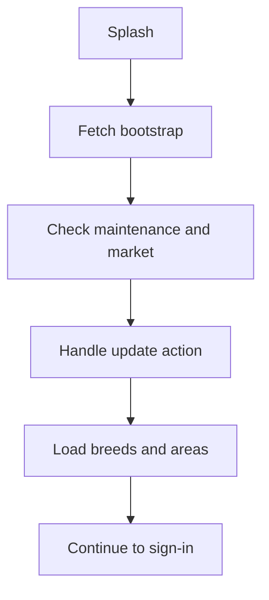

# M01 — App lifecycle and reference data

[Handover index](README.md) · [Shared client conventions](COMMON.md) · [OpenAPI](../openapi.yaml)

## Status

Implemented lifecycle/reference core; India is development-only. Release administration and waitlist enrollment are planned.

9 implemented operations. This document describes the checked-in backend, not a deployed environment.

## Screen flow

Current integration flow; readiness gates may stop progression.



## Wireframe

```text
+-----------------------------------+
| WAGGLE                            |
| Update available / service status |
| Country: India                    |
| Area search: [ Bengaluru       ]  |
| Development area / waitlist label |
| [ Continue ]                      |
+-----------------------------------+
```

## Client behavior and integration limits

- Bootstrap is public: platform and numeric buildNumber are required. Use effectiveLocale for content selection.
- Handle update.action none/recommended/required. Store URLs can be null; never invent a store destination. The backend does not yet enforce a minimum build on all routes.
- All product feature flags currently return false. A development area being selectable does not mean the public product has launched.
- Area search is literal, case-insensitive and cursor-paginated; render selectable=false rows disabled. Unknown countries return an empty area list.
- Bootstrap legal-version hints remain null. Fetch actual published policy documents through M03.
- Waitlist POST/GET /waitlist and DELETE /waitlist/{id} are private to the signed-in caller. Submit a same-country area in seeding/waitlist/gated state. Maximum five areas; repeats are idempotent. notificationDelivery=unavailable explicitly means no launch message is sent yet. Delete is idempotent and scoped to your record.

## Endpoint summary

| Method | Path | Access | Success |
| --- | --- | --- | --- |
| GET | `/v1/health` | Public | 200 |
| GET | `/v1/ready` | Public | 200 |
| GET | `/v1/app/countries` | Public | 200 |
| GET | `/v1/app/bootstrap` | Public | 200 |
| GET | `/v1/dogs/breeds` | Public | 200 |
| GET | `/v1/app/areas` | Public | 200 |
| POST | `/v1/waitlist` | Signed-in caller | 201 |
| GET | `/v1/waitlist` | Signed-in caller | 200 |
| DELETE | `/v1/waitlist/{id}` | Signed-in caller | 204 |

## Examples

Illustrative data only. Replace IDs with returned resource IDs and token/checksum placeholders with real local values. Examples are not seeded records, legal text or evidence. For examples without a response block, use the exact response shape in the endpoint section below.

### Bootstrap request

```http
GET /v1/app/bootstrap?platform=android&buildNumber=1&countryCode=IN&locale=en-IN
```

Response: HTTP 200

```json
{
  "policyRevision": "2026-10-07.1",
  "maintenance": false,
  "country": {
    "countryCode": "IN",
    "name": "India",
    "rollout": "development",
    "callingCode": "+91",
    "currency": "INR",
    "distanceUnit": "km",
    "defaultLocale": "en-IN",
    "supportedLocales": [
      "en-IN"
    ],
    "defaultTimezone": "Asia/Kolkata",
    "minimumAge": 18
  },
  "effectiveLocale": "en-IN",
  "update": {
    "action": "none",
    "minimumBuild": 1,
    "latestBuild": 1,
    "storeUrl": null
  },
  "features": {
    "pack": false,
    "lineage": false,
    "spark": false,
    "billing": false
  },
  "legal": {
    "termsVersion": null,
    "privacyVersion": null,
    "communityVersion": null
  }
}
```

## Module errors

Also handle the [shared error contract](COMMON.md#errors). These are module-level codes; applicability depends on the endpoint and current state. HTTP status alone is insufficient.

| HTTP | Code | Meaning | Client action |
| --- | --- | --- | --- |
| 409 | `waitlist-limit` | At most five areas may be saved. | Show a contextual error using code; correct input/state or respect the documented limit before retrying. |
| 409 | `waitlist-unavailable` | Choose an area currently accepting waitlist interest. | Show a contextual error using code; correct input/state or respect the documented limit before retrying. |

## Detailed request and response contracts

Shapes below are **type notation**, not JSON to send: `?` means optional, `|` means alternatives, and comments show constraints/defaults. Requests reject unknown write fields. JSON uses actual values. Runtime cross-field/business rules are in the client guidance above. The linked OpenAPI is the machine-readable source.

### GET /v1/health

Operation: `health`. Access: Public.

Request body: none.

Response HTTP 200:

```text
{
  status: "ok"
}
```

### GET /v1/ready

Operation: `readiness`. Access: Public.

Request body: none.

Response HTTP 200:

```text
{
  status: "ready"
}
```

### GET /v1/app/countries

Operation: `countries`. Access: Public.

Request body: none.

Response HTTP 200:

```text
{
  countries: Array<{
    countryCode: string
    name: string
    rollout: "development"
    callingCode: string
    currency: string
    distanceUnit: string
    defaultLocale: string
    supportedLocales: Array<string>
    defaultTimezone: string
    minimumAge: integer
  }>
}
```

### GET /v1/app/bootstrap

Operation: `bootstrap`. Access: Public.

Parameters:

- `platform` (query, required): ` "android" | "ios" `
- `buildNumber` (query, required): ` integer /* minimum=1, maximum=9999999999 */ `
- `countryCode` (query, optional): ` string /* pattern="^[A-Z]{2}$", default="IN" */ `
- `locale` (query, optional): ` string /* minLength=2, maxLength=35, default="en-IN" */ `

Request body: none.

Response HTTP 200:

```text
{
  policyRevision: string
  maintenance: boolean
  country: {
    countryCode: string
    name: string
    rollout: "development"
    callingCode: string
    currency: string
    distanceUnit: string
    defaultLocale: string
    supportedLocales: Array<string>
    defaultTimezone: string
    minimumAge: integer
  } | {
    countryCode: string
    rollout: "unavailable"
  }
  effectiveLocale: string
  update: {
    action: "none" | "recommended" | "required"
    minimumBuild: integer
    latestBuild: integer
    storeUrl: string /* format="uri" */ | null /* format="uri" */
  }
  features: {
    pack?: boolean
    lineage?: boolean
    spark?: boolean
    billing?: boolean
  }
  legal: {
    termsVersion?: string | null
    privacyVersion?: string | null
    communityVersion?: string | null
  }
}
```

### GET /v1/dogs/breeds

Operation: `breeds`. Access: Public.

Request body: none.

Response HTTP 200:

```text
{
  breeds: Array<{
    id: string /* format="uuid" */
    name: string
    sizeClass: string
    typicalEnergy: integer | null
    requiredHealthTests: Array<string>
    conformationFlags: Array<string>
  }>
}
```

### GET /v1/app/areas

Operation: `listAreas`. Access: Public.

List coarse areas; development and waitlist are not public launch promises.

Parameters:

- `countryCode` (query, optional): ` string /* pattern="^[A-Z]{2}$", default="IN" */ `
- `query` (query, optional): ` string /* maxLength=80, default="" */ `
- `limit` (query, optional): ` integer /* minimum=1, maximum=50, default=20 */ `
- `cursor` (query, optional): ` string /* maxLength=400 */ `

Request body: none.

Response HTTP 200:

```text
{
  areas: Array<{
    id: string /* format="uuid" */
    name: string
    countryCode: string
    adminRegion: string | null
    timezone: string
    rollout: "development" | "waitlist" | "soft_launch" | "gated" | "open"
    selectable: boolean
  }>
  nextCursor: string | null
}
```

### POST /v1/waitlist

Operation: `joinWaitlist`. Access: Signed-in caller.

Request body (application/json, required):

```text
{
  metroId: string /* format="uuid" */
}
```

Response HTTP 201:

```text
{
  id: string /* format="uuid" */
  metroId: string /* format="uuid" */
  createdAt: string /* format="date-time" */
  notificationDelivery: "unavailable"
}
```

### GET /v1/waitlist

Operation: `ownWaitlist`. Access: Signed-in caller.

Request body: none.

Response HTTP 200:

```text
{
  items: Array<{
    id: string /* format="uuid" */
    metroId: string /* format="uuid" */
    createdAt: string /* format="date-time" */
  }>
}
```

### DELETE /v1/waitlist/{id}

Operation: `leaveWaitlist`. Access: Signed-in caller.

Parameters:

- `id` (path, required): ` string /* format="uuid" */ `

Request body: none.

Response HTTP 204:

No response body.

---

Maintained through `scripts/handover-notes.mjs`, `docs/API_PLAN.md`, OpenAPI and source error codes. Regenerate with `npm run docs:handovers`; verify with `npm run check:handovers`.
