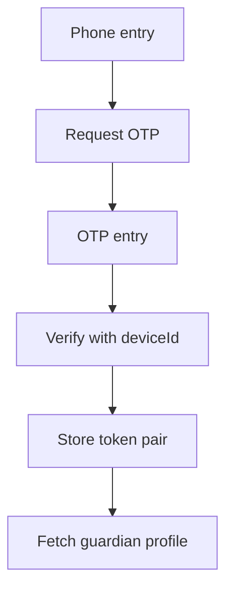

# M02 — Authentication and sessions

[Handover index](README.md) · [Shared client conventions](COMMON.md) · [OpenAPI](../openapi.yaml)

## Status

Implemented for local development. Production SMS/DLT, shared throttling, recovery and phone change are planned.

7 implemented operations. This document describes the checked-in backend, not a deployed environment.

## Screen flow

Current integration flow; readiness gates may stop progression.



## Wireframe

```text
+-----------------------------------+
| Your phone number                 |
| +91 [ 9000100000 ]                |
| [ Send code ]                     |
| Code [ _ _ _ _ _ _ ]              |
| Name for new account [          ] |
| [ Verify ]   Resend countdown     |
+-----------------------------------+
```

## Client behavior and integration limits

- OTP request returns a generic 202 even when suppressed; this does not prove an SMS was sent. Development OTP is printed in the server terminal only.
- Use one stable installation UUID as deviceId. New accounts need displayName; display-name-required allows retrying the same valid OTP with the name.
- OTP expires in 10 minutes; five failed attempts consume it. Resend cooldown is 60 seconds, with three sends per phone/hour. IP limits are also enforced.
- Store credentials in platform-appropriate protected storage. Do not put tokens in URLs, analytics or logs. Access lasts 15 minutes; refresh family lifetime is 30 days.
- Serialize refresh calls. A reused rotated refresh token revokes its entire family. Do not blindly replay refresh after a network timeout; a lost replacement may require signing in again.
- Logout and session revocation invalidate subsequent requests immediately. No provider OAuth, passkey or phone-change endpoint exists yet.

## Endpoint summary

| Method | Path | Access | Success |
| --- | --- | --- | --- |
| POST | `/v1/auth/otp/request` | Public | 202 |
| POST | `/v1/auth/otp/verify` | Public | 200 |
| POST | `/v1/auth/refresh` | Public | 200 |
| POST | `/v1/auth/logout` | Signed-in caller | 204 |
| POST | `/v1/auth/logout-all` | Signed-in caller | 204 |
| GET | `/v1/auth/sessions` | Signed-in caller | 200 |
| DELETE | `/v1/auth/sessions/{id}` | Signed-in caller | 204 |

## Examples

Illustrative data only. Replace IDs with returned resource IDs and token/checksum placeholders with real local values. Examples are not seeded records, legal text or evidence. For examples without a response block, use the exact response shape in the endpoint section below.

### Request a code

```http
POST /v1/auth/otp/request
Content-Type: application/json

{
  "phoneE164": "+919000100000",
  "countryCode": "IN"
}
```

Response: HTTP 202

```json
{
  "status": "accepted"
}
```

### Verify the code

```http
POST /v1/auth/otp/verify
Content-Type: application/json

{
  "phoneE164": "+919000100000",
  "code": "123456",
  "deviceId": "11111111-1111-4111-8111-111111111111",
  "displayName": "Test Guardian"
}
```

Response: HTTP 200

```json
{
  "accessToken": "<access JWT>",
  "refreshToken": "<opaque refresh token>",
  "expiresIn": 900,
  "userId": "22222222-2222-4222-8222-222222222222"
}
```

## Module errors

Also handle the [shared error contract](COMMON.md#errors). These are module-level codes; applicability depends on the endpoint and current state. HTTP status alone is insufficient.

| HTTP | Code | Meaning | Client action |
| --- | --- | --- | --- |
| 400 | `display-name-required` | A display name is required for a new account. | Ask for name and retry verification with the same valid code. |
| 401 | `invalid-otp` | That code is invalid or expired. | Let the user correct the code or request a new one. |
| 401 | `invalid-session` | Sign in again to continue. | Coordinate refresh once if appropriate; if refresh fails, sign in again. |
| 404 | `not-found` | Session not found. | Refresh the list/access state; avoid exposing whether another user owns the resource. |
| 429 | `rate-limited` | Too many requests. Try again later. | Show a contextual error using code; correct input/state or respect the documented limit before retrying. |
| 503 | `auth-unavailable` | Authentication is not configured. | Show a contextual error using code; correct input/state or respect the documented limit before retrying. |

## Detailed request and response contracts

Shapes below are **type notation**, not JSON to send: `?` means optional, `|` means alternatives, and comments show constraints/defaults. Requests reject unknown write fields. JSON uses actual values. Runtime cross-field/business rules are in the client guidance above. The linked OpenAPI is the machine-readable source.

### POST /v1/auth/otp/request

Operation: `requestOtp`. Access: Public.

Request body (application/json, required):

```text
{
  phoneE164: string /* pattern="^\\+91[6-9]\\d{9}$" */
  countryCode?: "IN"
}
```

Response HTTP 202:

```text
{
  status: "accepted"
}
```

### POST /v1/auth/otp/verify

Operation: `verifyOtp`. Access: Public.

Request body (application/json, required):

```text
{
  phoneE164: string /* pattern="^\\+[1-9]\\d{6,14}$" */
  code: string /* pattern="^\\d{6}$" */
  deviceId: string /* format="uuid" */
  displayName?: string /* minLength=1, maxLength=50 */
}
```

Response HTTP 200:

```text
{
  accessToken: string
  refreshToken: string
  expiresIn: 900
  userId: string /* format="uuid" */
}
```

### POST /v1/auth/refresh

Operation: `refresh`. Access: Public.

Request body (application/json, required):

```text
{
  refreshToken: string /* maxLength=80 */
}
```

Response HTTP 200:

```text
{
  accessToken: string
  refreshToken: string
  expiresIn: 900
  userId: string /* format="uuid" */
}
```

### POST /v1/auth/logout

Operation: `logout`. Access: Signed-in caller.

Request body: none.

Response HTTP 204:

No response body.

### POST /v1/auth/logout-all

Operation: `logoutAll`. Access: Signed-in caller.

Request body: none.

Response HTTP 204:

No response body.

### GET /v1/auth/sessions

Operation: `sessions`. Access: Signed-in caller.

Request body: none.

Response HTTP 200:

```text
{
  sessions: Array<{
    id: string /* format="uuid" */
    deviceId: string /* format="uuid" */
    createdAt: string /* format="date-time" */
    expiresAt: string /* format="date-time" */
    current: boolean
  }>
}
```

### DELETE /v1/auth/sessions/{id}

Operation: `revokeSession`. Access: Signed-in caller.

Parameters:

- `id` (path, required): ` string /* format="uuid" */ `

Request body: none.

Response HTTP 204:

No response body.

---

Maintained through `scripts/handover-notes.mjs`, `docs/API_PLAN.md`, OpenAPI and source error codes. Regenerate with `npm run docs:handovers`; verify with `npm run check:handovers`.
