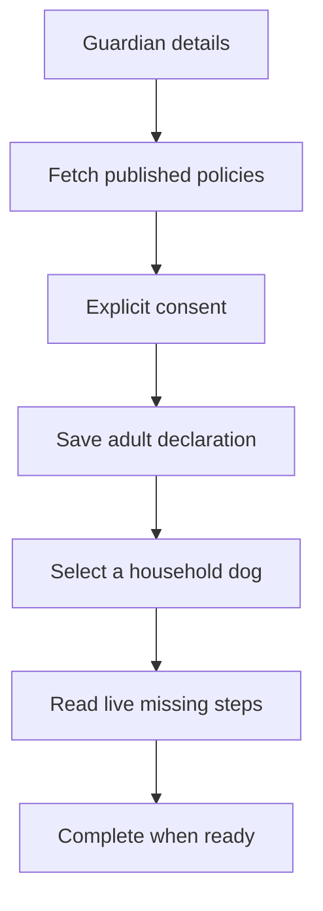

# M03 — Guardian profile, consent and resumable onboarding

[Handover index](README.md) · [Shared client conventions](COMMON.md) · [OpenAPI](../openapi.yaml)

## Status

Implemented consent/progress engine. Reviewed legal documents are not seeded; photos and identity evidence still require production integrations.

12 implemented operations. This document describes the checked-in backend, not a deployed environment.

## Screen flow

Current integration flow; readiness gates may stop progression.



## Wireframe

```text
+-------------------------------------+
| Set up your profile                 |
| Name [                         ]    |
| [ ] I am an adult                   |
| Terms / Privacy / Community links   |
| Your dog [ Ruby v ]                 |
| Missing: photos, area, verification |
| [ Save progress ]                   |
+-------------------------------------+
```

## Client behavior and integration limits

- Fetch GET /me and GET /me/onboarding on resume. Do not infer readiness from account status or historical completedAt.
- Accept policies only after displaying the exact current document. Send documentId, never a client-generated version/hash/accepted flag. document-not-current requires fetching the new policy and asking again.
- Each guardian has separate consent. Location consent is required for the location step even though its consent record is not globally marked required. Marketing is optional.
- ready and missing are authoritative. Missing keys: adult-declaration; terms/privacy/community-document-unavailable or -acceptance; household; active-dog; dog-details; approved-photos; temperament; location; guardian-verification.
- Declaration is not age/identity verification. Missing legal content is a configuration state: do not add dummy consent or bypass the screen.
- Withdrawing required/location consent pauses that guardian’s discovery; it does not erase shared household data. Use the explicit household location DELETE to remove the shared area.
- 409 onboarding-incomplete: refetch progress and route to nextAction. Discovery can only be enabled after live readiness passes.

## Endpoint summary

| Method | Path | Access | Success |
| --- | --- | --- | --- |
| GET | `/v1/me` | Signed-in caller | 200 |
| PATCH | `/v1/me` | Signed-in caller | 200 |
| GET | `/v1/legal/documents/{kind}` | Public | 200 |
| GET | `/v1/me/onboarding` | Signed-in caller | 200 |
| PUT | `/v1/me/onboarding/preferences` | Signed-in caller | 200 |
| POST | `/v1/me/onboarding/complete` | Signed-in caller | 200 |
| GET | `/v1/me/consents` | Signed-in caller | 200 |
| POST | `/v1/me/consents` | Signed-in caller | 200 |
| DELETE | `/v1/me/consents/{purpose}` | Signed-in caller | 204 |
| PUT | `/v1/me/active-dog` | Signed-in caller | 200 |
| GET | `/v1/me/preferences` | Signed-in caller | 200 |
| PATCH | `/v1/me/preferences` | Signed-in caller | 200 |

## Examples

Illustrative data only. Replace IDs with returned resource IDs and token/checksum placeholders with real local values. Examples are not seeded records, legal text or evidence. For examples without a response block, use the exact response shape in the endpoint section below.

### Save resumable preferences

```http
PUT /v1/me/onboarding/preferences
Authorization: Bearer <accessToken>
Content-Type: application/json

{
  "countryCode": "IN",
  "locale": "en-IN",
  "mode": "pack",
  "adultDeclared": true
}
```

### Accept a displayed current policy

```http
POST /v1/me/consents
Authorization: Bearer <accessToken>
Content-Type: application/json

{
  "documentId": "33333333-3333-4333-8333-333333333333"
}
```

### Read progress (illustrative existing household/dog)

```http
GET /v1/me/onboarding
Authorization: Bearer <accessToken>
```

Response: HTTP 200

```json
{
  "rulesVersion": 1,
  "ready": false,
  "missing": [
    "approved-photos",
    "location",
    "guardian-verification"
  ],
  "nextAction": "approved-photos",
  "activeDogId": "44444444-4444-4444-8444-444444444444",
  "completedAt": null,
  "preferences": {
    "countryCode": "IN",
    "locale": "en-IN",
    "mode": "pack",
    "adultDeclared": true
  }
}
```

## Module errors

Also handle the [shared error contract](COMMON.md#errors). These are module-level codes; applicability depends on the endpoint and current state. HTTP status alone is insufficient.

| HTTP | Code | Meaning | Client action |
| --- | --- | --- | --- |
| 404 | `document-unavailable` | A published document is not available for this request. | Show policy unavailable; backend needs reviewed published content. |
| 404 | `not-found` | Dog not found. | Refresh the list/access state; avoid exposing whether another user owns the resource. |
| 409 | `country-mismatch` | Onboarding cannot change account market. | Show a contextual error using code; correct input/state or respect the documented limit before retrying. |
| 409 | `document-not-current` | Accept the current published document for your country and locale. | Reload the policy and obtain explicit acceptance of its new version. |
| 409 | `onboarding-incomplete` | Required onboarding steps are missing; fetch onboarding progress. | GET /me/onboarding and route to nextAction. |

## Detailed request and response contracts

Shapes below are **type notation**, not JSON to send: `?` means optional, `|` means alternatives, and comments show constraints/defaults. Requests reject unknown write fields. JSON uses actual values. Runtime cross-field/business rules are in the client guidance above. The linked OpenAPI is the machine-readable source.

### GET /v1/me

Operation: `me`. Access: Signed-in caller.

Parameters:

- `X-App-Platform` (header, optional): ` "android" | "ios" `
- `X-App-Build` (header, optional): ` string /* pattern="^[1-9][0-9]{0,9}$" */ `

Request body: none.

Response HTTP 200:

```text
{
  id: string /* format="uuid" */
  displayName: string
  phoneE164Masked: string
  locale: string
  timezone: string
  status: string
  countryCode: string
  residencyRegion: string
  createdAt: string /* format="date-time" */
}
```

### PATCH /v1/me

Operation: `updateMe`. Access: Signed-in caller.

Parameters:

- `X-App-Platform` (header, optional): ` "android" | "ios" `
- `X-App-Build` (header, optional): ` string /* pattern="^[1-9][0-9]{0,9}$" */ `

Request body (application/json, required):

```text
{
  displayName?: string /* minLength=1, maxLength=50 */
  locale?: "en-IN"
  timezone?: string /* maxLength=64 */
} /* minProperties=1 */
```

Response HTTP 200:

```text
{
  id: string /* format="uuid" */
  displayName: string
  phoneE164Masked: string
  locale: string
  timezone: string
  status: string
  countryCode: string
  residencyRegion: string
  createdAt: string /* format="date-time" */
}
```

### GET /v1/legal/documents/{kind}

Operation: `legalDocument`. Access: Public.

Parameters:

- `kind` (path, required): ` "terms" | "privacy" | "community" | "location" | "marketing" `
- `countryCode` (query, optional): ` "IN" `
- `locale` (query, optional): ` "en-IN" `
- `version` (query, optional): ` string /* minLength=1, maxLength=60 */ `

Request body: none.

Response HTTP 200:

```text
{
  id: string /* format="uuid" */
  purpose: "terms" | "privacy" | "community" | "location" | "marketing"
  version: string
  countryCode: string
  locale: string
  body: string
  contentSha256: string
  publishedAt: string /* format="date-time" */
}
```

### GET /v1/me/onboarding

Operation: `onboarding`. Access: Signed-in caller.

Parameters:

- `X-App-Platform` (header, optional): ` "android" | "ios" `
- `X-App-Build` (header, optional): ` string /* pattern="^[1-9][0-9]{0,9}$" */ `

Request body: none.

Response HTTP 200:

```text
{
  rulesVersion: 1
  ready: boolean
  missing: Array<string>
  nextAction: string | null
  activeDogId: string /* format="uuid" */ | null /* format="uuid" */
  completedAt: string /* format="date-time" */ | null /* format="date-time" */
  preferences: {
    countryCode: "IN"
    locale: "en-IN"
    mode: "pack"
    adultDeclared: boolean
  }
}
```

### PUT /v1/me/onboarding/preferences

Operation: `saveOnboardingPreferences`. Access: Signed-in caller.

Parameters:

- `X-App-Platform` (header, optional): ` "android" | "ios" `
- `X-App-Build` (header, optional): ` string /* pattern="^[1-9][0-9]{0,9}$" */ `

Request body (application/json, required):

```text
{
  countryCode: "IN"
  locale: "en-IN"
  mode: "pack"
  adultDeclared: boolean
}
```

Response HTTP 200:

```text
{
  rulesVersion: 1
  ready: boolean
  missing: Array<string>
  nextAction: string | null
  activeDogId: string /* format="uuid" */ | null /* format="uuid" */
  completedAt: string /* format="date-time" */ | null /* format="date-time" */
  preferences: {
    countryCode: "IN"
    locale: "en-IN"
    mode: "pack"
    adultDeclared: boolean
  }
}
```

### POST /v1/me/onboarding/complete

Operation: `completeOnboarding`. Access: Signed-in caller.

Parameters:

- `X-App-Platform` (header, optional): ` "android" | "ios" `
- `X-App-Build` (header, optional): ` string /* pattern="^[1-9][0-9]{0,9}$" */ `

Request body (application/json, required):

```text
{}
```

Response HTTP 200:

```text
{
  rulesVersion: 1
  ready: boolean
  missing: Array<string>
  nextAction: string | null
  activeDogId: string /* format="uuid" */ | null /* format="uuid" */
  completedAt: string /* format="date-time" */ | null /* format="date-time" */
  preferences: {
    countryCode: "IN"
    locale: "en-IN"
    mode: "pack"
    adultDeclared: boolean
  }
}
```

### GET /v1/me/consents

Operation: `consents`. Access: Signed-in caller.

Parameters:

- `X-App-Platform` (header, optional): ` "android" | "ios" `
- `X-App-Build` (header, optional): ` string /* pattern="^[1-9][0-9]{0,9}$" */ `

Request body: none.

Response HTTP 200:

```text
{
  consents: Array<{
    purpose: "terms" | "privacy" | "community" | "location" | "marketing"
    required: boolean
    currentDocumentId: string | null
    currentVersion: string | null
    status: "accepted" | "withdrawn" | "not-accepted"
    acceptedDocumentId: string | null
    current: boolean
    recordedAt: string /* format="date-time" */ | null /* format="date-time" */
  }>
}
```

### POST /v1/me/consents

Operation: `acceptConsent`. Access: Signed-in caller.

Parameters:

- `X-App-Platform` (header, optional): ` "android" | "ios" `
- `X-App-Build` (header, optional): ` string /* pattern="^[1-9][0-9]{0,9}$" */ `

Request body (application/json, required):

```text
{
  documentId: string /* format="uuid" */
}
```

Response HTTP 200:

```text
{
  consents: Array<{
    purpose: "terms" | "privacy" | "community" | "location" | "marketing"
    required: boolean
    currentDocumentId: string | null
    currentVersion: string | null
    status: "accepted" | "withdrawn" | "not-accepted"
    acceptedDocumentId: string | null
    current: boolean
    recordedAt: string /* format="date-time" */ | null /* format="date-time" */
  }>
}
```

### DELETE /v1/me/consents/{purpose}

Operation: `withdrawConsent`. Access: Signed-in caller.

Parameters:

- `purpose` (path, required): ` "terms" | "privacy" | "community" | "location" | "marketing" `
- `X-App-Platform` (header, optional): ` "android" | "ios" `
- `X-App-Build` (header, optional): ` string /* pattern="^[1-9][0-9]{0,9}$" */ `

Request body: none.

Response HTTP 204:

No response body.

### PUT /v1/me/active-dog

Operation: `selectActiveDog`. Access: Signed-in caller.

Parameters:

- `X-App-Platform` (header, optional): ` "android" | "ios" `
- `X-App-Build` (header, optional): ` string /* pattern="^[1-9][0-9]{0,9}$" */ `

Request body (application/json, required):

```text
{
  dogId: string /* format="uuid" */ | null /* format="uuid" */
}
```

Response HTTP 200:

```text
{
  rulesVersion: 1
  ready: boolean
  missing: Array<string>
  nextAction: string | null
  activeDogId: string /* format="uuid" */ | null /* format="uuid" */
  completedAt: string /* format="date-time" */ | null /* format="date-time" */
  preferences: {
    countryCode: "IN"
    locale: "en-IN"
    mode: "pack"
    adultDeclared: boolean
  }
}
```

### GET /v1/me/preferences

Operation: `userPreferences`. Access: Signed-in caller.

Parameters:

- `X-App-Platform` (header, optional): ` "android" | "ios" `
- `X-App-Build` (header, optional): ` string /* pattern="^[1-9][0-9]{0,9}$" */ `

Request body: none.

Response HTTP 200:

```text
{
  discoveryPaused: boolean
  readReceipts: boolean
}
```

### PATCH /v1/me/preferences

Operation: `saveUserPreferences`. Access: Signed-in caller.

Parameters:

- `X-App-Platform` (header, optional): ` "android" | "ios" `
- `X-App-Build` (header, optional): ` string /* pattern="^[1-9][0-9]{0,9}$" */ `

Request body (application/json, required):

```text
{
  discoveryPaused?: boolean
  readReceipts?: boolean
} /* minProperties=1 */
```

Response HTTP 200:

```text
{
  discoveryPaused: boolean
  readReceipts: boolean
}
```

---

Maintained through `scripts/handover-notes.mjs`, `docs/API_PLAN.md`, OpenAPI and source error codes. Regenerate with `npm run docs:handovers`; verify with `npm run check:handovers`.
