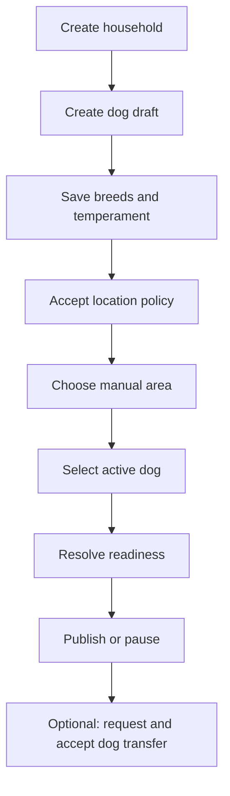

# M04 — Households and dog profiles

[Handover index](README.md) · [Shared client conventions](COMMON.md) · [OpenAPI](../openapi.yaml)

## Status

Implemented household/dog core and consented manual city selection. GPS/displaced anchors, public dog profiles and ownership transfer remain planned.

29 implemented operations. This document describes the checked-in backend, not a deployed environment.

## Screen flow

Current integration flow; readiness gates may stop progression.



## Wireframe

```text
+----------------------------------------+
| Ruby / My household                    |
| Photo status: pending moderation       |
| Name [ Ruby ]  Sex [ Female v ]        |
| Breed mix [ Indie 100% ]               |
| Temperament / Schedule / Preferences   |
| Area [ Bengaluru - development v ]     |
| Location precision: city               |
| [ Save draft ]  [ Publish when ready ] |
+----------------------------------------+
```

## Client behavior and integration limits

- Owners/co-guardians edit profiles. Only owners manage membership and invitations or memorialise dogs. Walkers/view-only members can read household data. Never use role display alone as permission enforcement.
- Owner removal/demotion can return last-owner. Invitations are manual-share, phone-bound, single-use and expire in seven days. Show the token once and treat it as a secret; no invitation SMS is sent.
- Create household first, then POST /dogs with householdId. Birth/neutering dates must be real and consistent. Breeds are unique and percentages total 100; source is always declared.
- Temperament is versioned structured input, not the originally proposed twelve-question scorer. Availability uses IANA timezone and non-overlapping weekly minute windows; split overnight windows across days.
- Location: fetch /app/areas, accept current location policy, PUT household location with source=manual_area and areaId. GET location is member-only. Precision is city; do not render a home pin or infer a kilometre bucket.
- Bengaluru is development seed data, not a confirmed public launch city. Manual selection stores a metro ID only and does not create GPS cells or allocate fine-distance matching anchors.
- Identical area saves are idempotent after consent/availability checks. Area changes are limited to once per 24 hours; use canChangeAt after location-change-limited. Clearing is always allowed but does not reset that deadline. A different editor shares the same household limit.
- Area change/clear sets all household dogs back to draft and cancels beacons. Clearing does not withdraw personal consent. Changes to required policy or area availability reopen location readiness.
- Select this dog before publish/beacon. Publish requires live onboarding readiness; beacon also requires discovery enabled and lasts at most 90 minutes. Memorialisation is irreversible through these APIs.
- Profile edits reset publication; identity/breed changes revoke existing dog verification. GET /dogs/{id} is private, not a public discovery profile.
- Matching preferences now accept allowCityOnly (default false). Opt in explicitly to whole-city discovery; the current city selection cannot enforce a kilometre radius. Publishing records the authenticated editor as publisher for future live consent/verification checks.
- Two-party transfers: POST /dogs/{id}/transfer requires a different same-country recipientUserId who owns targetHouseholdId, and shareRecords=true acknowledging profile/completed-photo/health metadata sharing. Current source ownership is required. Obtain destination references from that guardian directly; no public household search is exposed.
- The response contains a seven-day token once. Share it privately with the named recipient, who calls POST /dog-transfers/{id}/accept with token and acceptRecords=true. Account authentication alone or token possession alone is insufficient. Store/share no token in analytics or public URLs. A pending duplicate returns transfer-pending; if the token is lost, cancel and create another request. Maximum five requests/day/sender.
- GET /dog-transfers lists only requests where you were sender/recipient, with no token. Either can DELETE a pending request; accepted transfers cannot be cancelled. Expired requests cannot be accepted. Acceptance rechecks both current owner roles, account status, dog status and destination capacity (twenty active dogs).
- Acceptance moves the dog atomically, resets it to draft, clears published attribution and whole-city opt-in, clears selected-dog pointers, cancels beacons, revokes dog tiers/unfinished verification and abandons unfinished uploads for cleanup. Completed photos/profile/health metadata remain with the dog. Original users’ private conversations, reports and account data do not move.
- Old connections/conversations close and active meetups cancel. New owner must reselect the dog, review preferences and finish current onboarding/verification before republishing. Accepted retries with the same recipient/token return the historical accepted result without moving the dog again. A future reverse transfer requires a new two-party request.

## Endpoint summary

| Method | Path | Access | Success |
| --- | --- | --- | --- |
| POST | `/v1/households` | Signed-in caller | 201 |
| GET | `/v1/households` | Signed-in caller | 200 |
| GET | `/v1/households/{id}` | Accepted household member | 200 |
| PATCH | `/v1/households/{id}` | Owner/co-guardian | 200 |
| GET | `/v1/households/{id}/members` | Accepted household member | 200 |
| PATCH | `/v1/households/{id}/members/{userId}` | Household owner | 204 |
| DELETE | `/v1/households/{id}/members/{userId}` | Household owner | 204 |
| POST | `/v1/households/{id}/invitations` | Household owner | 201 |
| POST | `/v1/household-invitations/{token}/accept` | Signed-in intended recipient | 200 |
| POST | `/v1/dogs` | Owner/co-guardian of supplied household | 201 |
| GET | `/v1/dogs` | Signed-in caller | 200 |
| GET | `/v1/dogs/{id}` | Accepted household member | 200 |
| PATCH | `/v1/dogs/{id}` | Owner/co-guardian | 200 |
| PUT | `/v1/dogs/{id}/breeds` | Owner/co-guardian | 200 |
| PUT | `/v1/dogs/{id}/temperament` | Owner/co-guardian | 200 |
| PUT | `/v1/dogs/{id}/preferences` | Owner/co-guardian | 200 |
| PUT | `/v1/dogs/{id}/availability` | Owner/co-guardian | 200 |
| POST | `/v1/dogs/{id}/publish` | Owner/co-guardian | 200 |
| POST | `/v1/dogs/{id}/pause` | Owner/co-guardian | 200 |
| POST | `/v1/dogs/{id}/memorialise` | Household owner | 200 |
| POST | `/v1/dogs/{id}/beacon` | Owner/co-guardian | 200 |
| DELETE | `/v1/dogs/{id}/beacon` | Owner/co-guardian | 204 |
| GET | `/v1/households/{id}/location` | Accepted household member | 200 |
| PUT | `/v1/households/{id}/location` | Owner/co-guardian | 200 |
| DELETE | `/v1/households/{id}/location` | Owner/co-guardian | 204 |
| POST | `/v1/dogs/{id}/transfer` | Current source owner; destination owner must separately accept | 201 |
| GET | `/v1/dog-transfers` | Original sender or recipient | 200 |
| POST | `/v1/dog-transfers/{id}/accept` | Named recipient + token + current destination ownership | 200 |
| DELETE | `/v1/dog-transfers/{id}` | Original sender or recipient | 204 |

## Examples

Illustrative data only. Replace IDs with returned resource IDs and token/checksum placeholders with real local values. Examples are not seeded records, legal text or evidence. For examples without a response block, use the exact response shape in the endpoint section below.

### Create a dog draft

```http
POST /v1/dogs
Authorization: Bearer <accessToken>
Content-Type: application/json

{
  "householdId": "55555555-5555-4555-8555-555555555555",
  "name": "Ruby",
  "sex": "female",
  "sizeClass": "medium",
  "dateOfBirth": "2023-01-01",
  "neutered": true
}
```

### Select a city after accepting location consent

```http
PUT /v1/households/55555555-5555-4555-8555-555555555555/location
Authorization: Bearer <accessToken>
Content-Type: application/json

{
  "source": "manual_area",
  "areaId": "01920000-0000-7000-8000-0000000e0001"
}
```

Response: HTTP 200

```json
{
  "householdId": "55555555-5555-4555-8555-555555555555",
  "source": "manual_area",
  "precision": "city",
  "area": {
    "id": "01920000-0000-7000-8000-0000000e0001",
    "name": "Bengaluru",
    "countryCode": "IN",
    "adminRegion": "KA",
    "timezone": "Asia/Kolkata",
    "rollout": "development",
    "selectable": true
  },
  "updatedAt": "2026-10-08T10:00:00.000Z",
  "canChangeAt": "2026-10-09T10:00:00.000Z"
}
```

### Request two-party transfer

```http
POST /v1/dogs/44444444-4444-4444-8444-444444444444/transfer
Authorization: Bearer <accessToken>
Content-Type: application/json

{
  "targetHouseholdId": "77777777-7777-4777-8777-777777777777",
  "recipientUserId": "88888888-8888-4888-8888-888888888888",
  "shareRecords": true
}
```

## Module errors

Also handle the [shared error contract](COMMON.md#errors). These are module-level codes; applicability depends on the endpoint and current state. HTTP status alone is insufficient.

| HTTP | Code | Meaning | Client action |
| --- | --- | --- | --- |
| 400 | `invalid-dates` | Neutering date requires neutered=true and cannot predate birth. | Correct dates and their ordering. |
| 400 | `same-household` | Choose a different household. | Show a contextual error using code; correct input/state or respect the documented limit before retrying. |
| 400 | `two-party-required` | Choose a different guardian to accept the transfer. | Show a contextual error using code; correct input/state or respect the documented limit before retrying. |
| 400 | `unknown-breed` | One or more breed IDs are unknown. | Show a contextual error using code; correct input/state or respect the documented limit before retrying. |
| 403 | `forbidden` | Your household role cannot perform this action. | Hide the unavailable action and refresh the user’s current household role. |
| 404 | `not-found` | Transfer is unavailable. | Refresh the list/access state; avoid exposing whether another user owns the resource. |
| 409 | `already-member` | You are already a household member. | Refresh the household list; do not accept again. |
| 409 | `area-unavailable` | Choose a selectable area in your account country. | Reload areas and choose a selectable area in the account country. |
| 409 | `beacon-unavailable` | Publish this dog and enable discovery after completing onboarding. | Refresh selected dog, publication, readiness and discovery preference. |
| 409 | `dog-inactive` | This dog profile can no longer be edited. | Show a contextual error using code; correct input/state or respect the documented limit before retrying. |
| 409 | `dog-limit` | Destination household already has twenty active dogs. | Show a contextual error using code; correct input/state or respect the documented limit before retrying. |
| 409 | `household-limit` | At most ten households per account are supported. | Show a contextual error using code; correct input/state or respect the documented limit before retrying. |
| 409 | `invitation-unavailable` | Invitation has expired or was already used. | Ask the owner for a new invitation. |
| 409 | `last-owner` | A household must keep at least one accepted owner. | Keep or appoint another accepted owner before removal/demotion. |
| 409 | `location-consent-required` | Accept the current location document before saving an area. | Fetch and display the current location policy, obtain consent, then retry. |
| 409 | `publication-incomplete` | Select this dog and complete the required onboarding steps before publishing. | Select the dog and refresh onboarding requirements. |
| 409 | `transfer-final` | Accepted transfers cannot be cancelled. | Show a contextual error using code; correct input/state or respect the documented limit before retrying. |
| 409 | `transfer-pending` | Cancel the current transfer before starting another. | Show a contextual error using code; correct input/state or respect the documented limit before retrying. |
| 409 | `transfer-unavailable` | Dog ownership or status changed. | Show a contextual error using code; correct input/state or respect the documented limit before retrying. |
| 429 | `invite-limit` | The daily invitation limit has been reached. | Show a contextual error using code; correct input/state or respect the documented limit before retrying. |
| 429 | `location-change-limited` | Area changes are limited to once every 24 hours; read location for canChangeAt. | GET location and display canChangeAt; do not loop retry. |
| 429 | `transfer-limit` | At most five transfer requests per day. | Show a contextual error using code; correct input/state or respect the documented limit before retrying. |

## Detailed request and response contracts

Shapes below are **type notation**, not JSON to send: `?` means optional, `|` means alternatives, and comments show constraints/defaults. Requests reject unknown write fields. JSON uses actual values. Runtime cross-field/business rules are in the client guidance above. The linked OpenAPI is the machine-readable source.

### POST /v1/households

Operation: `createHousehold`. Access: Signed-in caller.

Parameters:

- `X-App-Platform` (header, optional): ` "android" | "ios" `
- `X-App-Build` (header, optional): ` string /* pattern="^[1-9][0-9]{0,9}$" */ `

Request body (application/json, required):

```text
{
  name: string /* minLength=1, maxLength=80 */
}
```

Response HTTP 201:

```text
{
  id: string /* format="uuid" */
  name: string | null
  role: "owner" | "co_guardian" | "walker" | "view_only"
  createdAt: string /* format="date-time" */
  updatedAt: string /* format="date-time" */
}
```

### GET /v1/households

Operation: `listHouseholds`. Access: Signed-in caller.

Parameters:

- `limit` (query, optional): ` integer /* minimum=1, maximum=50, default=20 */ `
- `cursor` (query, optional): ` string /* maxLength=400 */ `
- `X-App-Platform` (header, optional): ` "android" | "ios" `
- `X-App-Build` (header, optional): ` string /* pattern="^[1-9][0-9]{0,9}$" */ `

Request body: none.

Response HTTP 200:

```text
{
  households: Array<{
    id: string /* format="uuid" */
    name: string | null
    role: "owner" | "co_guardian" | "walker" | "view_only"
    createdAt: string /* format="date-time" */
    updatedAt: string /* format="date-time" */
  }>
  nextCursor: string | null
}
```

### GET /v1/households/{id}

Operation: `getHousehold`. Access: Accepted household member.

Parameters:

- `id` (path, required): ` string /* format="uuid" */ `
- `X-App-Platform` (header, optional): ` "android" | "ios" `
- `X-App-Build` (header, optional): ` string /* pattern="^[1-9][0-9]{0,9}$" */ `

Request body: none.

Response HTTP 200:

```text
{
  id: string /* format="uuid" */
  name: string | null
  role: "owner" | "co_guardian" | "walker" | "view_only"
  createdAt: string /* format="date-time" */
  updatedAt: string /* format="date-time" */
}
```

### PATCH /v1/households/{id}

Operation: `renameHousehold`. Access: Owner/co-guardian.

Parameters:

- `id` (path, required): ` string /* format="uuid" */ `
- `X-App-Platform` (header, optional): ` "android" | "ios" `
- `X-App-Build` (header, optional): ` string /* pattern="^[1-9][0-9]{0,9}$" */ `

Request body (application/json, required):

```text
{
  name: string /* minLength=1, maxLength=80 */
}
```

Response HTTP 200:

```text
{
  id: string /* format="uuid" */
  name: string | null
  role: "owner" | "co_guardian" | "walker" | "view_only"
  createdAt: string /* format="date-time" */
  updatedAt: string /* format="date-time" */
}
```

### GET /v1/households/{id}/members

Operation: `listMembers`. Access: Accepted household member.

Parameters:

- `id` (path, required): ` string /* format="uuid" */ `
- `X-App-Platform` (header, optional): ` "android" | "ios" `
- `X-App-Build` (header, optional): ` string /* pattern="^[1-9][0-9]{0,9}$" */ `

Request body: none.

Response HTTP 200:

```text
{
  members: Array<{
    userId: string /* format="uuid" */
    displayName: string
    role: "owner" | "co_guardian" | "walker" | "view_only"
    acceptedAt: string /* format="date-time" */
  }>
}
```

### PATCH /v1/households/{id}/members/{userId}

Operation: `changeMemberRole`. Access: Household owner.

Parameters:

- `id` (path, required): ` string /* format="uuid" */ `
- `userId` (path, required): ` string /* format="uuid" */ `
- `X-App-Platform` (header, optional): ` "android" | "ios" `
- `X-App-Build` (header, optional): ` string /* pattern="^[1-9][0-9]{0,9}$" */ `

Request body (application/json, required):

```text
{
  role: "owner" | "co_guardian" | "walker" | "view_only"
}
```

Response HTTP 204:

No response body.

### DELETE /v1/households/{id}/members/{userId}

Operation: `removeMember`. Access: Household owner.

Parameters:

- `id` (path, required): ` string /* format="uuid" */ `
- `userId` (path, required): ` string /* format="uuid" */ `
- `X-App-Platform` (header, optional): ` "android" | "ios" `
- `X-App-Build` (header, optional): ` string /* pattern="^[1-9][0-9]{0,9}$" */ `

Request body: none.

Response HTTP 204:

No response body.

### POST /v1/households/{id}/invitations

Operation: `inviteMember`. Access: Household owner.

Parameters:

- `id` (path, required): ` string /* format="uuid" */ `
- `X-App-Platform` (header, optional): ` "android" | "ios" `
- `X-App-Build` (header, optional): ` string /* pattern="^[1-9][0-9]{0,9}$" */ `

Request body (application/json, required):

```text
{
  phoneE164: string /* pattern="^\\+91[6-9]\\d{9}$" */
  role?: "co_guardian" | "walker" | "view_only"
}
```

Response HTTP 201:

```text
{
  invitationId: string /* format="uuid" */
  inviteToken: string /* pattern="^[A-Za-z0-9_-]{43}$" */
  expiresAt: string /* format="date-time" */
  delivery: "manual-share"
}
```

### POST /v1/household-invitations/{token}/accept

Operation: `acceptInvitation`. Access: Signed-in intended recipient.

Parameters:

- `token` (path, required): ` string /* pattern="^[A-Za-z0-9_-]{43}$" */ `
- `X-App-Platform` (header, optional): ` "android" | "ios" `
- `X-App-Build` (header, optional): ` string /* pattern="^[1-9][0-9]{0,9}$" */ `

Request body (application/json, required):

```text
{}
```

Response HTTP 200:

```text
{
  id: string /* format="uuid" */
  name: string | null
  role: "owner" | "co_guardian" | "walker" | "view_only"
  createdAt: string /* format="date-time" */
  updatedAt: string /* format="date-time" */
}
```

### POST /v1/dogs

Operation: `createDog`. Access: Owner/co-guardian of supplied household.

Parameters:

- `X-App-Platform` (header, optional): ` "android" | "ios" `
- `X-App-Build` (header, optional): ` string /* pattern="^[1-9][0-9]{0,9}$" */ `

Request body (application/json, required):

```text
{
  name: string /* minLength=1, maxLength=40 */
  sex: "male" | "female"
  sizeClass: "toy" | "small" | "medium" | "large" | "giant"
  dateOfBirth?: string /* format="date" */ | null /* format="date" */
  dobPrecision?: "exact" | "month" | "year" | "estimate"
  neutered?: boolean | null
  neuteredAt?: string /* format="date" */ | null /* format="date" */
  weightG?: integer /* minimum=500, maximum=120000 */ | null /* minimum=500, maximum=120000 */
  bio?: string /* maxLength=300 */ | null /* maxLength=300 */
  householdId: string /* format="uuid" */
}
```

Response HTTP 201:

```text
{
  id: string /* format="uuid" */
  householdId: string /* format="uuid" */
  name: string /* minLength=1, maxLength=40 */
  sex: "male" | "female"
  sizeClass: "toy" | "small" | "medium" | "large" | "giant"
  dateOfBirth: string /* format="date" */ | null /* format="date" */
  dobPrecision: "exact" | "month" | "year" | "estimate"
  neutered: boolean | null
  neuteredAt: string /* format="date" */ | null /* format="date" */
  weightG: integer /* minimum=500, maximum=120000 */ | null /* minimum=500, maximum=120000 */
  bio: string /* maxLength=300 */ | null /* maxLength=300 */
  status: "active" | "rehomed" | "memorialised" | "removed"
  publicationState: "draft" | "published" | "paused"
  createdAt: string /* format="date-time" */
  updatedAt: string /* format="date-time" */
  breeds: Array<{
    breedId: string /* format="uuid" */
    name: string
    percentage: integer | null
    source: "declared" | "dna_test" | "registry"
  }>
  temperament: {
    questionnaireVersion: 1
    energy: integer /* minimum=1, maximum=5 */
    playStyle: Array<"wrestle" | "chase" | "parallel" | "fetch" | "sniff"> /* minItems=1, maxItems=5, uniqueItems=true */
    dogReactivity: integer /* minimum=1, maximum=5 */
    humanReactivity: integer /* minimum=1, maximum=5 */
    resourceGuarding: integer /* minimum=1, maximum=5 */
    recallReliability: integer /* minimum=1, maximum=5 */
    sizeTolerance: Array<"toy" | "small" | "medium" | "large" | "giant"> /* minItems=1, maxItems=5, uniqueItems=true */
    needsToKnow: string /* maxLength=500, default="" */
  } | null
  preferences: {
    maxDistanceBucket: "under_2_km" | "km_2_5" | "km_5_10" | "km_10_25" | "over_25_km"
    sizeClasses: Array<"toy" | "small" | "medium" | "large" | "giant"> /* maxItems=5, uniqueItems=true, default=[] */
    ageMinMonths: integer /* minimum=0, maximum=360, default=null */ | null /* minimum=0, maximum=360, default=null */
    ageMaxMonths: integer /* minimum=0, maximum=360, default=null */ | null /* minimum=0, maximum=360, default=null */
    energyMin: integer /* minimum=1, maximum=5, default=null */ | null /* minimum=1, maximum=5, default=null */
    energyMax: integer /* minimum=1, maximum=5, default=null */ | null /* minimum=1, maximum=5, default=null */
    playStyles: Array<"wrestle" | "chase" | "parallel" | "fetch" | "sniff"> /* maxItems=5, uniqueItems=true, default=[] */
    minVerificationTier: integer /* minimum=0, maximum=4, default=1 */
    parallelWalkOnly: boolean /* default=false */
    acceptsReactive: boolean /* default=false */
    allowCityOnly: boolean /* default=false */
  } | null
  availability: {
    timezone: string /* maxLength=64 */
    windows: Array<{
      dayOfWeek: integer /* minimum=0, maximum=6 */
      startMin: integer /* minimum=0, maximum=1439 */
      endMin: integer /* minimum=1, maximum=1440 */
    }> /* maxItems=21 */
  }
}
```

### GET /v1/dogs

Operation: `listDogs`. Access: Signed-in caller.

Parameters:

- `limit` (query, optional): ` integer /* minimum=1, maximum=50, default=20 */ `
- `cursor` (query, optional): ` string /* maxLength=400 */ `
- `X-App-Platform` (header, optional): ` "android" | "ios" `
- `X-App-Build` (header, optional): ` string /* pattern="^[1-9][0-9]{0,9}$" */ `

Request body: none.

Response HTTP 200:

```text
{
  dogs: Array<{
    id: string /* format="uuid" */
    householdId: string /* format="uuid" */
    name: string /* minLength=1, maxLength=40 */
    sex: "male" | "female"
    sizeClass: "toy" | "small" | "medium" | "large" | "giant"
    dateOfBirth: string /* format="date" */ | null /* format="date" */
    dobPrecision: "exact" | "month" | "year" | "estimate"
    neutered: boolean | null
    neuteredAt: string /* format="date" */ | null /* format="date" */
    weightG: integer /* minimum=500, maximum=120000 */ | null /* minimum=500, maximum=120000 */
    bio: string /* maxLength=300 */ | null /* maxLength=300 */
    status: "active" | "rehomed" | "memorialised" | "removed"
    publicationState: "draft" | "published" | "paused"
    createdAt: string /* format="date-time" */
    updatedAt: string /* format="date-time" */
  }>
  nextCursor: string | null
}
```

### GET /v1/dogs/{id}

Operation: `getOwnDog`. Access: Accepted household member.

Parameters:

- `id` (path, required): ` string /* format="uuid" */ `
- `X-App-Platform` (header, optional): ` "android" | "ios" `
- `X-App-Build` (header, optional): ` string /* pattern="^[1-9][0-9]{0,9}$" */ `

Request body: none.

Response HTTP 200:

```text
{
  id: string /* format="uuid" */
  householdId: string /* format="uuid" */
  name: string /* minLength=1, maxLength=40 */
  sex: "male" | "female"
  sizeClass: "toy" | "small" | "medium" | "large" | "giant"
  dateOfBirth: string /* format="date" */ | null /* format="date" */
  dobPrecision: "exact" | "month" | "year" | "estimate"
  neutered: boolean | null
  neuteredAt: string /* format="date" */ | null /* format="date" */
  weightG: integer /* minimum=500, maximum=120000 */ | null /* minimum=500, maximum=120000 */
  bio: string /* maxLength=300 */ | null /* maxLength=300 */
  status: "active" | "rehomed" | "memorialised" | "removed"
  publicationState: "draft" | "published" | "paused"
  createdAt: string /* format="date-time" */
  updatedAt: string /* format="date-time" */
  breeds: Array<{
    breedId: string /* format="uuid" */
    name: string
    percentage: integer | null
    source: "declared" | "dna_test" | "registry"
  }>
  temperament: {
    questionnaireVersion: 1
    energy: integer /* minimum=1, maximum=5 */
    playStyle: Array<"wrestle" | "chase" | "parallel" | "fetch" | "sniff"> /* minItems=1, maxItems=5, uniqueItems=true */
    dogReactivity: integer /* minimum=1, maximum=5 */
    humanReactivity: integer /* minimum=1, maximum=5 */
    resourceGuarding: integer /* minimum=1, maximum=5 */
    recallReliability: integer /* minimum=1, maximum=5 */
    sizeTolerance: Array<"toy" | "small" | "medium" | "large" | "giant"> /* minItems=1, maxItems=5, uniqueItems=true */
    needsToKnow: string /* maxLength=500, default="" */
  } | null
  preferences: {
    maxDistanceBucket: "under_2_km" | "km_2_5" | "km_5_10" | "km_10_25" | "over_25_km"
    sizeClasses: Array<"toy" | "small" | "medium" | "large" | "giant"> /* maxItems=5, uniqueItems=true, default=[] */
    ageMinMonths: integer /* minimum=0, maximum=360, default=null */ | null /* minimum=0, maximum=360, default=null */
    ageMaxMonths: integer /* minimum=0, maximum=360, default=null */ | null /* minimum=0, maximum=360, default=null */
    energyMin: integer /* minimum=1, maximum=5, default=null */ | null /* minimum=1, maximum=5, default=null */
    energyMax: integer /* minimum=1, maximum=5, default=null */ | null /* minimum=1, maximum=5, default=null */
    playStyles: Array<"wrestle" | "chase" | "parallel" | "fetch" | "sniff"> /* maxItems=5, uniqueItems=true, default=[] */
    minVerificationTier: integer /* minimum=0, maximum=4, default=1 */
    parallelWalkOnly: boolean /* default=false */
    acceptsReactive: boolean /* default=false */
    allowCityOnly: boolean /* default=false */
  } | null
  availability: {
    timezone: string /* maxLength=64 */
    windows: Array<{
      dayOfWeek: integer /* minimum=0, maximum=6 */
      startMin: integer /* minimum=0, maximum=1439 */
      endMin: integer /* minimum=1, maximum=1440 */
    }> /* maxItems=21 */
  }
}
```

### PATCH /v1/dogs/{id}

Operation: `updateDog`. Access: Owner/co-guardian.

Parameters:

- `id` (path, required): ` string /* format="uuid" */ `
- `X-App-Platform` (header, optional): ` "android" | "ios" `
- `X-App-Build` (header, optional): ` string /* pattern="^[1-9][0-9]{0,9}$" */ `

Request body (application/json, required):

```text
{
  name?: string /* minLength=1, maxLength=40 */
  sex?: "male" | "female"
  sizeClass?: "toy" | "small" | "medium" | "large" | "giant"
  dateOfBirth?: string /* format="date" */ | null /* format="date" */
  dobPrecision?: "exact" | "month" | "year" | "estimate"
  neutered?: boolean | null
  neuteredAt?: string /* format="date" */ | null /* format="date" */
  weightG?: integer /* minimum=500, maximum=120000 */ | null /* minimum=500, maximum=120000 */
  bio?: string /* maxLength=300 */ | null /* maxLength=300 */
} /* minProperties=1 */
```

Response HTTP 200:

```text
{
  id: string /* format="uuid" */
  householdId: string /* format="uuid" */
  name: string /* minLength=1, maxLength=40 */
  sex: "male" | "female"
  sizeClass: "toy" | "small" | "medium" | "large" | "giant"
  dateOfBirth: string /* format="date" */ | null /* format="date" */
  dobPrecision: "exact" | "month" | "year" | "estimate"
  neutered: boolean | null
  neuteredAt: string /* format="date" */ | null /* format="date" */
  weightG: integer /* minimum=500, maximum=120000 */ | null /* minimum=500, maximum=120000 */
  bio: string /* maxLength=300 */ | null /* maxLength=300 */
  status: "active" | "rehomed" | "memorialised" | "removed"
  publicationState: "draft" | "published" | "paused"
  createdAt: string /* format="date-time" */
  updatedAt: string /* format="date-time" */
  breeds: Array<{
    breedId: string /* format="uuid" */
    name: string
    percentage: integer | null
    source: "declared" | "dna_test" | "registry"
  }>
  temperament: {
    questionnaireVersion: 1
    energy: integer /* minimum=1, maximum=5 */
    playStyle: Array<"wrestle" | "chase" | "parallel" | "fetch" | "sniff"> /* minItems=1, maxItems=5, uniqueItems=true */
    dogReactivity: integer /* minimum=1, maximum=5 */
    humanReactivity: integer /* minimum=1, maximum=5 */
    resourceGuarding: integer /* minimum=1, maximum=5 */
    recallReliability: integer /* minimum=1, maximum=5 */
    sizeTolerance: Array<"toy" | "small" | "medium" | "large" | "giant"> /* minItems=1, maxItems=5, uniqueItems=true */
    needsToKnow: string /* maxLength=500, default="" */
  } | null
  preferences: {
    maxDistanceBucket: "under_2_km" | "km_2_5" | "km_5_10" | "km_10_25" | "over_25_km"
    sizeClasses: Array<"toy" | "small" | "medium" | "large" | "giant"> /* maxItems=5, uniqueItems=true, default=[] */
    ageMinMonths: integer /* minimum=0, maximum=360, default=null */ | null /* minimum=0, maximum=360, default=null */
    ageMaxMonths: integer /* minimum=0, maximum=360, default=null */ | null /* minimum=0, maximum=360, default=null */
    energyMin: integer /* minimum=1, maximum=5, default=null */ | null /* minimum=1, maximum=5, default=null */
    energyMax: integer /* minimum=1, maximum=5, default=null */ | null /* minimum=1, maximum=5, default=null */
    playStyles: Array<"wrestle" | "chase" | "parallel" | "fetch" | "sniff"> /* maxItems=5, uniqueItems=true, default=[] */
    minVerificationTier: integer /* minimum=0, maximum=4, default=1 */
    parallelWalkOnly: boolean /* default=false */
    acceptsReactive: boolean /* default=false */
    allowCityOnly: boolean /* default=false */
  } | null
  availability: {
    timezone: string /* maxLength=64 */
    windows: Array<{
      dayOfWeek: integer /* minimum=0, maximum=6 */
      startMin: integer /* minimum=0, maximum=1439 */
      endMin: integer /* minimum=1, maximum=1440 */
    }> /* maxItems=21 */
  }
}
```

### PUT /v1/dogs/{id}/breeds

Operation: `replaceDogBreeds`. Access: Owner/co-guardian.

Parameters:

- `id` (path, required): ` string /* format="uuid" */ `
- `X-App-Platform` (header, optional): ` "android" | "ios" `
- `X-App-Build` (header, optional): ` string /* pattern="^[1-9][0-9]{0,9}$" */ `

Request body (application/json, required):

```text
{
  breeds: Array<{
    breedId: string /* format="uuid" */
    percentage: integer /* minimum=1, maximum=100 */
  }> /* minItems=1, maxItems=4 */
}
```

Response HTTP 200:

```text
{
  id: string /* format="uuid" */
  householdId: string /* format="uuid" */
  name: string /* minLength=1, maxLength=40 */
  sex: "male" | "female"
  sizeClass: "toy" | "small" | "medium" | "large" | "giant"
  dateOfBirth: string /* format="date" */ | null /* format="date" */
  dobPrecision: "exact" | "month" | "year" | "estimate"
  neutered: boolean | null
  neuteredAt: string /* format="date" */ | null /* format="date" */
  weightG: integer /* minimum=500, maximum=120000 */ | null /* minimum=500, maximum=120000 */
  bio: string /* maxLength=300 */ | null /* maxLength=300 */
  status: "active" | "rehomed" | "memorialised" | "removed"
  publicationState: "draft" | "published" | "paused"
  createdAt: string /* format="date-time" */
  updatedAt: string /* format="date-time" */
  breeds: Array<{
    breedId: string /* format="uuid" */
    name: string
    percentage: integer | null
    source: "declared" | "dna_test" | "registry"
  }>
  temperament: {
    questionnaireVersion: 1
    energy: integer /* minimum=1, maximum=5 */
    playStyle: Array<"wrestle" | "chase" | "parallel" | "fetch" | "sniff"> /* minItems=1, maxItems=5, uniqueItems=true */
    dogReactivity: integer /* minimum=1, maximum=5 */
    humanReactivity: integer /* minimum=1, maximum=5 */
    resourceGuarding: integer /* minimum=1, maximum=5 */
    recallReliability: integer /* minimum=1, maximum=5 */
    sizeTolerance: Array<"toy" | "small" | "medium" | "large" | "giant"> /* minItems=1, maxItems=5, uniqueItems=true */
    needsToKnow: string /* maxLength=500, default="" */
  } | null
  preferences: {
    maxDistanceBucket: "under_2_km" | "km_2_5" | "km_5_10" | "km_10_25" | "over_25_km"
    sizeClasses: Array<"toy" | "small" | "medium" | "large" | "giant"> /* maxItems=5, uniqueItems=true, default=[] */
    ageMinMonths: integer /* minimum=0, maximum=360, default=null */ | null /* minimum=0, maximum=360, default=null */
    ageMaxMonths: integer /* minimum=0, maximum=360, default=null */ | null /* minimum=0, maximum=360, default=null */
    energyMin: integer /* minimum=1, maximum=5, default=null */ | null /* minimum=1, maximum=5, default=null */
    energyMax: integer /* minimum=1, maximum=5, default=null */ | null /* minimum=1, maximum=5, default=null */
    playStyles: Array<"wrestle" | "chase" | "parallel" | "fetch" | "sniff"> /* maxItems=5, uniqueItems=true, default=[] */
    minVerificationTier: integer /* minimum=0, maximum=4, default=1 */
    parallelWalkOnly: boolean /* default=false */
    acceptsReactive: boolean /* default=false */
    allowCityOnly: boolean /* default=false */
  } | null
  availability: {
    timezone: string /* maxLength=64 */
    windows: Array<{
      dayOfWeek: integer /* minimum=0, maximum=6 */
      startMin: integer /* minimum=0, maximum=1439 */
      endMin: integer /* minimum=1, maximum=1440 */
    }> /* maxItems=21 */
  }
}
```

### PUT /v1/dogs/{id}/temperament

Operation: `replaceTemperament`. Access: Owner/co-guardian.

Parameters:

- `id` (path, required): ` string /* format="uuid" */ `
- `X-App-Platform` (header, optional): ` "android" | "ios" `
- `X-App-Build` (header, optional): ` string /* pattern="^[1-9][0-9]{0,9}$" */ `

Request body (application/json, required):

```text
{
  questionnaireVersion: 1
  energy: integer /* minimum=1, maximum=5 */
  playStyle: Array<"wrestle" | "chase" | "parallel" | "fetch" | "sniff"> /* minItems=1, maxItems=5, uniqueItems=true */
  dogReactivity: integer /* minimum=1, maximum=5 */
  humanReactivity: integer /* minimum=1, maximum=5 */
  resourceGuarding: integer /* minimum=1, maximum=5 */
  recallReliability: integer /* minimum=1, maximum=5 */
  sizeTolerance: Array<"toy" | "small" | "medium" | "large" | "giant"> /* minItems=1, maxItems=5, uniqueItems=true */
  needsToKnow?: string /* maxLength=500, default="" */
}
```

Response HTTP 200:

```text
{
  id: string /* format="uuid" */
  householdId: string /* format="uuid" */
  name: string /* minLength=1, maxLength=40 */
  sex: "male" | "female"
  sizeClass: "toy" | "small" | "medium" | "large" | "giant"
  dateOfBirth: string /* format="date" */ | null /* format="date" */
  dobPrecision: "exact" | "month" | "year" | "estimate"
  neutered: boolean | null
  neuteredAt: string /* format="date" */ | null /* format="date" */
  weightG: integer /* minimum=500, maximum=120000 */ | null /* minimum=500, maximum=120000 */
  bio: string /* maxLength=300 */ | null /* maxLength=300 */
  status: "active" | "rehomed" | "memorialised" | "removed"
  publicationState: "draft" | "published" | "paused"
  createdAt: string /* format="date-time" */
  updatedAt: string /* format="date-time" */
  breeds: Array<{
    breedId: string /* format="uuid" */
    name: string
    percentage: integer | null
    source: "declared" | "dna_test" | "registry"
  }>
  temperament: {
    questionnaireVersion: 1
    energy: integer /* minimum=1, maximum=5 */
    playStyle: Array<"wrestle" | "chase" | "parallel" | "fetch" | "sniff"> /* minItems=1, maxItems=5, uniqueItems=true */
    dogReactivity: integer /* minimum=1, maximum=5 */
    humanReactivity: integer /* minimum=1, maximum=5 */
    resourceGuarding: integer /* minimum=1, maximum=5 */
    recallReliability: integer /* minimum=1, maximum=5 */
    sizeTolerance: Array<"toy" | "small" | "medium" | "large" | "giant"> /* minItems=1, maxItems=5, uniqueItems=true */
    needsToKnow: string /* maxLength=500, default="" */
  } | null
  preferences: {
    maxDistanceBucket: "under_2_km" | "km_2_5" | "km_5_10" | "km_10_25" | "over_25_km"
    sizeClasses: Array<"toy" | "small" | "medium" | "large" | "giant"> /* maxItems=5, uniqueItems=true, default=[] */
    ageMinMonths: integer /* minimum=0, maximum=360, default=null */ | null /* minimum=0, maximum=360, default=null */
    ageMaxMonths: integer /* minimum=0, maximum=360, default=null */ | null /* minimum=0, maximum=360, default=null */
    energyMin: integer /* minimum=1, maximum=5, default=null */ | null /* minimum=1, maximum=5, default=null */
    energyMax: integer /* minimum=1, maximum=5, default=null */ | null /* minimum=1, maximum=5, default=null */
    playStyles: Array<"wrestle" | "chase" | "parallel" | "fetch" | "sniff"> /* maxItems=5, uniqueItems=true, default=[] */
    minVerificationTier: integer /* minimum=0, maximum=4, default=1 */
    parallelWalkOnly: boolean /* default=false */
    acceptsReactive: boolean /* default=false */
    allowCityOnly: boolean /* default=false */
  } | null
  availability: {
    timezone: string /* maxLength=64 */
    windows: Array<{
      dayOfWeek: integer /* minimum=0, maximum=6 */
      startMin: integer /* minimum=0, maximum=1439 */
      endMin: integer /* minimum=1, maximum=1440 */
    }> /* maxItems=21 */
  }
}
```

### PUT /v1/dogs/{id}/preferences

Operation: `replaceDogPreferences`. Access: Owner/co-guardian.

Parameters:

- `id` (path, required): ` string /* format="uuid" */ `
- `X-App-Platform` (header, optional): ` "android" | "ios" `
- `X-App-Build` (header, optional): ` string /* pattern="^[1-9][0-9]{0,9}$" */ `

Request body (application/json, required):

```text
{
  maxDistanceBucket?: "under_2_km" | "km_2_5" | "km_5_10" | "km_10_25" | "over_25_km"
  sizeClasses?: Array<"toy" | "small" | "medium" | "large" | "giant"> /* maxItems=5, uniqueItems=true, default=[] */
  ageMinMonths?: integer /* minimum=0, maximum=360, default=null */ | null /* minimum=0, maximum=360, default=null */
  ageMaxMonths?: integer /* minimum=0, maximum=360, default=null */ | null /* minimum=0, maximum=360, default=null */
  energyMin?: integer /* minimum=1, maximum=5, default=null */ | null /* minimum=1, maximum=5, default=null */
  energyMax?: integer /* minimum=1, maximum=5, default=null */ | null /* minimum=1, maximum=5, default=null */
  playStyles?: Array<"wrestle" | "chase" | "parallel" | "fetch" | "sniff"> /* maxItems=5, uniqueItems=true, default=[] */
  minVerificationTier?: integer /* minimum=0, maximum=4, default=1 */
  parallelWalkOnly?: boolean /* default=false */
  acceptsReactive?: boolean /* default=false */
  allowCityOnly?: boolean /* default=false */
}
```

Response HTTP 200:

```text
{
  id: string /* format="uuid" */
  householdId: string /* format="uuid" */
  name: string /* minLength=1, maxLength=40 */
  sex: "male" | "female"
  sizeClass: "toy" | "small" | "medium" | "large" | "giant"
  dateOfBirth: string /* format="date" */ | null /* format="date" */
  dobPrecision: "exact" | "month" | "year" | "estimate"
  neutered: boolean | null
  neuteredAt: string /* format="date" */ | null /* format="date" */
  weightG: integer /* minimum=500, maximum=120000 */ | null /* minimum=500, maximum=120000 */
  bio: string /* maxLength=300 */ | null /* maxLength=300 */
  status: "active" | "rehomed" | "memorialised" | "removed"
  publicationState: "draft" | "published" | "paused"
  createdAt: string /* format="date-time" */
  updatedAt: string /* format="date-time" */
  breeds: Array<{
    breedId: string /* format="uuid" */
    name: string
    percentage: integer | null
    source: "declared" | "dna_test" | "registry"
  }>
  temperament: {
    questionnaireVersion: 1
    energy: integer /* minimum=1, maximum=5 */
    playStyle: Array<"wrestle" | "chase" | "parallel" | "fetch" | "sniff"> /* minItems=1, maxItems=5, uniqueItems=true */
    dogReactivity: integer /* minimum=1, maximum=5 */
    humanReactivity: integer /* minimum=1, maximum=5 */
    resourceGuarding: integer /* minimum=1, maximum=5 */
    recallReliability: integer /* minimum=1, maximum=5 */
    sizeTolerance: Array<"toy" | "small" | "medium" | "large" | "giant"> /* minItems=1, maxItems=5, uniqueItems=true */
    needsToKnow: string /* maxLength=500, default="" */
  } | null
  preferences: {
    maxDistanceBucket: "under_2_km" | "km_2_5" | "km_5_10" | "km_10_25" | "over_25_km"
    sizeClasses: Array<"toy" | "small" | "medium" | "large" | "giant"> /* maxItems=5, uniqueItems=true, default=[] */
    ageMinMonths: integer /* minimum=0, maximum=360, default=null */ | null /* minimum=0, maximum=360, default=null */
    ageMaxMonths: integer /* minimum=0, maximum=360, default=null */ | null /* minimum=0, maximum=360, default=null */
    energyMin: integer /* minimum=1, maximum=5, default=null */ | null /* minimum=1, maximum=5, default=null */
    energyMax: integer /* minimum=1, maximum=5, default=null */ | null /* minimum=1, maximum=5, default=null */
    playStyles: Array<"wrestle" | "chase" | "parallel" | "fetch" | "sniff"> /* maxItems=5, uniqueItems=true, default=[] */
    minVerificationTier: integer /* minimum=0, maximum=4, default=1 */
    parallelWalkOnly: boolean /* default=false */
    acceptsReactive: boolean /* default=false */
    allowCityOnly: boolean /* default=false */
  } | null
  availability: {
    timezone: string /* maxLength=64 */
    windows: Array<{
      dayOfWeek: integer /* minimum=0, maximum=6 */
      startMin: integer /* minimum=0, maximum=1439 */
      endMin: integer /* minimum=1, maximum=1440 */
    }> /* maxItems=21 */
  }
}
```

### PUT /v1/dogs/{id}/availability

Operation: `replaceAvailability`. Access: Owner/co-guardian.

Parameters:

- `id` (path, required): ` string /* format="uuid" */ `
- `X-App-Platform` (header, optional): ` "android" | "ios" `
- `X-App-Build` (header, optional): ` string /* pattern="^[1-9][0-9]{0,9}$" */ `

Request body (application/json, required):

```text
{
  timezone: string /* maxLength=64 */
  windows: Array<{
    dayOfWeek: integer /* minimum=0, maximum=6 */
    startMin: integer /* minimum=0, maximum=1439 */
    endMin: integer /* minimum=1, maximum=1440 */
  }> /* maxItems=21 */
}
```

Response HTTP 200:

```text
{
  id: string /* format="uuid" */
  householdId: string /* format="uuid" */
  name: string /* minLength=1, maxLength=40 */
  sex: "male" | "female"
  sizeClass: "toy" | "small" | "medium" | "large" | "giant"
  dateOfBirth: string /* format="date" */ | null /* format="date" */
  dobPrecision: "exact" | "month" | "year" | "estimate"
  neutered: boolean | null
  neuteredAt: string /* format="date" */ | null /* format="date" */
  weightG: integer /* minimum=500, maximum=120000 */ | null /* minimum=500, maximum=120000 */
  bio: string /* maxLength=300 */ | null /* maxLength=300 */
  status: "active" | "rehomed" | "memorialised" | "removed"
  publicationState: "draft" | "published" | "paused"
  createdAt: string /* format="date-time" */
  updatedAt: string /* format="date-time" */
  breeds: Array<{
    breedId: string /* format="uuid" */
    name: string
    percentage: integer | null
    source: "declared" | "dna_test" | "registry"
  }>
  temperament: {
    questionnaireVersion: 1
    energy: integer /* minimum=1, maximum=5 */
    playStyle: Array<"wrestle" | "chase" | "parallel" | "fetch" | "sniff"> /* minItems=1, maxItems=5, uniqueItems=true */
    dogReactivity: integer /* minimum=1, maximum=5 */
    humanReactivity: integer /* minimum=1, maximum=5 */
    resourceGuarding: integer /* minimum=1, maximum=5 */
    recallReliability: integer /* minimum=1, maximum=5 */
    sizeTolerance: Array<"toy" | "small" | "medium" | "large" | "giant"> /* minItems=1, maxItems=5, uniqueItems=true */
    needsToKnow: string /* maxLength=500, default="" */
  } | null
  preferences: {
    maxDistanceBucket: "under_2_km" | "km_2_5" | "km_5_10" | "km_10_25" | "over_25_km"
    sizeClasses: Array<"toy" | "small" | "medium" | "large" | "giant"> /* maxItems=5, uniqueItems=true, default=[] */
    ageMinMonths: integer /* minimum=0, maximum=360, default=null */ | null /* minimum=0, maximum=360, default=null */
    ageMaxMonths: integer /* minimum=0, maximum=360, default=null */ | null /* minimum=0, maximum=360, default=null */
    energyMin: integer /* minimum=1, maximum=5, default=null */ | null /* minimum=1, maximum=5, default=null */
    energyMax: integer /* minimum=1, maximum=5, default=null */ | null /* minimum=1, maximum=5, default=null */
    playStyles: Array<"wrestle" | "chase" | "parallel" | "fetch" | "sniff"> /* maxItems=5, uniqueItems=true, default=[] */
    minVerificationTier: integer /* minimum=0, maximum=4, default=1 */
    parallelWalkOnly: boolean /* default=false */
    acceptsReactive: boolean /* default=false */
    allowCityOnly: boolean /* default=false */
  } | null
  availability: {
    timezone: string /* maxLength=64 */
    windows: Array<{
      dayOfWeek: integer /* minimum=0, maximum=6 */
      startMin: integer /* minimum=0, maximum=1439 */
      endMin: integer /* minimum=1, maximum=1440 */
    }> /* maxItems=21 */
  }
}
```

### POST /v1/dogs/{id}/publish

Operation: `publishDog`. Access: Owner/co-guardian.

Parameters:

- `id` (path, required): ` string /* format="uuid" */ `
- `X-App-Platform` (header, optional): ` "android" | "ios" `
- `X-App-Build` (header, optional): ` string /* pattern="^[1-9][0-9]{0,9}$" */ `

Request body (application/json, required):

```text
{}
```

Response HTTP 200:

```text
{
  id: string /* format="uuid" */
  householdId: string /* format="uuid" */
  name: string /* minLength=1, maxLength=40 */
  sex: "male" | "female"
  sizeClass: "toy" | "small" | "medium" | "large" | "giant"
  dateOfBirth: string /* format="date" */ | null /* format="date" */
  dobPrecision: "exact" | "month" | "year" | "estimate"
  neutered: boolean | null
  neuteredAt: string /* format="date" */ | null /* format="date" */
  weightG: integer /* minimum=500, maximum=120000 */ | null /* minimum=500, maximum=120000 */
  bio: string /* maxLength=300 */ | null /* maxLength=300 */
  status: "active" | "rehomed" | "memorialised" | "removed"
  publicationState: "draft" | "published" | "paused"
  createdAt: string /* format="date-time" */
  updatedAt: string /* format="date-time" */
  breeds: Array<{
    breedId: string /* format="uuid" */
    name: string
    percentage: integer | null
    source: "declared" | "dna_test" | "registry"
  }>
  temperament: {
    questionnaireVersion: 1
    energy: integer /* minimum=1, maximum=5 */
    playStyle: Array<"wrestle" | "chase" | "parallel" | "fetch" | "sniff"> /* minItems=1, maxItems=5, uniqueItems=true */
    dogReactivity: integer /* minimum=1, maximum=5 */
    humanReactivity: integer /* minimum=1, maximum=5 */
    resourceGuarding: integer /* minimum=1, maximum=5 */
    recallReliability: integer /* minimum=1, maximum=5 */
    sizeTolerance: Array<"toy" | "small" | "medium" | "large" | "giant"> /* minItems=1, maxItems=5, uniqueItems=true */
    needsToKnow: string /* maxLength=500, default="" */
  } | null
  preferences: {
    maxDistanceBucket: "under_2_km" | "km_2_5" | "km_5_10" | "km_10_25" | "over_25_km"
    sizeClasses: Array<"toy" | "small" | "medium" | "large" | "giant"> /* maxItems=5, uniqueItems=true, default=[] */
    ageMinMonths: integer /* minimum=0, maximum=360, default=null */ | null /* minimum=0, maximum=360, default=null */
    ageMaxMonths: integer /* minimum=0, maximum=360, default=null */ | null /* minimum=0, maximum=360, default=null */
    energyMin: integer /* minimum=1, maximum=5, default=null */ | null /* minimum=1, maximum=5, default=null */
    energyMax: integer /* minimum=1, maximum=5, default=null */ | null /* minimum=1, maximum=5, default=null */
    playStyles: Array<"wrestle" | "chase" | "parallel" | "fetch" | "sniff"> /* maxItems=5, uniqueItems=true, default=[] */
    minVerificationTier: integer /* minimum=0, maximum=4, default=1 */
    parallelWalkOnly: boolean /* default=false */
    acceptsReactive: boolean /* default=false */
    allowCityOnly: boolean /* default=false */
  } | null
  availability: {
    timezone: string /* maxLength=64 */
    windows: Array<{
      dayOfWeek: integer /* minimum=0, maximum=6 */
      startMin: integer /* minimum=0, maximum=1439 */
      endMin: integer /* minimum=1, maximum=1440 */
    }> /* maxItems=21 */
  }
}
```

### POST /v1/dogs/{id}/pause

Operation: `pauseDog`. Access: Owner/co-guardian.

Parameters:

- `id` (path, required): ` string /* format="uuid" */ `
- `X-App-Platform` (header, optional): ` "android" | "ios" `
- `X-App-Build` (header, optional): ` string /* pattern="^[1-9][0-9]{0,9}$" */ `

Request body (application/json, required):

```text
{}
```

Response HTTP 200:

```text
{
  id: string /* format="uuid" */
  householdId: string /* format="uuid" */
  name: string /* minLength=1, maxLength=40 */
  sex: "male" | "female"
  sizeClass: "toy" | "small" | "medium" | "large" | "giant"
  dateOfBirth: string /* format="date" */ | null /* format="date" */
  dobPrecision: "exact" | "month" | "year" | "estimate"
  neutered: boolean | null
  neuteredAt: string /* format="date" */ | null /* format="date" */
  weightG: integer /* minimum=500, maximum=120000 */ | null /* minimum=500, maximum=120000 */
  bio: string /* maxLength=300 */ | null /* maxLength=300 */
  status: "active" | "rehomed" | "memorialised" | "removed"
  publicationState: "draft" | "published" | "paused"
  createdAt: string /* format="date-time" */
  updatedAt: string /* format="date-time" */
  breeds: Array<{
    breedId: string /* format="uuid" */
    name: string
    percentage: integer | null
    source: "declared" | "dna_test" | "registry"
  }>
  temperament: {
    questionnaireVersion: 1
    energy: integer /* minimum=1, maximum=5 */
    playStyle: Array<"wrestle" | "chase" | "parallel" | "fetch" | "sniff"> /* minItems=1, maxItems=5, uniqueItems=true */
    dogReactivity: integer /* minimum=1, maximum=5 */
    humanReactivity: integer /* minimum=1, maximum=5 */
    resourceGuarding: integer /* minimum=1, maximum=5 */
    recallReliability: integer /* minimum=1, maximum=5 */
    sizeTolerance: Array<"toy" | "small" | "medium" | "large" | "giant"> /* minItems=1, maxItems=5, uniqueItems=true */
    needsToKnow: string /* maxLength=500, default="" */
  } | null
  preferences: {
    maxDistanceBucket: "under_2_km" | "km_2_5" | "km_5_10" | "km_10_25" | "over_25_km"
    sizeClasses: Array<"toy" | "small" | "medium" | "large" | "giant"> /* maxItems=5, uniqueItems=true, default=[] */
    ageMinMonths: integer /* minimum=0, maximum=360, default=null */ | null /* minimum=0, maximum=360, default=null */
    ageMaxMonths: integer /* minimum=0, maximum=360, default=null */ | null /* minimum=0, maximum=360, default=null */
    energyMin: integer /* minimum=1, maximum=5, default=null */ | null /* minimum=1, maximum=5, default=null */
    energyMax: integer /* minimum=1, maximum=5, default=null */ | null /* minimum=1, maximum=5, default=null */
    playStyles: Array<"wrestle" | "chase" | "parallel" | "fetch" | "sniff"> /* maxItems=5, uniqueItems=true, default=[] */
    minVerificationTier: integer /* minimum=0, maximum=4, default=1 */
    parallelWalkOnly: boolean /* default=false */
    acceptsReactive: boolean /* default=false */
    allowCityOnly: boolean /* default=false */
  } | null
  availability: {
    timezone: string /* maxLength=64 */
    windows: Array<{
      dayOfWeek: integer /* minimum=0, maximum=6 */
      startMin: integer /* minimum=0, maximum=1439 */
      endMin: integer /* minimum=1, maximum=1440 */
    }> /* maxItems=21 */
  }
}
```

### POST /v1/dogs/{id}/memorialise

Operation: `memorialiseDog`. Access: Household owner.

Parameters:

- `id` (path, required): ` string /* format="uuid" */ `
- `X-App-Platform` (header, optional): ` "android" | "ios" `
- `X-App-Build` (header, optional): ` string /* pattern="^[1-9][0-9]{0,9}$" */ `

Request body (application/json, required):

```text
{}
```

Response HTTP 200:

```text
{
  id: string /* format="uuid" */
  householdId: string /* format="uuid" */
  name: string /* minLength=1, maxLength=40 */
  sex: "male" | "female"
  sizeClass: "toy" | "small" | "medium" | "large" | "giant"
  dateOfBirth: string /* format="date" */ | null /* format="date" */
  dobPrecision: "exact" | "month" | "year" | "estimate"
  neutered: boolean | null
  neuteredAt: string /* format="date" */ | null /* format="date" */
  weightG: integer /* minimum=500, maximum=120000 */ | null /* minimum=500, maximum=120000 */
  bio: string /* maxLength=300 */ | null /* maxLength=300 */
  status: "active" | "rehomed" | "memorialised" | "removed"
  publicationState: "draft" | "published" | "paused"
  createdAt: string /* format="date-time" */
  updatedAt: string /* format="date-time" */
  breeds: Array<{
    breedId: string /* format="uuid" */
    name: string
    percentage: integer | null
    source: "declared" | "dna_test" | "registry"
  }>
  temperament: {
    questionnaireVersion: 1
    energy: integer /* minimum=1, maximum=5 */
    playStyle: Array<"wrestle" | "chase" | "parallel" | "fetch" | "sniff"> /* minItems=1, maxItems=5, uniqueItems=true */
    dogReactivity: integer /* minimum=1, maximum=5 */
    humanReactivity: integer /* minimum=1, maximum=5 */
    resourceGuarding: integer /* minimum=1, maximum=5 */
    recallReliability: integer /* minimum=1, maximum=5 */
    sizeTolerance: Array<"toy" | "small" | "medium" | "large" | "giant"> /* minItems=1, maxItems=5, uniqueItems=true */
    needsToKnow: string /* maxLength=500, default="" */
  } | null
  preferences: {
    maxDistanceBucket: "under_2_km" | "km_2_5" | "km_5_10" | "km_10_25" | "over_25_km"
    sizeClasses: Array<"toy" | "small" | "medium" | "large" | "giant"> /* maxItems=5, uniqueItems=true, default=[] */
    ageMinMonths: integer /* minimum=0, maximum=360, default=null */ | null /* minimum=0, maximum=360, default=null */
    ageMaxMonths: integer /* minimum=0, maximum=360, default=null */ | null /* minimum=0, maximum=360, default=null */
    energyMin: integer /* minimum=1, maximum=5, default=null */ | null /* minimum=1, maximum=5, default=null */
    energyMax: integer /* minimum=1, maximum=5, default=null */ | null /* minimum=1, maximum=5, default=null */
    playStyles: Array<"wrestle" | "chase" | "parallel" | "fetch" | "sniff"> /* maxItems=5, uniqueItems=true, default=[] */
    minVerificationTier: integer /* minimum=0, maximum=4, default=1 */
    parallelWalkOnly: boolean /* default=false */
    acceptsReactive: boolean /* default=false */
    allowCityOnly: boolean /* default=false */
  } | null
  availability: {
    timezone: string /* maxLength=64 */
    windows: Array<{
      dayOfWeek: integer /* minimum=0, maximum=6 */
      startMin: integer /* minimum=0, maximum=1439 */
      endMin: integer /* minimum=1, maximum=1440 */
    }> /* maxItems=21 */
  }
}
```

### POST /v1/dogs/{id}/beacon

Operation: `startBeacon`. Access: Owner/co-guardian.

Parameters:

- `id` (path, required): ` string /* format="uuid" */ `
- `X-App-Platform` (header, optional): ` "android" | "ios" `
- `X-App-Build` (header, optional): ` string /* pattern="^[1-9][0-9]{0,9}$" */ `

Request body (application/json, required):

```text
{
  durationMinutes: integer /* minimum=1, maximum=90 */
}
```

Response HTTP 200:

```text
{
  beaconUntil: string /* format="date-time" */
}
```

### DELETE /v1/dogs/{id}/beacon

Operation: `stopBeacon`. Access: Owner/co-guardian.

Parameters:

- `id` (path, required): ` string /* format="uuid" */ `
- `X-App-Platform` (header, optional): ` "android" | "ios" `
- `X-App-Build` (header, optional): ` string /* pattern="^[1-9][0-9]{0,9}$" */ `

Request body: none.

Response HTTP 204:

No response body.

### GET /v1/households/{id}/location

Operation: `getHouseholdLocation`. Access: Accepted household member.

Read private city-level household selection.

Parameters:

- `id` (path, required): ` string /* format="uuid" */ `
- `X-App-Platform` (header, optional): ` "android" | "ios" `
- `X-App-Build` (header, optional): ` string /* pattern="^[1-9][0-9]{0,9}$" */ `

Request body: none.

Response HTTP 200:

```text
{
  householdId: string /* format="uuid" */
  source: "manual_area" | null
  precision: "city" | null
  area: {
    id: string /* format="uuid" */
    name: string
    countryCode: string
    adminRegion: string | null
    timezone: string
    rollout: "development" | "waitlist" | "soft_launch" | "gated" | "open"
    selectable: boolean
  } | null
  updatedAt: string /* format="date-time" */ | null /* format="date-time" */
  canChangeAt: string /* format="date-time" */ | null /* format="date-time" */
}
```

### PUT /v1/households/{id}/location

Operation: `setHouseholdLocation`. Access: Owner/co-guardian.

Select a city with current location consent; changes limited to once per 24 hours.

Parameters:

- `id` (path, required): ` string /* format="uuid" */ `
- `X-App-Platform` (header, optional): ` "android" | "ios" `
- `X-App-Build` (header, optional): ` string /* pattern="^[1-9][0-9]{0,9}$" */ `

Request body (application/json, required):

```text
{
  source: "manual_area"
  areaId: string /* format="uuid" */
}
```

Response HTTP 200:

```text
{
  householdId: string /* format="uuid" */
  source: "manual_area" | null
  precision: "city" | null
  area: {
    id: string /* format="uuid" */
    name: string
    countryCode: string
    adminRegion: string | null
    timezone: string
    rollout: "development" | "waitlist" | "soft_launch" | "gated" | "open"
    selectable: boolean
  } | null
  updatedAt: string /* format="date-time" */ | null /* format="date-time" */
  canChangeAt: string /* format="date-time" */ | null /* format="date-time" */
}
```

### DELETE /v1/households/{id}/location

Operation: `clearHouseholdLocation`. Access: Owner/co-guardian.

Clear household location and reset dog publication; cooldown is retained.

Parameters:

- `id` (path, required): ` string /* format="uuid" */ `
- `X-App-Platform` (header, optional): ` "android" | "ios" `
- `X-App-Build` (header, optional): ` string /* pattern="^[1-9][0-9]{0,9}$" */ `

Request body: none.

Response HTTP 204:

No response body.

### POST /v1/dogs/{id}/transfer

Operation: `requestDogTransfer`. Access: Current source owner; destination owner must separately accept.

Parameters:

- `id` (path, required): ` string /* format="uuid" */ `
- `X-App-Platform` (header, optional): ` "android" | "ios" `
- `X-App-Build` (header, optional): ` string /* pattern="^[1-9][0-9]{0,9}$" */ `

Request body (application/json, required):

```text
{
  targetHouseholdId: string /* format="uuid" */
  recipientUserId: string /* format="uuid" */
  shareRecords: true
}
```

Response HTTP 201:

```text
{
  id: string /* format="uuid" */
  dogId: string /* format="uuid" */
  sourceHouseholdId: string /* format="uuid" */
  targetHouseholdId: string /* format="uuid" */
  requestedBy: string /* format="uuid" */
  recipientUserId: string /* format="uuid" */
  state: "pending" | "accepted" | "cancelled" | "expired"
  expiresAt: string /* format="date-time" */
  createdAt: string /* format="date-time" */
  acceptedAt: string /* format="date-time" */ | null
  token: string
  recordSharing: Array<"profile" | "completed_photos" | "health_metadata">
}
```

### GET /v1/dog-transfers

Operation: `listDogTransfers`. Access: Original sender or recipient.

Parameters:

- `limit` (query, optional): ` integer /* minimum=1, maximum=50, default=20 */ `
- `cursor` (query, optional): ` string `
- `X-App-Platform` (header, optional): ` "android" | "ios" `
- `X-App-Build` (header, optional): ` string /* pattern="^[1-9][0-9]{0,9}$" */ `

Request body: none.

Response HTTP 200:

```text
{
  items: Array<{
    id: string /* format="uuid" */
    dogId: string /* format="uuid" */
    sourceHouseholdId: string /* format="uuid" */
    targetHouseholdId: string /* format="uuid" */
    requestedBy: string /* format="uuid" */
    recipientUserId: string /* format="uuid" */
    state: "pending" | "accepted" | "cancelled" | "expired"
    expiresAt: string /* format="date-time" */
    createdAt: string /* format="date-time" */
    acceptedAt: string /* format="date-time" */ | null
  }>
  nextCursor: string | null
}
```

### POST /v1/dog-transfers/{id}/accept

Operation: `acceptDogTransfer`. Access: Named recipient + token + current destination ownership.

Parameters:

- `id` (path, required): ` string /* format="uuid" */ `
- `X-App-Platform` (header, optional): ` "android" | "ios" `
- `X-App-Build` (header, optional): ` string /* pattern="^[1-9][0-9]{0,9}$" */ `

Request body (application/json, required):

```text
{
  token: string /* pattern="^[A-Za-z0-9_-]{43}$" */
  acceptRecords: true
}
```

Response HTTP 200:

```text
{
  id: string /* format="uuid" */
  dogId: string /* format="uuid" */
  state: "accepted"
}
```

### DELETE /v1/dog-transfers/{id}

Operation: `cancelDogTransfer`. Access: Original sender or recipient.

Parameters:

- `id` (path, required): ` string /* format="uuid" */ `
- `X-App-Platform` (header, optional): ` "android" | "ios" `
- `X-App-Build` (header, optional): ` string /* pattern="^[1-9][0-9]{0,9}$" */ `

Request body: none.

Response HTTP 204:

No response body.

---

Maintained through `scripts/handover-notes.mjs`, `docs/API_PLAN.md`, OpenAPI and source error codes. Regenerate with `npm run docs:handovers`; verify with `npm run check:handovers`.
