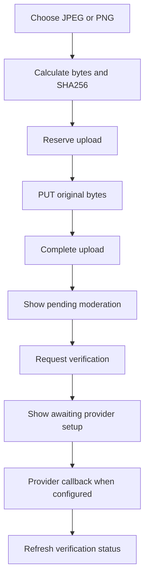

# M05 — Uploads and verification

[Handover index](README.md) · [Shared client conventions](COMMON.md) · [OpenAPI](../openapi.yaml)

## Status

Implemented private local photo pipeline, verification intake, provider-neutral callback boundary and self-reported health metadata. No production identity adapter, moderation, documents or review workflow is connected.

14 implemented operations. This document describes the checked-in backend, not a deployed environment.

## Screen flow

Current integration flow; readiness gates may stop progression.



## Wireframe

```text
+---------------------------------------+
| Photos and verification               |
| [ Add photo ]  Upload progress 0-100% |
| Photo: pending moderation             |
| Guardian verification: setup pending  |
| Dog verification: setup pending       |
| After real callback: refresh status   |
| Health record: self-reported          |
| [ Add health record ]                 |
+---------------------------------------+
```

## Client behavior and integration limits

- Storage must be enabled by the backend developer with MEDIA_MODE=local. This adapter is development/test only; media-unavailable means configuration is missing.
- Reserve with exact original byte size, MIME and lowercase SHA-256. PUT those same bytes as image/jpeg or image/png using the uploader’s bearer token; do not send multipart or base64 JSON. The 15-minute reservation is not a signed object-store URL.
- Limits: 8 MiB, 20 megapixels, 30 live slots/dog, 60 reservations/dog/day. The server removes metadata and creates a JPEG up to 1600×1600. Original bytes are discarded.
- Content upload is single-use; on a lost response, read status. awaiting_upload permits retry before expiry; uploaded permits complete; completed is already finished. Repeated complete is idempotent. Expired reservations need a new upload.
- No photo download URL/endpoint exists. Keep a local UI preview separate from approved server media; pending is never a verified/public photo. Do not poll pending status aggressively while the moderation worker is unconfigured.
- Order requires every live photo ID exactly once. Deleting a photo resets dog publication. A failed physical delete can already have hidden the photo; refetch status/list and let server cleanup retry.
- Verification requests record intent only: pending plus awaiting_provider_setup. They do not create an identity-provider session or badge. Repeated creation returns the current active request; new requests are limited to three per user/day.
- Verification status is requester-only, including within a household. Dog requests also require current membership. An open request can be withdrawn idempotently.
- Health records are private household metadata, self_reported by default. Expiry is separate from provenance. Limits: 100 live and 10 new/day per dog. Removing reviewed evidence revokes health tiers; soft deletion is not full account erasure.
- Do not send identity documents/numbers through photo or health endpoints. Document upload and real provider adapters are not implemented.
- A bounded verification expiry pass revokes grants whose expiresAt has passed. For a guardian with no remaining live tier, it also clears isAdultVerified, pauses dogs published by that guardian and removes active beacons. Live onboarding/discovery already check expiry at read time. The pass grants no badge and does not complete pending provider requests. Clients should refetch progress/profile after a tier lapses and expect reverification through a future approved provider flow.
- POST /webhooks/verification is a provider-only server callback, never a mobile/web call. It returns 503 verification-provider-unavailable until a selected adapter verifies its exact raw bytes, timestamp and source. Its JSON request and authentication headers are vendor-specific and deliberately unspecified. An accepted event returns accepted/requestId/duplicate; exact replay returns duplicate=true; reused event ID with changed bytes returns 409 provider-event-conflict. No real adapter is installed.
- After a real verified callback, GET /v1/verifications/{id} is the client source of truth. approved grants a time-limited subject tier; rejected finishes the request; needs_more_info leaves it open. The only current signer and synthetic approval evidence live in disposable integration tests. Do not present a pending request as an approved badge.

## Endpoint summary

| Method | Path | Access | Success |
| --- | --- | --- | --- |
| POST | `/webhooks/verification` | Selected provider adapter: verified raw body, timestamp and replay ID | 200 |
| POST | `/v1/dogs/{dogId}/media/uploads` | Owner/co-guardian | 201 |
| GET | `/v1/dogs/{dogId}/media` | Accepted household member | 200 |
| PATCH | `/v1/dogs/{dogId}/media/order` | Owner/co-guardian | 204 |
| DELETE | `/v1/dogs/{dogId}/media/{id}` | Owner/co-guardian | 204 |
| PUT | `/v1/media/{id}/content` | Uploader and current owner/co-guardian | 200 |
| POST | `/v1/media/{id}/complete` | Owner/co-guardian | 200 |
| GET | `/v1/media/{id}` | Accepted household member | 200 |
| POST | `/v1/verifications` | Caller; dog: owner/co-guardian | 201 |
| GET | `/v1/verifications/{id}` | Requester; dog: current member also | 200 |
| POST | `/v1/verifications/{id}/withdraw` | Requester; dog: current member also | 200 |
| POST | `/v1/dogs/{dogId}/health-records` | Owner/co-guardian | 201 |
| GET | `/v1/dogs/{dogId}/health-records` | Accepted household member | 200 |
| DELETE | `/v1/dogs/{dogId}/health-records/{id}` | Owner/co-guardian | 204 |

## Examples

Illustrative data only. Replace IDs with returned resource IDs and token/checksum placeholders with real local values. Examples are not seeded records, legal text or evidence. For examples without a response block, use the exact response shape in the endpoint section below.

### Reserve original photo bytes

```http
POST /v1/dogs/44444444-4444-4444-8444-444444444444/media/uploads
Authorization: Bearer <accessToken>
Content-Type: application/json

{
  "contentType": "image/jpeg",
  "sizeBytes": 12345,
  "sha256": "<64 lowercase hex characters calculated from your photo>"
}
```

### Request guardian verification

```http
POST /v1/verifications
Authorization: Bearer <accessToken>
Content-Type: application/json

{
  "kind": "guardian"
}
```

Response: HTTP 201

```json
{
  "id": "66666666-6666-4666-8666-666666666666",
  "subjectType": "user",
  "subjectId": "22222222-2222-4222-8222-222222222222",
  "targetTier": 1,
  "state": "pending",
  "reasonCode": null,
  "createdAt": "2026-10-08T10:00:00.000Z",
  "updatedAt": "2026-10-08T10:00:00.000Z",
  "nextAction": "awaiting_provider_setup"
}
```

### Add a self-reported health record

```http
POST /v1/dogs/44444444-4444-4444-8444-444444444444/health-records
Authorization: Bearer <accessToken>
Content-Type: application/json

{
  "recordType": "rabies",
  "testedAt": "2026-01-01",
  "expiresAt": "2027-01-01"
}
```

## Module errors

Also handle the [shared error contract](COMMON.md#errors). These are module-level codes; applicability depends on the endpoint and current state. HTTP status alone is insufficient.

| HTTP | Code | Meaning | Client action |
| --- | --- | --- | --- |
| 400 | `invalid-dates` | Health record cannot predate birth. | Correct dates and their ordering. |
| 400 | `invalid-image` | Photo decoding failed or the 20-megapixel limit was exceeded. | Ask for another valid JPEG/PNG within the limits. |
| 400 | `invalid-media-order` | Provide every live photo ID exactly once. | Show a contextual error using code; correct input/state or respect the documented limit before retrying. |
| 400 | `invalid-provider-event` | Evidence assurance does not match its subject. | Show a contextual error using code; correct input/state or respect the documented limit before retrying. |
| 400 | `upload-mismatch` | Photo type, size or checksum does not match the upload request. | Recompute MIME, size and checksum from the same original bytes. |
| 401 | `provider-unauthenticated` | Valid provider authentication is required. | Show a contextual error using code; correct input/state or respect the documented limit before retrying. |
| 403 | `upload-owner` | Only the upload creator can send its content. | Show a contextual error using code; correct input/state or respect the documented limit before retrying. |
| 404 | `not-found` | Health record not found. | Refresh the list/access state; avoid exposing whether another user owns the resource. |
| 404 | `verification-request-unavailable` | Verification request is unavailable. | Show a contextual error using code; correct input/state or respect the documented limit before retrying. |
| 409 | `dog-inactive` | This dog profile can no longer be edited. | Show a contextual error using code; correct input/state or respect the documented limit before retrying. |
| 409 | `photo-limit` | At most thirty photo slots are allowed. | Show a contextual error using code; correct input/state or respect the documented limit before retrying. |
| 409 | `provider-event-conflict` | Provider event ID was already used. | Show a contextual error using code; correct input/state or respect the documented limit before retrying. |
| 409 | `upload-consumed` | This upload has already received content. | Read upload status before retrying; content is single-use. |
| 409 | `upload-incomplete` | Upload photo content first. | Send bytes successfully before completing. |
| 409 | `verification-final` | Only an open request can be withdrawn. | Refresh status; the request can no longer be withdrawn. |
| 409 | `verification-subject-unavailable` | Dog ownership or status changed. | Show a contextual error using code; correct input/state or respect the documented limit before retrying. |
| 410 | `upload-expired` | Create a new photo upload. | Create a new reservation and upload again. |
| 415 | `unsupported-encoding` | Compressed request bodies are not accepted. | Show a contextual error using code; correct input/state or respect the documented limit before retrying. |
| 415 | `unsupported-media` | Use image/jpeg or image/png. | Show a contextual error using code; correct input/state or respect the documented limit before retrying. |
| 429 | `health-record-limit` | Health record limit reached. | Show a contextual error using code; correct input/state or respect the documented limit before retrying. |
| 429 | `processor-busy` | Retry the photo upload shortly. | Retry later with backoff while the reservation remains valid. |
| 429 | `upload-limit` | Daily photo upload limit reached. | Show a contextual error using code; correct input/state or respect the documented limit before retrying. |
| 429 | `verification-limit` | At most three new verification requests per day are allowed. | Show a contextual error using code; correct input/state or respect the documented limit before retrying. |
| 503 | `media-unavailable` | Photo storage is not configured. | Show uploads unavailable; backend configuration is required. |
| 503 | `verification-provider-unavailable` | Verification provider is not configured. | Show a contextual error using code; correct input/state or respect the documented limit before retrying. |

## Detailed request and response contracts

Shapes below are **type notation**, not JSON to send: `?` means optional, `|` means alternatives, and comments show constraints/defaults. Requests reject unknown write fields. JSON uses actual values. Runtime cross-field/business rules are in the client guidance above. The linked OpenAPI is the machine-readable source.

### POST /webhooks/verification

Operation: `receiveVerificationProviderEvent`. Access: Selected provider adapter: verified raw body, timestamp and replay ID.

Process a verified provider event with replay protection.

Request body (application/json, required):

```text
Record<string, unknown>
```

Response HTTP 200:

```text
{
  accepted: true
  requestId: string /* format="uuid" */
  duplicate: boolean
}
```

### POST /v1/dogs/{dogId}/media/uploads

Operation: `createPhotoUpload`. Access: Owner/co-guardian.

Reserve a private photo upload; local bearer PUT expires after 15 minutes.

Parameters:

- `dogId` (path, required): ` string /* format="uuid" */ `
- `X-App-Platform` (header, optional): ` "android" | "ios" `
- `X-App-Build` (header, optional): ` string /* pattern="^[1-9][0-9]{0,9}$" */ `

Request body (application/json, required):

```text
{
  contentType: "image/jpeg" | "image/png"
  sizeBytes: integer /* minimum=1, maximum=8388608 */
  sha256: string /* pattern="^[a-f0-9]{64}$" */
}
```

Response HTTP 201:

```text
{
  id: string /* format="uuid" */
  dogId: string /* format="uuid" */
  ordinal: integer /* minimum=0, maximum=29 */
  width: integer | null
  height: integer | null
  moderationState: "pending" | "approved" | "rejected" | "quarantined"
  uploadState: "awaiting_upload" | "uploaded" | "completed" | "deleted" | null
  expiresAt: string /* format="date-time" */ | null /* format="date-time" */
  createdAt: string /* format="date-time" */
} & {
  upload: {
    method: "PUT"
    path: string
    authentication: "bearer"
    contentType: "image/jpeg" | "image/png"
  }
}
```

### GET /v1/dogs/{dogId}/media

Operation: `listDogPhotos`. Access: Accepted household member.

List household photo metadata; no storage keys or image URLs.

Parameters:

- `dogId` (path, required): ` string /* format="uuid" */ `
- `X-App-Platform` (header, optional): ` "android" | "ios" `
- `X-App-Build` (header, optional): ` string /* pattern="^[1-9][0-9]{0,9}$" */ `

Request body: none.

Response HTTP 200:

```text
{
  media: Array<{
    id: string /* format="uuid" */
    dogId: string /* format="uuid" */
    ordinal: integer /* minimum=0, maximum=29 */
    width: integer | null
    height: integer | null
    moderationState: "pending" | "approved" | "rejected" | "quarantined"
    uploadState: "awaiting_upload" | "uploaded" | "completed" | "deleted" | null
    expiresAt: string /* format="date-time" */ | null /* format="date-time" */
    createdAt: string /* format="date-time" */
  }>
}
```

### PATCH /v1/dogs/{dogId}/media/order

Operation: `orderDogPhotos`. Access: Owner/co-guardian.

Replace the complete live photo order.

Parameters:

- `dogId` (path, required): ` string /* format="uuid" */ `
- `X-App-Platform` (header, optional): ` "android" | "ios" `
- `X-App-Build` (header, optional): ` string /* pattern="^[1-9][0-9]{0,9}$" */ `

Request body (application/json, required):

```text
{
  mediaIds: Array<string /* format="uuid" */> /* minItems=1, maxItems=30, uniqueItems=true */
}
```

Response HTTP 204:

No response body.

### DELETE /v1/dogs/{dogId}/media/{id}

Operation: `deleteDogPhoto`. Access: Owner/co-guardian.

Delete photo, invalidate publication and schedule physical cleanup.

Parameters:

- `dogId` (path, required): ` string /* format="uuid" */ `
- `id` (path, required): ` string /* format="uuid" */ `
- `X-App-Platform` (header, optional): ` "android" | "ios" `
- `X-App-Build` (header, optional): ` string /* pattern="^[1-9][0-9]{0,9}$" */ `

Request body: none.

Response HTTP 204:

No response body.

### PUT /v1/media/{id}/content

Operation: `uploadPhotoContent`. Access: Uploader and current owner/co-guardian.

Uploader-only single-use JPEG/PNG content, maximum 8 MiB and 20 megapixels.

Parameters:

- `id` (path, required): ` string /* format="uuid" */ `
- `X-App-Platform` (header, optional): ` "android" | "ios" `
- `X-App-Build` (header, optional): ` string /* pattern="^[1-9][0-9]{0,9}$" */ `

Request body (image/jpeg, required):

```text
string /* format="binary" */
```

Request body (image/png, required):

```text
string /* format="binary" */
```

Response HTTP 200:

```text
{
  id: string /* format="uuid" */
  dogId: string /* format="uuid" */
  ordinal: integer /* minimum=0, maximum=29 */
  width: integer | null
  height: integer | null
  moderationState: "pending" | "approved" | "rejected" | "quarantined"
  uploadState: "awaiting_upload" | "uploaded" | "completed" | "deleted" | null
  expiresAt: string /* format="date-time" */ | null /* format="date-time" */
  createdAt: string /* format="date-time" */
}
```

### POST /v1/media/{id}/complete

Operation: `completePhotoUpload`. Access: Owner/co-guardian.

Idempotently complete an uploaded photo; moderation remains pending.

Parameters:

- `id` (path, required): ` string /* format="uuid" */ `
- `X-App-Platform` (header, optional): ` "android" | "ios" `
- `X-App-Build` (header, optional): ` string /* pattern="^[1-9][0-9]{0,9}$" */ `

Request body (application/json, required):

```text
{}
```

Response HTTP 200:

```text
{
  id: string /* format="uuid" */
  dogId: string /* format="uuid" */
  ordinal: integer /* minimum=0, maximum=29 */
  width: integer | null
  height: integer | null
  moderationState: "pending" | "approved" | "rejected" | "quarantined"
  uploadState: "awaiting_upload" | "uploaded" | "completed" | "deleted" | null
  expiresAt: string /* format="date-time" */ | null /* format="date-time" */
  createdAt: string /* format="date-time" */
}
```

### GET /v1/media/{id}

Operation: `getPhotoStatus`. Access: Accepted household member.

Read household-scoped photo processing status.

Parameters:

- `id` (path, required): ` string /* format="uuid" */ `
- `X-App-Platform` (header, optional): ` "android" | "ios" `
- `X-App-Build` (header, optional): ` string /* pattern="^[1-9][0-9]{0,9}$" */ `

Request body: none.

Response HTTP 200:

```text
{
  id: string /* format="uuid" */
  dogId: string /* format="uuid" */
  ordinal: integer /* minimum=0, maximum=29 */
  width: integer | null
  height: integer | null
  moderationState: "pending" | "approved" | "rejected" | "quarantined"
  uploadState: "awaiting_upload" | "uploaded" | "completed" | "deleted" | null
  expiresAt: string /* format="date-time" */ | null /* format="date-time" */
  createdAt: string /* format="date-time" */
}
```

### POST /v1/verifications

Operation: `requestVerification`. Access: Caller; dog: owner/co-guardian.

Record verification intent; same active request is returned on retry, no provider or badge is created.

Parameters:

- `X-App-Platform` (header, optional): ` "android" | "ios" `
- `X-App-Build` (header, optional): ` string /* pattern="^[1-9][0-9]{0,9}$" */ `

Request body (application/json, required):

```text
{
  kind: "guardian"
} | {
  kind: "dog"
  dogId: string /* format="uuid" */
}
```

Response HTTP 201:

```text
{
  id: string /* format="uuid" */
  subjectType: "user" | "dog"
  subjectId: string /* format="uuid" */
  targetTier: 1 | 2
  state: "pending" | "in_review" | "needs_more_info" | "approved" | "rejected" | "expired" | "withdrawn"
  reasonCode: string | null
  createdAt: string /* format="date-time" */
  updatedAt: string /* format="date-time" */
  nextAction: "none" | "awaiting_provider_setup" | "awaiting_review" | "contact_support"
}
```

### GET /v1/verifications/{id}

Operation: `getVerification`. Access: Requester; dog: current member also.

Read requester-only status; dog membership is also required.

Parameters:

- `id` (path, required): ` string /* format="uuid" */ `
- `X-App-Platform` (header, optional): ` "android" | "ios" `
- `X-App-Build` (header, optional): ` string /* pattern="^[1-9][0-9]{0,9}$" */ `

Request body: none.

Response HTTP 200:

```text
{
  id: string /* format="uuid" */
  subjectType: "user" | "dog"
  subjectId: string /* format="uuid" */
  targetTier: 1 | 2
  state: "pending" | "in_review" | "needs_more_info" | "approved" | "rejected" | "expired" | "withdrawn"
  reasonCode: string | null
  createdAt: string /* format="date-time" */
  updatedAt: string /* format="date-time" */
  nextAction: "none" | "awaiting_provider_setup" | "awaiting_review" | "contact_support"
}
```

### POST /v1/verifications/{id}/withdraw

Operation: `withdrawVerification`. Access: Requester; dog: current member also.

Idempotently withdraw an open request.

Parameters:

- `id` (path, required): ` string /* format="uuid" */ `
- `X-App-Platform` (header, optional): ` "android" | "ios" `
- `X-App-Build` (header, optional): ` string /* pattern="^[1-9][0-9]{0,9}$" */ `

Request body (application/json, required):

```text
{}
```

Response HTTP 200:

```text
{
  id: string /* format="uuid" */
  subjectType: "user" | "dog"
  subjectId: string /* format="uuid" */
  targetTier: 1 | 2
  state: "pending" | "in_review" | "needs_more_info" | "approved" | "rejected" | "expired" | "withdrawn"
  reasonCode: string | null
  createdAt: string /* format="date-time" */
  updatedAt: string /* format="date-time" */
  nextAction: "none" | "awaiting_provider_setup" | "awaiting_review" | "contact_support"
}
```

### POST /v1/dogs/{dogId}/health-records

Operation: `addHealthRecord`. Access: Owner/co-guardian.

Save a self-reported health record; no identity documents or verification fields accepted.

Parameters:

- `dogId` (path, required): ` string /* format="uuid" */ `
- `X-App-Platform` (header, optional): ` "android" | "ios" `
- `X-App-Build` (header, optional): ` string /* pattern="^[1-9][0-9]{0,9}$" */ `

Request body (application/json, required):

```text
{
  recordType: "vaccination" | "rabies" | "deworming" | "hip_score" | "elbow_score" | "eye_exam" | "cardiac_exam" | "dna_panel" | "vet_exam"
  testedAt: string /* format="date" */
  expiresAt?: string /* format="date" */ | null /* format="date" */
  resultCode?: string /* pattern="^[a-z0-9_]{1,40}$" */ | null /* pattern="^[a-z0-9_]{1,40}$" */
}
```

Response HTTP 201:

```text
{
  id: string /* format="uuid" */
  dogId: string /* format="uuid" */
  recordType: "vaccination" | "rabies" | "deworming" | "hip_score" | "elbow_score" | "eye_exam" | "cardiac_exam" | "dna_panel" | "vet_exam"
  testedAt: string /* format="date" */
  expiresAt: string /* format="date" */ | null /* format="date" */
  resultCode: string /* pattern="^[a-z0-9_]{1,40}$" */ | null /* pattern="^[a-z0-9_]{1,40}$" */
  verifiedAt: string /* format="date-time" */ | null /* format="date-time" */
  createdAt: string /* format="date-time" */
  provenance: "self_reported" | "reviewed"
  expired: boolean
}
```

### GET /v1/dogs/{dogId}/health-records

Operation: `listHealthRecords`. Access: Accepted household member.

List private household health records; expired evidence remains marked.

Parameters:

- `dogId` (path, required): ` string /* format="uuid" */ `
- `limit` (query, optional): ` integer /* minimum=1, maximum=50, default=20 */ `
- `cursor` (query, optional): ` string /* maxLength=400 */ `
- `X-App-Platform` (header, optional): ` "android" | "ios" `
- `X-App-Build` (header, optional): ` string /* pattern="^[1-9][0-9]{0,9}$" */ `

Request body: none.

Response HTTP 200:

```text
{
  records: Array<{
    id: string /* format="uuid" */
    dogId: string /* format="uuid" */
    recordType: "vaccination" | "rabies" | "deworming" | "hip_score" | "elbow_score" | "eye_exam" | "cardiac_exam" | "dna_panel" | "vet_exam"
    testedAt: string /* format="date" */
    expiresAt: string /* format="date" */ | null /* format="date" */
    resultCode: string /* pattern="^[a-z0-9_]{1,40}$" */ | null /* pattern="^[a-z0-9_]{1,40}$" */
    verifiedAt: string /* format="date-time" */ | null /* format="date-time" */
    createdAt: string /* format="date-time" */
    provenance: "self_reported" | "reviewed"
    expired: boolean
  }>
  nextCursor: string | null
}
```

### DELETE /v1/dogs/{dogId}/health-records/{id}

Operation: `deleteHealthRecord`. Access: Owner/co-guardian.

Idempotently remove a record; reviewed evidence removal revokes dog health tiers and resets publication.

Parameters:

- `dogId` (path, required): ` string /* format="uuid" */ `
- `id` (path, required): ` string /* format="uuid" */ `
- `X-App-Platform` (header, optional): ` "android" | "ios" `
- `X-App-Build` (header, optional): ` string /* pattern="^[1-9][0-9]{0,9}$" */ `

Request body: none.

Response HTTP 204:

No response body.

---

Maintained through `scripts/handover-notes.mjs`, `docs/API_PLAN.md`, OpenAPI and source error codes. Regenerate with `npm run docs:handovers`; verify with `npm run check:handovers`.
