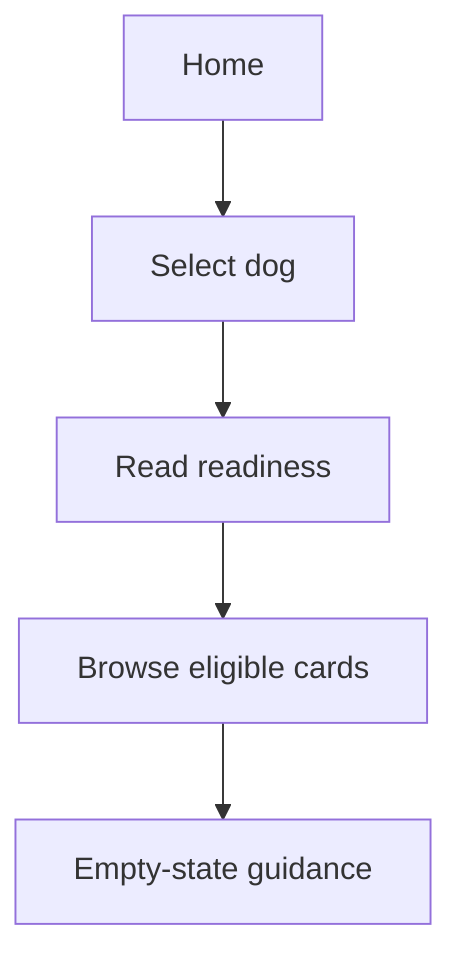

# M06 — Home and discovery

[Handover index](README.md) · [Shared client conventions](COMMON.md) · [OpenAPI](../openapi.yaml)

## Status

Not implemented. Design/reference only; no supported request/response or error contract.

0 implemented operations. This document describes the checked-in backend, not a deployed environment.

## Screen flow

Proposed flow only; no working API is implied.



## Wireframe

```text
+------------------------------+
| Home - planned               |
| Your dog [ Ruby v ]          |
| Tasks / unread / connections |
| [ Dog discovery card ]       |
| Empty-state guidance         |
+------------------------------+
```

## Client behavior and integration limits

- Requires live consent, blocks, current membership/verification and approved photos. Manual city locations need an explicit city-only display; never derive precise distance from them.

## Request, response and error status

No supported contract yet. Do not call the planned paths or use fallback/mock success in production. Schemas, status codes, error codes, authentication and retry behavior will be added with implementation. Generic route/auth failures are not a feature contract.

## Planned scope

| Method + path | Access | Purpose |
| --- | --- | --- |
| GET `/home?dogId=` | U | Selected dog, tasks, unread counts, connections, next meetup; honest partial-section status |
| GET `/feed?dogId=&mode=pack&cursor=&limit=` | U | Coarse-area candidates, filters, ranked cards, signed impression tokens |
| GET `/feed/empty-reason?dogId=` | U | Specific actionable empty-state reasons |
| GET `/dogs/{id}/discovery-preferences` | Editor | Current effective filters and allowed ranges |

No arbitrary GPS/radius probe on the feed. Exclude self, household dogs, blocked/suspended/hidden dogs and disallowed candidates. Start with an explainable heuristic over temperament, size preferences, schedule and coarse distance. No ML service required initially. Signed impressions bind viewer, actor dog, target dog, mode and expiry; profile reads have distinct-profile limits. Home counters follow the same blocking rules as lists.

---

Maintained through `scripts/handover-notes.mjs`, `docs/API_PLAN.md`, OpenAPI and source error codes. Regenerate with `npm run docs:handovers`; verify with `npm run check:handovers`.
