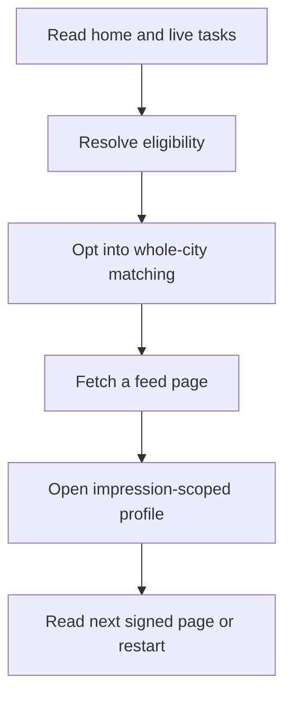

# M06 — Home and discovery

[Handover index](README.md) · [Shared client conventions](COMMON.md) · [OpenAPI](../openapi.yaml)

## Status

Home and city-only metadata discovery implemented for opt-in development. Public rollout, approved image delivery and production verification remain blocked.

5 implemented operations. This document describes the checked-in backend, not a deployed environment.

## Screen flow

Current integration flow; readiness gates may stop progression.



## Wireframe

```text
+----------------------------------------+
| Home / Discovery - development         |
| Your dog [ Ruby v ]                    |
| Tasks: complete missing prerequisites  |
| [ ] Include dogs across my whole city  |
| Distance: unknown                      |
| [ Dog card / approved-photo metadata ] |
| [ Open profile ]   [ Next page ]       |
| Connections / unread / upcoming counts |
+----------------------------------------+
```

## Client behavior and integration limits

- GET /home works before eligibility is complete. dog may be null; onboarding is live. Sections now contain real account-wide counts: active visible connections, unread messages from others, future active meetups and unread visible inbox items. Messaging reports unavailable/null when message encryption is not configured. Blocks, ended relationships and removed editor membership exclude rows.
- DISCOVERY_MODE=development explicitly enables the server-side development feed using AUTH_SECRET. This mode is forbidden in production. Bootstrap product flags remain false; do not expose a public launch from these endpoints.
- The actor must be the selected dog, and the caller must be an accepted owner/co-guardian with current consent, active account, verified adulthood and a current guardian tier. Required profile details, three approved photos, temperament, publication and a selectable manual area are rechecked. Saving adultDeclared does not provide verified adulthood.
- The target must have a current eligible publisher who is still its owner/co-guardian. Published profiles predating migration 0018 must be republished to record their publisher. Consent withdrawal, account restriction, expired verification, missing photos and removed membership hide the target on subsequent requests.
- Both dogs must opt in with PUT /dogs/{id}/preferences and allowCityOnly=true. This is explicit consent to search the whole city with distance unknown. Existing kilometre-bucket preferences are retained but are not applied in this mode. GET discovery-preferences reports distanceBucketApplied=false. GPS-based matching remains planned.
- Cards expose a safe dog/guardian projection and approved-photo metadata only. mediaDelivery=unavailable and no image URL is returned. Do not present pending/local images as approved feed content. verificationTier=1 means guardian verification; tiers 2+ require current dog grants.
- Exclusions include the caller’s own households, either direction of any accepted-member household block, recent pass/existing interest and existing matches (including ended/blocked). Preferences are applied both ways: size, age, energy, play style, minimum tier and reactive-dog acceptance. No breed or temperament field is a medical safety guarantee.
- Initial ranking rewards energy similarity, shared play styles, same size and overlapping weekly windows in the same timezone. Cross-timezone schedules receive no schedule bonus. Ordering is heuristic, not a compatibility probability.
- Feed snapshots hold up to 200 ranked IDs for ten minutes. Pagination preserves that order while rechecking target eligibility. Hidden dogs are skipped. Fresh eligible dogs appear after refresh. Page limit defaults to 20, maximum 50. Tokens bind caller and actor; never edit them.
- Changing actor profile, location or preferences requires restarting pagination. A signed impressionToken from a card is required for GET /dogs/{targetId}/profile with dogId=<actor>. It expires with the feed session and is not permission to bypass current blocks or eligibility. Redact these query tokens from access logs and analytics.
- Limits are persisted: 60 new feed snapshots/hour/user and 200 distinct exposed dogs per UTC day across feed/profile reads. Re-reading an already counted dog does not consume another distinct slot. Run npm run discovery:cleanup regularly; scheduling remains an operations task.
- Empty reasons: discovery_disabled, select_dog, onboarding_incomplete, discovery_paused, account_not_eligible, dog_not_published, city_discovery_not_enabled, dog_not_eligible, no_eligible_dogs, end_of_feed. null means no empty reason. missing contains onboarding steps where relevant. No eligible dogs does not reveal whether hidden or blocked dogs exist.
- 400 invalid-discovery-token: discard cursor/token. 410 discovery-token-expired: restart feed. 409 discovery-context-changed: restart after refreshing settings. 409 active-dog-required: select the intended dog. 409 discovery-ineligible: refetch home. 404 profile: remove the card. 429 discovery-limit: wait until midnight UTC; feed-refresh-limit: stop refreshing and retry later.
- M07 now accepts impression-bound interests/passes and creates mutual connections. Messaging delivery remains a separate module.
- The operations maintenance pass calls the bounded discovery cleanup: at most 1,000 sessions older than one day and 1,000 prior-UTC-day exposure rows per pass. Client feed/profile behavior is unchanged; expired signed tokens already fail live checks.

## Endpoint summary

| Method | Path | Access | Success |
| --- | --- | --- | --- |
| GET | `/v1/home` | Signed-in caller | 200 |
| GET | `/v1/feed` | Signed-in caller; eligible selected-dog editor to receive cards | 200 |
| GET | `/v1/feed/empty-reason` | Signed-in caller; eligible selected-dog editor to receive cards | 200 |
| GET | `/v1/dogs/{id}/profile` | Eligible selected-dog editor; matching impression token required | 200 |
| GET | `/v1/dogs/{id}/discovery-preferences` | Owner/co-guardian | 200 |

## Examples

Illustrative data only. Replace IDs with returned resource IDs and token/checksum placeholders with real local values. Examples are not seeded records, legal text or evidence. For examples without a response block, use the exact response shape in the endpoint section below.

### Read whole-city discovery settings

```http
GET /v1/dogs/44444444-4444-4444-8444-444444444444/discovery-preferences
Authorization: Bearer <accessToken>
```

### Read the selected dog feed

```http
GET /v1/feed?mode=pack&limit=20
Authorization: Bearer <accessToken>
```

Response: HTTP 200

```json
{
  "cards": [],
  "nextCursor": null,
  "emptyReason": "onboarding_incomplete",
  "missing": [
    "approved-photos",
    "guardian-verification"
  ],
  "scope": "city"
}
```

### Read the actionable empty state

```http
GET /v1/feed/empty-reason
Authorization: Bearer <accessToken>
```

Response: HTTP 200

```json
{
  "reason": "no_eligible_dogs",
  "missing": [],
  "scope": "city"
}
```

## Module errors

Also handle the [shared error contract](COMMON.md#errors). These are module-level codes; applicability depends on the endpoint and current state. HTTP status alone is insufficient.

| HTTP | Code | Meaning | Client action |
| --- | --- | --- | --- |
| 400 | `invalid-discovery-token` | Discovery token is invalid; restart the feed. | Show a contextual error using code; correct input/state or respect the documented limit before retrying. |
| 404 | `not-found` | Discovery profile is unavailable. | Refresh the list/access state; avoid exposing whether another user owns the resource. |
| 409 | `active-dog-required` | Select this dog before using discovery. | Show a contextual error using code; correct input/state or respect the documented limit before retrying. |
| 409 | `discovery-context-changed` | Your discovery settings changed; restart the feed. | Show a contextual error using code; correct input/state or respect the documented limit before retrying. |
| 409 | `discovery-ineligible` | Discovery is unavailable; refresh home for the current reason. | Show a contextual error using code; correct input/state or respect the documented limit before retrying. |
| 410 | `discovery-token-expired` | Discovery token expired; restart the feed. | Show a contextual error using code; correct input/state or respect the documented limit before retrying. |
| 429 | `discovery-limit` | The daily discovery limit is reached; try after midnight UTC. | Show a contextual error using code; correct input/state or respect the documented limit before retrying. |
| 429 | `feed-refresh-limit` | Too many feed refreshes; try again later. | Show a contextual error using code; correct input/state or respect the documented limit before retrying. |

## Detailed request and response contracts

Shapes below are **type notation**, not JSON to send: `?` means optional, `|` means alternatives, and comments show constraints/defaults. Requests reject unknown write fields. JSON uses actual values. Runtime cross-field/business rules are in the client guidance above. The linked OpenAPI is the machine-readable source.

### GET /v1/home

Operation: `getHome`. Access: Signed-in caller.

Own selected-dog dashboard with truthful unavailable sections.

Parameters:

- `dogId` (query, optional): ` string /* format="uuid" */ `

Request body: none.

Response HTTP 200:

```text
{
  dog: {
    id: string /* format="uuid" */
    name: string
    publicationState: "draft" | "published" | "paused"
  } | null
  onboarding: {
    rulesVersion: 1
    ready: boolean
    missing: Array<string>
    nextAction: string | null
    activeDogId: string /* format="uuid" */ | null /* format="uuid" */
    completedAt: string /* format="date-time" */ | null /* format="date-time" */
    preferences: {
      countryCode: "IN"
      locale: "en-IN"
      mode: "pack"
      adultDeclared: boolean
    }
  }
  discovery: {
    available: boolean
    reason: "discovery_disabled" | "select_dog" | "onboarding_incomplete" | "discovery_paused" | "account_not_eligible" | "dog_not_published" | "city_discovery_not_enabled" | "dog_not_eligible" | "no_eligible_dogs" | "end_of_feed" | null
    scope: "city"
    distance: "unknown"
    mediaDelivery: "unavailable"
  }
  sections: {
    connections: {
      status: "available" | "unavailable"
      value: null
    }
    messages: {
      status: "available" | "unavailable"
      value: null
    }
    meetup: {
      status: "available" | "unavailable"
      value: null
    }
    notifications: {
      status: "available" | "unavailable"
      value: null
    }
  }
}
```

### GET /v1/feed

Operation: `getDiscoveryFeed`. Access: Signed-in caller; eligible selected-dog editor to receive cards.

Development city-only metadata feed with live eligibility and signed snapshot pagination.

Parameters:

- `dogId` (query, optional): ` string /* format="uuid" */ `
- `mode` (query, optional): ` "pack" `
- `limit` (query, optional): ` integer /* minimum=1, maximum=50, default=20 */ `
- `cursor` (query, optional): ` string /* maxLength=2048 */ `

Request body: none.

Response HTTP 200:

```text
{
  cards: Array<{
    id: string /* format="uuid" */
    name: string
    sex: "male" | "female"
    sizeClass: "toy" | "small" | "medium" | "large" | "giant"
    ageMonths: integer /* minimum=0 */
    bio: string | null
    temperament: {
      energy: integer /* minimum=1, maximum=5 */
      playStyle: Array<"wrestle" | "chase" | "parallel" | "fetch" | "sniff">
      dogReactivity: integer /* minimum=1, maximum=5 */
      humanReactivity: integer /* minimum=1, maximum=5 */
    }
    verificationTier: integer /* minimum=1, maximum=4 */
    guardian: {
      id: string /* format="uuid" */
      displayName: string
    }
    distance: "unknown"
    locationPrecision: "city"
    photos: Array<{
      id: string /* format="uuid" */
      width: integer | null
      height: integer | null
    }>
    mediaDelivery: "unavailable"
    impressionToken: string /* maxLength=2048 */
  }>
  nextCursor: string | null
  emptyReason: "discovery_disabled" | "select_dog" | "onboarding_incomplete" | "discovery_paused" | "account_not_eligible" | "dog_not_published" | "city_discovery_not_enabled" | "dog_not_eligible" | "no_eligible_dogs" | "end_of_feed" | null
  missing: Array<string>
  scope: "city"
}
```

### GET /v1/feed/empty-reason

Operation: `getDiscoveryEmptyReason`. Access: Signed-in caller; eligible selected-dog editor to receive cards.

Actionable own-actor state without revealing excluded candidates.

Parameters:

- `dogId` (query, optional): ` string /* format="uuid" */ `

Request body: none.

Response HTTP 200:

```text
{
  reason: "discovery_disabled" | "select_dog" | "onboarding_incomplete" | "discovery_paused" | "account_not_eligible" | "dog_not_published" | "city_discovery_not_enabled" | "dog_not_eligible" | "no_eligible_dogs" | "end_of_feed" | null
  missing: Array<string>
  scope: "city"
}
```

### GET /v1/dogs/{id}/profile

Operation: `getDiscoveryProfile`. Access: Eligible selected-dog editor; matching impression token required.

Impression-scoped target projection with fresh privacy checks.

Parameters:

- `id` (path, required): ` string /* format="uuid" */ `
- `dogId` (query, required): ` string /* format="uuid" */ `
- `impressionToken` (query, required): ` string /* maxLength=2048 */ `

Request body: none.

Response HTTP 200:

```text
{
  id: string /* format="uuid" */
  name: string
  sex: "male" | "female"
  sizeClass: "toy" | "small" | "medium" | "large" | "giant"
  ageMonths: integer /* minimum=0 */
  bio: string | null
  temperament: {
    energy: integer /* minimum=1, maximum=5 */
    playStyle: Array<"wrestle" | "chase" | "parallel" | "fetch" | "sniff">
    dogReactivity: integer /* minimum=1, maximum=5 */
    humanReactivity: integer /* minimum=1, maximum=5 */
  }
  verificationTier: integer /* minimum=1, maximum=4 */
  guardian: {
    id: string /* format="uuid" */
    displayName: string
  }
  distance: "unknown"
  locationPrecision: "city"
  photos: Array<{
    id: string /* format="uuid" */
    width: integer | null
    height: integer | null
  }>
  mediaDelivery: "unavailable"
}
```

### GET /v1/dogs/{id}/discovery-preferences

Operation: `getDiscoveryPreferences`. Access: Owner/co-guardian.

Editor-only stored matching preferences, effective city scope and quotas.

Parameters:

- `id` (path, required): ` string /* format="uuid" */ `

Request body: none.

Response HTTP 200:

```text
{
  preferences: {
    maxDistanceBucket: "under_2_km" | "km_2_5" | "km_5_10" | "km_10_25" | "over_25_km"
    sizeClasses: Array<"toy" | "small" | "medium" | "large" | "giant"> /* maxItems=5, uniqueItems=true, default=[] */
    ageMinMonths: integer /* minimum=0, maximum=360, default=null */ | null /* minimum=0, maximum=360, default=null */
    ageMaxMonths: integer /* minimum=0, maximum=360, default=null */ | null /* minimum=0, maximum=360, default=null */
    energyMin: integer /* minimum=1, maximum=5, default=null */ | null /* minimum=1, maximum=5, default=null */
    energyMax: integer /* minimum=1, maximum=5, default=null */ | null /* minimum=1, maximum=5, default=null */
    playStyles: Array<"wrestle" | "chase" | "parallel" | "fetch" | "sniff"> /* maxItems=5, uniqueItems=true, default=[] */
    minVerificationTier: integer /* minimum=0, maximum=4, default=1 */
    parallelWalkOnly: boolean /* default=false */
    acceptsReactive: boolean /* default=false */
    allowCityOnly: boolean /* default=false */
  }
  effective: {
    scope: "city"
    distance: "unknown"
    distanceBucketApplied: false
  }
  limits: {
    pageSize: 50
    snapshotSize: 200
    distinctDogsPerDay: 200
    refreshesPerHour: 60
    tokenLifetimeSeconds: 600
  }
  mode: "pack"
}
```

---

Maintained through `scripts/handover-notes.mjs`, `docs/API_PLAN.md`, OpenAPI and source error codes. Regenerate with `npm run docs:handovers`; verify with `npm run check:handovers`.
