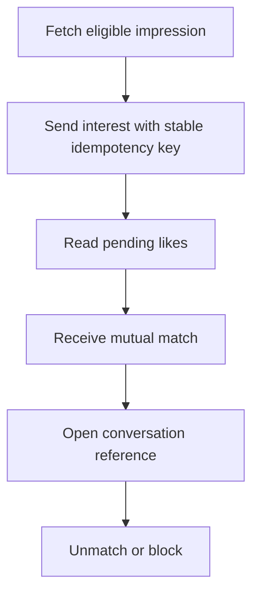

# M07 — Likes, connections and entitlements

[Handover index](README.md) · [Shared client conventions](COMMON.md) · [OpenAPI](../openapi.yaml)

## Status

Pack likes and connections implemented for development discovery. Purchases and production discovery remain unavailable.

8 implemented operations. This document describes the checked-in backend, not a deployed environment.

## Screen flow

Current integration flow; readiness gates may stop progression.



## Wireframe

```text
+-----------------------------------+
| Connections                       |
| [ Sent | Received | Matched ]     |
| [ Dog name ] [ Interest ]         |
| Daily interests remaining: 12     |
| [ Open conversation ] [ Unmatch ] |
+-----------------------------------+
```

## Client behavior and integration limits

- POST /decisions requires a UUID Idempotency-Key and a current actor-bound impressionToken. Keep the exact body/key on transport retries. A reused key with different input returns 409 idempotency-conflict. Committed retries do not consume another interest; current access is still checked.
- Only pack interest/pass is accepted. Both profiles must remain discovery eligible; caller must select the actor dog. Incoming likes provide a fresh scoped impression after live privacy checks. Interest is collective for a dog pair; only one decision per direction. A changed verdict or withdrawn interest returns decision-conflict. Passes can be reconsidered after 180 days.
- Free quota is 12 new interests per authenticated user per Asia/Kolkata calendar day, shared across dogs. GET /me/entitlements provides remaining and resetsAt. Passes are free. Withdrawal does not refund quota. Paid capabilities are unavailable.
- Mutual interest atomically creates one match, conversation and current owner/co-guardian conversation membership. Walkers/view-only members cannot participate. New household members are not automatically added to existing conversations; removed members lose access immediately.
- GET /likes/sent and /likes/received require selected dogId; only pending visible interests appear. DELETE /likes/{id} lets an actor-dog editor withdraw pending interest. Already matched returns 409 already-connected; use DELETE /matches/{id}.
- Lists use limit/cursor; continue while nextCursor is non-null even when privacy filtering produces an empty page. Match reads require original conversation membership and current editor membership. Blocks/deleted or inactive dogs hide connections. Pausing discovery does not end an existing connection.
- Unmatch closes conversation permanently. Ended/blocked pairs cannot rematch. Idempotent DELETE returns 204 while caller remains authorized. 404 means unavailable; remove local item. 429 interest-limit means wait for resetsAt.
- Social writes and blocks share a PostgreSQL advisory lock for correctness at development scale. Higher throughput needs measured lock partitioning. Idempotency receipts currently retain until account removal; automatic retention is not configured. Home aggregate counters remain pending.

## Endpoint summary

| Method | Path | Access | Success |
| --- | --- | --- | --- |
| POST | `/v1/decisions` | Signed-in caller | 200 |
| GET | `/v1/likes/sent` | Signed-in caller | 200 |
| GET | `/v1/likes/received` | Signed-in caller | 200 |
| DELETE | `/v1/likes/{id}` | Signed-in caller | 204 |
| GET | `/v1/matches` | Signed-in caller | 200 |
| GET | `/v1/matches/{id}` | Signed-in caller | 200 |
| DELETE | `/v1/matches/{id}` | Signed-in caller | 204 |
| GET | `/v1/me/entitlements` | Signed-in caller | 200 |

## Examples

Illustrative data only. Replace IDs with returned resource IDs and token/checksum placeholders with real local values. Examples are not seeded records, legal text or evidence. For examples without a response block, use the exact response shape in the endpoint section below.

### Send interest

```http
POST /v1/decisions
Authorization: Bearer <accessToken>
Content-Type: application/json

{
  "actorDogId": "44444444-4444-4444-8444-444444444444",
  "targetDogId": "55555555-5555-4555-8555-555555555555",
  "mode": "pack",
  "verdict": "interest",
  "impressionToken": "<from feed; Idempotency-Key header required>"
}
```

Response: HTTP 200

```json
{
  "id": "66666666-6666-4666-8666-666666666666",
  "verdict": "interest",
  "matchId": null
}
```

## Module errors

Also handle the [shared error contract](COMMON.md#errors). These are module-level codes; applicability depends on the endpoint and current state. HTTP status alone is insufficient.

| HTTP | Code | Meaning | Client action |
| --- | --- | --- | --- |
| 400 | `invalid-discovery-token` | Impression does not belong to this decision. | Show a contextual error using code; correct input/state or respect the documented limit before retrying. |
| 404 | `not-found` | Like is unavailable. | Refresh the list/access state; avoid exposing whether another user owns the resource. |
| 409 | `already-connected` | End the connection instead. | Show a contextual error using code; correct input/state or respect the documented limit before retrying. |
| 409 | `connection-ended` | This connection cannot be restored. | Show a contextual error using code; correct input/state or respect the documented limit before retrying. |
| 409 | `decision-conflict` | A decision already exists for this pair. | Show a contextual error using code; correct input/state or respect the documented limit before retrying. |
| 409 | `discovery-ineligible` | Discovery is unavailable; refresh home. | Show a contextual error using code; correct input/state or respect the documented limit before retrying. |
| 429 | `interest-limit` | Daily interest limit reached. | Show a contextual error using code; correct input/state or respect the documented limit before retrying. |

## Detailed request and response contracts

Shapes below are **type notation**, not JSON to send: `?` means optional, `|` means alternatives, and comments show constraints/defaults. Requests reject unknown write fields. JSON uses actual values. Runtime cross-field/business rules are in the client guidance above. The linked OpenAPI is the machine-readable source.

### POST /v1/decisions

Operation: `createDecision`. Access: Signed-in caller.

Parameters:

- `Idempotency-Key` (header, required): ` string /* format="uuid" */ `
- `X-App-Platform` (header, optional): ` "android" | "ios" `
- `X-App-Build` (header, optional): ` string /* pattern="^[1-9][0-9]{0,9}$" */ `

Request body (application/json, required):

```text
{
  actorDogId: string /* format="uuid" */
  targetDogId: string /* format="uuid" */
  mode: "pack"
  verdict: "interest" | "pass"
  impressionToken: string /* maxLength=2048 */
}
```

Response HTTP 200:

```text
{
  id: string /* format="uuid" */
  verdict: "interest" | "pass"
  matchId: string /* format="uuid" */ | null
}
```

### GET /v1/likes/sent

Operation: `sentLikes`. Access: Signed-in caller.

Parameters:

- `limit` (query, optional): ` integer /* minimum=1, maximum=50, default=20 */ `
- `cursor` (query, optional): ` string `
- `dogId` (query, required): ` string /* format="uuid" */ `
- `X-App-Platform` (header, optional): ` "android" | "ios" `
- `X-App-Build` (header, optional): ` string /* pattern="^[1-9][0-9]{0,9}$" */ `

Request body: none.

Response HTTP 200:

```text
{
  items: Array<{
    id: string /* format="uuid" */
    dogId: string /* format="uuid" */
    createdAt: string /* format="date-time" */
    dog: {
      id: string /* format="uuid" */
      name: string
    }
    impressionToken: string
  }>
  nextCursor: string | null
}
```

### GET /v1/likes/received

Operation: `receivedLikes`. Access: Signed-in caller.

Parameters:

- `limit` (query, optional): ` integer /* minimum=1, maximum=50, default=20 */ `
- `cursor` (query, optional): ` string `
- `dogId` (query, required): ` string /* format="uuid" */ `
- `X-App-Platform` (header, optional): ` "android" | "ios" `
- `X-App-Build` (header, optional): ` string /* pattern="^[1-9][0-9]{0,9}$" */ `

Request body: none.

Response HTTP 200:

```text
{
  items: Array<{
    id: string /* format="uuid" */
    dogId: string /* format="uuid" */
    createdAt: string /* format="date-time" */
    dog: {
      id: string /* format="uuid" */
      name: string
    }
    impressionToken: string
  }>
  nextCursor: string | null
}
```

### DELETE /v1/likes/{id}

Operation: `withdrawLike`. Access: Signed-in caller.

Parameters:

- `id` (path, required): ` string /* format="uuid" */ `
- `X-App-Platform` (header, optional): ` "android" | "ios" `
- `X-App-Build` (header, optional): ` string /* pattern="^[1-9][0-9]{0,9}$" */ `

Request body: none.

Response HTTP 204:

No response body.

### GET /v1/matches

Operation: `listMatches`. Access: Signed-in caller.

Parameters:

- `limit` (query, optional): ` integer /* minimum=1, maximum=50, default=20 */ `
- `cursor` (query, optional): ` string `
- `X-App-Platform` (header, optional): ` "android" | "ios" `
- `X-App-Build` (header, optional): ` string /* pattern="^[1-9][0-9]{0,9}$" */ `

Request body: none.

Response HTTP 200:

```text
{
  items: Array<{
    id: string /* format="uuid" */
    dogAId: string /* format="uuid" */
    dogBId: string /* format="uuid" */
    state: "active" | "ended" | "blocked"
    conversationId: string /* format="uuid" */ | null
    createdAt: string /* format="date-time" */
  }>
  nextCursor: string | null
}
```

### GET /v1/matches/{id}

Operation: `getMatch`. Access: Signed-in caller.

Parameters:

- `id` (path, required): ` string /* format="uuid" */ `
- `X-App-Platform` (header, optional): ` "android" | "ios" `
- `X-App-Build` (header, optional): ` string /* pattern="^[1-9][0-9]{0,9}$" */ `

Request body: none.

Response HTTP 200:

```text
{
  id: string /* format="uuid" */
  dogAId: string /* format="uuid" */
  dogBId: string /* format="uuid" */
  state: "active" | "ended" | "blocked"
  conversationId: string /* format="uuid" */ | null
  createdAt: string /* format="date-time" */
}
```

### DELETE /v1/matches/{id}

Operation: `endMatch`. Access: Signed-in caller.

Parameters:

- `id` (path, required): ` string /* format="uuid" */ `
- `X-App-Platform` (header, optional): ` "android" | "ios" `
- `X-App-Build` (header, optional): ` string /* pattern="^[1-9][0-9]{0,9}$" */ `

Request body: none.

Response HTTP 204:

No response body.

### GET /v1/me/entitlements

Operation: `getEntitlements`. Access: Signed-in caller.

Parameters:

- `X-App-Platform` (header, optional): ` "android" | "ios" `
- `X-App-Build` (header, optional): ` string /* pattern="^[1-9][0-9]{0,9}$" */ `

Request body: none.

Response HTTP 200:

```text
{
  plan: "free"
  dailyInterests: 12
  remaining: integer /* minimum=0, maximum=12 */
  resetsAt: string /* format="date-time" */
  timeZone: "Asia/Kolkata"
  purchasesAvailable: false
}
```

---

Maintained through `scripts/handover-notes.mjs`, `docs/API_PLAN.md`, OpenAPI and source error codes. Regenerate with `npm run docs:handovers`; verify with `npm run check:handovers`.
