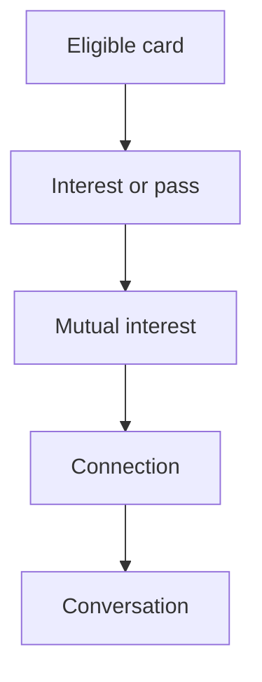

# M07 — Likes, connections and entitlements

[Handover index](README.md) · [Shared client conventions](COMMON.md) · [OpenAPI](../openapi.yaml)

## Status

Not implemented. Design/reference only; no supported request/response or error contract.

0 implemented operations. This document describes the checked-in backend, not a deployed environment.

## Screen flow

Proposed flow only; no working API is implied.



## Wireframe

```text
+-----------------------+
| Connections - planned |
| Sent / Received       |
| [ Pending interest ]  |
| [ Matched dog ]       |
| [ Open conversation ] |
+-----------------------+
```

## Client behavior and integration limits

- Requires impression-bound decisions, idempotency, quotas and atomic mutual matching. Do not implement client-side match creation or assume a paid entitlement.

## Request, response and error status

No supported contract yet. Do not call the planned paths or use fallback/mock success in production. Schemas, status codes, error codes, authentication and retry behavior will be added with implementation. Generic route/auth failures are not a feature contract.

## Planned scope

| Method + path | Access | Purpose |
| --- | --- | --- |
| POST `/decisions` | U | `{actorDogId,targetDogId,mode,verdict,impressionToken}`; interest/pass; quota and eligibility |
| GET `/likes/sent`; GET `/likes/received` | U | Actor-dog-scoped pending interests, cursor pagination and visibility checks |
| DELETE `/likes/{id}` | U | Withdraw own pending interest; no hidden resurrection of unmatched pairs |
| GET `/matches`; GET `/matches/{id}` | U | Mutual connections and their state/conversation |
| DELETE `/matches/{id}` | Participant | Immediate unmatch; close message permission |
| GET `/me/entitlements` | U | Server-computed capabilities, remaining quotas, reset time |

Plan default inherited from Waggle: unverified users may browse but cannot like/message; verified free users receive 12 interests per local day. Treat this as configurable product policy needing funnel validation. Incoming-like visibility must not promise a paid feature before billing exists. Canonical pair uniqueness plus row/advisory locks and transactions ensure reciprocal concurrent likes produce one match and one conversation; do not solve this solely with cache locks. A block overrides subscription or match state.

---

Maintained through `scripts/handover-notes.mjs`, `docs/API_PLAN.md`, OpenAPI and source error codes. Regenerate with `npm run docs:handovers`; verify with `npm run check:handovers`.
