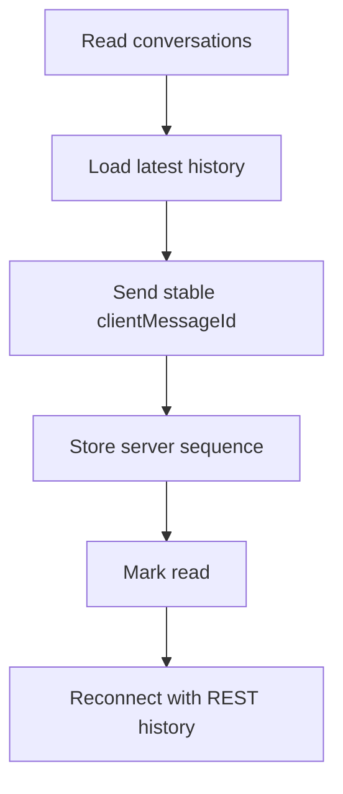

# M08 — Messages and realtime

[Handover index](README.md) · [Shared client conventions](COMMON.md) · [OpenAPI](../openapi.yaml)

## Status

Text messaging and development WebSocket transport implemented. Attachments, typing/presence and production key management remain unavailable.

6 implemented operations. This document describes the checked-in backend, not a deployed environment.

## Screen flow

Current integration flow; readiness gates may stop progression.



## Wireframe

```text
+-------------------------------------------+
| Messages                                  |
| [ Conversation / unread count ]           |
| [ Earlier messages ]                      |
| [ Pending / acknowledged bubble ]         |
| [ Text up to 4000 characters ] [ Send ]   |
| Mute / Archive / Report via safety module |
+-------------------------------------------+
```

## Client behavior and integration limits

- MESSAGE_KEY is a separate 32-byte lowercase hexadecimal local wrapping key. It is forbidden in production. Each conversation has a random AES-256-GCM data key wrapped under this key; bodies are encrypted with conversation/message authenticated context. This is server encryption, not end-to-end encryption. Losing the key loses history; production KMS integration/rotation remains required.
- POST messages supports text only and returns 200 for first send or exact retry. Deduplication is per sender/conversation/clientMessageId. Reuse with changed text returns 409 message-id-conflict. Persist before marking sent. Maximum 4000 trimmed characters and 30 new messages/minute/user; retries do not consume another sequence.
- All sequence values are decimal strings to preserve bigint precision. Default history is descending latest-first; beforeSeq is exclusive. afterSeq (including 0) is ascending catch-up. Use one direction, page up to 50, and continue from the last returned seq while hasMore. Deduplicate by message id.
- Conversation lists are UUID-keyset pages with unreadCount, lastSeq and lastMessageAt; body previews are deliberately omitted. Read markers move forward only, cannot exceed lastSeq and currently remain private to the reader. Archive is local and clears when a new message arrives. Mute expires at mutedUntil; null unmutes.
- Reads/sends require original conversation membership, current owner/co-guardian membership, active dogs, live unblocked relationship and open conversation. Removed members/blocked or unmatched pairs get 404. A block closes existing sockets on the next subscription poll and immediately prevents subsequent REST/socket message operations.
- POST /realtime/tickets returns a single-use 30-second ticket (10/minute/user). Connect WS /v1/realtime and send {type:"authenticate",ticket} as the first frame within 5 seconds. No token belongs in the URL. Socket lifetime is 15 minutes. Session validity is rechecked for every frame and every 2-second poll. Maximum 200 sockets/process, 20 KiB frames and bounded send buffering.
- Socket frames: subscribe {conversationId,afterSeq:"0"}, send {conversationId,message:{clientMessageId,kind:"text",body}}, read {conversationId,upToSeq}. Include type equal to the action. One subscription/socket. Responses: ready, subscribed, message.created {conversationId,message}, message.ack {conversationId,message}, read.updated {conversationId,lastReadSeq}, sync.required {conversationId,afterSeq}, error {code,status?}. socket-busy means retry serially with the same clientMessageId.
- Development delivery polls persisted history every two seconds, so it works across API instances without in-memory delivery assumptions. Catch-up may repeat messages; REST is authoritative. It does not implement typing, presence, match.created broadcasts or shared read receipts. Closed connections do not retain history access; safety evidence reporting is a separate workflow.
- Implementation references the official ws server/authentication guidance at https://github.com/websockets/ws. Expired socket tickets currently require operational retention cleanup; no scheduler is configured.

## Endpoint summary

| Method | Path | Access | Success |
| --- | --- | --- | --- |
| GET | `/v1/conversations` | Signed-in caller | 200 |
| GET | `/v1/conversations/{id}/messages` | Signed-in caller | 200 |
| POST | `/v1/conversations/{id}/messages` | Signed-in caller | 200 |
| POST | `/v1/conversations/{id}/read` | Signed-in caller | 200 |
| PATCH | `/v1/conversations/{id}/preferences` | Signed-in caller | 200 |
| POST | `/v1/realtime/tickets` | Signed-in caller | 201 |

## Examples

Illustrative data only. Replace IDs with returned resource IDs and token/checksum placeholders with real local values. Examples are not seeded records, legal text or evidence. For examples without a response block, use the exact response shape in the endpoint section below.

### Send text

```http
POST /v1/conversations/66666666-6666-4666-8666-666666666666/messages
Authorization: Bearer <accessToken>
Content-Type: application/json

{
  "clientMessageId": "77777777-7777-4777-8777-777777777777",
  "kind": "text",
  "body": "Would a park walk suit you?"
}
```

### Recover missed history

```http
GET /v1/conversations/66666666-6666-4666-8666-666666666666/messages?afterSeq=12&limit=30
Authorization: Bearer <accessToken>
```

## Module errors

Also handle the [shared error contract](COMMON.md#errors). These are module-level codes; applicability depends on the endpoint and current state. HTTP status alone is insufficient.

| HTTP | Code | Meaning | Client action |
| --- | --- | --- | --- |
| 400 | `invalid-mute` | Mute cannot exceed one year. | Show a contextual error using code; correct input/state or respect the documented limit before retrying. |
| 400 | `invalid-read-sequence` | Read sequence exceeds conversation history. | Show a contextual error using code; correct input/state or respect the documented limit before retrying. |
| 401 | `invalid-ticket` | Socket ticket is unavailable. | Show a contextual error using code; correct input/state or respect the documented limit before retrying. |
| 404 | `not-found` | Conversation is unavailable. | Refresh the list/access state; avoid exposing whether another user owns the resource. |
| 409 | `message-id-conflict` | Client message ID already has different content. | Show a contextual error using code; correct input/state or respect the documented limit before retrying. |
| 429 | `message-limit` | Wait before sending more messages. | Show a contextual error using code; correct input/state or respect the documented limit before retrying. |
| 429 | `ticket-limit` | Wait before requesting another socket ticket. | Show a contextual error using code; correct input/state or respect the documented limit before retrying. |
| 503 | `messaging-unavailable` | Message encryption is not configured. | Show a contextual error using code; correct input/state or respect the documented limit before retrying. |

## Detailed request and response contracts

Shapes below are **type notation**, not JSON to send: `?` means optional, `|` means alternatives, and comments show constraints/defaults. Requests reject unknown write fields. JSON uses actual values. Runtime cross-field/business rules are in the client guidance above. The linked OpenAPI is the machine-readable source.

### GET /v1/conversations

Operation: `listConversations`. Access: Signed-in caller.

Parameters:

- `limit` (query, optional): ` integer /* minimum=1, maximum=50, default=20 */ `
- `cursor` (query, optional): ` string `

Request body: none.

Response HTTP 200:

```text
{
  items: Array<{
    id: string /* format="uuid" */
    matchId: string /* format="uuid" */
    lastSeq: string /* pattern="^[0-9]+$" */
    lastMessageAt: string /* format="date-time" */ | null
    lastReadSeq: string /* pattern="^[0-9]+$" */
    archived: boolean
    mutedUntil: string /* format="date-time" */ | null
    unreadCount: integer /* minimum=0 */
  }>
  nextCursor: string | null
}
```

### GET /v1/conversations/{id}/messages

Operation: `messageHistory`. Access: Signed-in caller.

Parameters:

- `id` (path, required): ` string /* format="uuid" */ `
- `beforeSeq` (query, optional): ` string /* pattern="^[0-9]+$" */ `
- `afterSeq` (query, optional): ` string /* pattern="^[0-9]+$" */ `
- `limit` (query, optional): ` integer /* minimum=1, maximum=50, default=30 */ `

Request body: none.

Response HTTP 200:

```text
{
  messages: Array<{
    id: string /* format="uuid" */
    clientMessageId: string /* format="uuid" */
    seq: string /* pattern="^[0-9]+$" */
    senderUserId: string /* format="uuid" */
    kind: "text"
    body: string | null
    createdAt: string /* format="date-time" */
  }>
  hasMore: boolean
  lastSeq: string /* pattern="^[0-9]+$" */
}
```

### POST /v1/conversations/{id}/messages

Operation: `sendMessage`. Access: Signed-in caller.

Parameters:

- `id` (path, required): ` string /* format="uuid" */ `

Request body (application/json, required):

```text
{
  clientMessageId: string /* format="uuid" */
  kind: "text"
  body: string /* minLength=1, maxLength=4000 */
}
```

Response HTTP 200:

```text
{
  id: string /* format="uuid" */
  clientMessageId: string /* format="uuid" */
  seq: string /* pattern="^[0-9]+$" */
  senderUserId: string /* format="uuid" */
  kind: "text"
  body: string | null
  createdAt: string /* format="date-time" */
}
```

### POST /v1/conversations/{id}/read

Operation: `markConversationRead`. Access: Signed-in caller.

Parameters:

- `id` (path, required): ` string /* format="uuid" */ `

Request body (application/json, required):

```text
{
  upToSeq: string /* pattern="^[0-9]+$" */
}
```

Response HTTP 200:

```text
{
  lastReadSeq: string /* pattern="^[0-9]+$" */
}
```

### PATCH /v1/conversations/{id}/preferences

Operation: `conversationPreferences`. Access: Signed-in caller.

Parameters:

- `id` (path, required): ` string /* format="uuid" */ `

Request body (application/json, required):

```text
{
  archived?: boolean
  mutedUntil?: string /* format="date-time" */ | null
} /* minProperties=1 */
```

Response HTTP 200:

```text
{
  archived: boolean
  mutedUntil: string /* format="date-time" */ | null
}
```

### POST /v1/realtime/tickets

Operation: `realtimeTicket`. Access: Signed-in caller.

Request body: none.

Response HTTP 201:

```text
{
  ticket: string
  expiresAt: string /* format="date-time" */
  path: "/v1/realtime"
  authentication: "first_frame"
}
```

---

Maintained through `scripts/handover-notes.mjs`, `docs/API_PLAN.md`, OpenAPI and source error codes. Regenerate with `npm run docs:handovers`; verify with `npm run check:handovers`.
