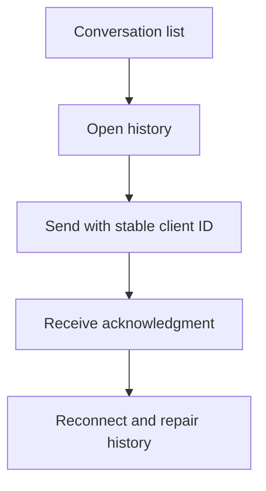

# M08 — Messages and realtime

[Handover index](README.md) · [Shared client conventions](COMMON.md) · [OpenAPI](../openapi.yaml)

## Status

Not implemented. Design/reference only; no supported request/response or error contract.

0 implemented operations. This document describes the checked-in backend, not a deployed environment.

## Screen flow

Proposed flow only; no working API is implied.



## Wireframe

```text
+--------------------------------+
| Messages - planned             |
| Ruby and Milo                  |
| [ Message bubble ]             |
| [ Pending / sent / read ]      |
| [ Type message      ] [ Send ] |
+--------------------------------+
```

## Client behavior and integration limits

- Requires participant authorization, server sequencing, deduplication and REST reconnect recovery. No websocket URL, event contract or encryption promise is available yet.

## Request, response and error status

No supported contract yet. Do not call the planned paths or use fallback/mock success in production. Schemas, status codes, error codes, authentication and retry behavior will be added with implementation. Generic route/auth failures are not a feature contract.

## Planned scope

| Method + path | Access | Purpose |
| --- | --- | --- |
| GET `/conversations` | Participant | Latest message preview, unread count, cursor |
| GET `/conversations/{id}/messages?beforeSeq=&afterSeq=&limit=` | Participant | Bounded history or reconnect recovery |
| POST `/conversations/{id}/messages` | Participant | `{clientMessageId,kind,body?,mediaId?}` with stable retry identity |
| POST `/conversations/{id}/read` | Participant | Monotonic `upToSeq`, bounded by existing messages |
| PATCH `/conversations/{id}/preferences` | Participant | Mute, archive, local visibility; does not delete other's history |
| POST `/conversations/{id}/report` | Participant | Report with authorized message references |
| POST `/realtime/tickets` | U | Short-lived single-use socket ticket; no reusable JWT in a logged URL |
| WS `/realtime` | Ticket | `message.created`, `message.ack`, `read.updated`, `typing`, `match.created`, `sync.required` |

Text first. Server assigns per-conversation sequence within the message transaction. Unique `(sender, conversation, clientMessageId)` deduplicates HTTP and socket retries. Check live membership and block state on every send/read/subscription. Persist before acknowledge; notifications/outbox after commit. Presence is coarse/opt-in, typing ephemeral and limited. Socket reconnect always has REST fallback. Attachments follow media moderation. Do not claim end-to-end encryption unless implemented and reviewed.

---

Maintained through `scripts/handover-notes.mjs`, `docs/API_PLAN.md`, OpenAPI and source error codes. Regenerate with `npm run docs:handovers`; verify with `npm run check:handovers`.
