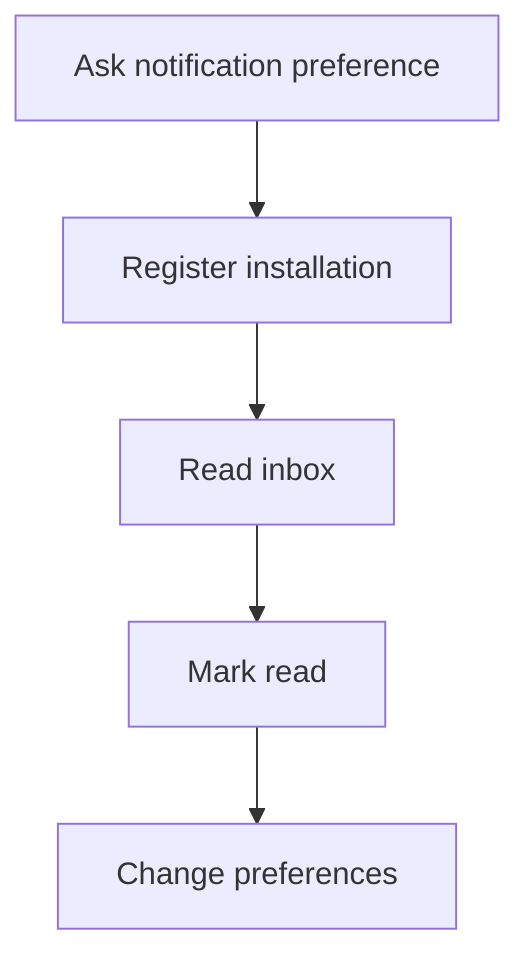

# M09 — Notifications and devices

[Handover index](README.md) · [Shared client conventions](COMMON.md) · [OpenAPI](../openapi.yaml)

## Status

Not implemented. Design/reference only; no supported request/response or error contract.

0 implemented operations. This document describes the checked-in backend, not a deployed environment.

## Screen flow

Proposed flow only; no working API is implied.



## Wireframe

```text
+-------------------------+
| Notifications - planned |
| [ Unread item ]         |
| [ Earlier item ]        |
| Push: [ on/off ]        |
| Quiet hours [      ]    |
+-------------------------+
```

## Client behavior and integration limits

- Push is optional; the future durable inbox is authoritative. No device-registration or push-provider contract exists yet.

## Request, response and error status

No supported contract yet. Do not call the planned paths or use fallback/mock success in production. Schemas, status codes, error codes, authentication and retry behavior will be added with implementation. Generic route/auth failures are not a feature contract.

## Planned scope

| Method + path | Access | Purpose |
| --- | --- | --- |
| PUT `/me/devices/{installationId}`; DELETE same | U | Provider registration, platform/locale/app build, revoke on logout |
| GET `/notifications`; POST `/notifications/read` | U | Durable inbox and bounded list of IDs to mark read |
| GET/PUT `/me/notification-preferences` | U | Categories/channels, previews, timezone and quiet hours |

Outbox drives match, message, meetup, moderation and verification updates. Retries have backoff, event deduplication and a dead-letter queue. Remove invalid registrations; transfer device ownership safely on account switch. Notification payloads avoid full messages, exact location and sensitive health/identity information. Delivery is best effort; durable inbox is authoritative.

---

Maintained through `scripts/handover-notes.mjs`, `docs/API_PLAN.md`, OpenAPI and source error codes. Regenerate with `npm run docs:handovers`; verify with `npm run check:handovers`.
