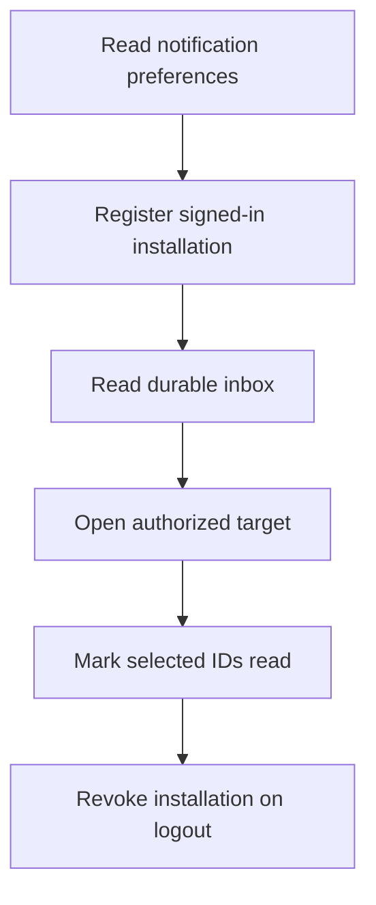

# M09 — Notifications and devices

[Handover index](README.md) · [Shared client conventions](COMMON.md) · [OpenAPI](../openapi.yaml)

## Status

Durable inbox, preferences, encrypted installations, provider-neutral relay and FCM HTTP v1 adapter implemented. No Firebase credentials or scheduler are configured; pushAvailable remains false.

6 implemented operations. This document describes the checked-in backend, not a deployed environment.

## Screen flow

Current integration flow; readiness gates may stop progression.



## Wireframe

```text
+-------------------------------+
| Notifications                 |
| [ New connection ]            |
| [ New message ]               |
| [ Mark read ]                 |
| Push preference [ off/on ]    |
| Quiet hours [ 22:00 - 07:00 ] |
| Push delivery: not configured |
+-------------------------------+
```

## Client behavior and integration limits

- Connection and message writes create inbox records and awaiting_provider delivery intents in the same PostgreSQL transaction. Event IDs deduplicate per recipient. Message notifications omit bodies, dog names, media, phone and location; inbox items contain category and resource IDs only.
- GET /notifications rechecks current connection membership and blocks. Unavailable targets disappear. Pages use UUID cursors; follow nextCursor even for empty filtered pages. POST /notifications/read accepts 1–100 unique IDs, marks only your rows and returns 204 without revealing other users’ IDs.
- PUT /me/devices/{id} must use deviceId supplied at the current OTP sign-in. Tokens are encrypted using the configured local key wrapper and never returned. Max ten live installations per user. Registering an existing installation/token transfers ownership to the current authenticated installation. Android requires fcm, iOS fcm/apns, web webpush.
- Session-family logout/revocation removes its registrations; logout-all removes all. Refresh rotation retains the family registration. Device DELETE is scoped to caller and idempotent. Private token storage requires MESSAGE_KEY in development; otherwise 503 device-storage-unavailable.
- PUT preferences replaces the full preference object. Quiet start/end are local minutes since midnight, both integers or both null; timezone must be an IANA name. These are saved delivery preferences; the durable inbox is still retained regardless of push settings.
- pushAvailable is always false. Registered does not mean delivered. FCM HTTP v1 adapter code is available, but no Firebase project/ADC credentials or scheduler is configured. APNs and Web Push adapters remain absent. Registration and inbox are not proof of remote delivery. Jobs stay awaiting_provider until an operator runs the configured worker.
- Backend relay deliverPushBatch uses a two-minute per-job lease and concurrent-worker SKIP LOCKED claims, at most ten jobs/call. Each provider send has a five-second deadline and abort signal. Transient failures back off from 30 seconds exponentially; five attempts or a permanent provider failure enter dead_letter. Only redacted error codes are retained.
- Before delivery and before each installation send, the relay rechecks live account/session/registration ownership, connection membership, blocks, notification read state and preferences. Messages honor conversation mute. Quiet hours use the stored IANA timezone, including overnight intervals, and defer in 15-minute increments without consuming retries. Equal start/end disables the quiet interval.
- Provider payloads contain only notificationId, category and a generic title. Delivery IDs are stable per notification/installation; successful sends persist receipts so other-device retries do not resend them. A lost provider acknowledgment can still duplicate delivery: clients deduplicate by notificationId. delivered means provider accepted, not that a person saw it.
- Invalid-token feedback deletes only the exact token hash sent; a token rotated in flight survives. A block occurring after dispatch may still permit a generic in-flight notification to arrive; opening the target always performs normal authorization. Unsupported provider kinds stay deferred. No device or disabled preference suppresses delivery while keeping the durable inbox.
- Staff operations can list /admin/v1/notifications/jobs and retry a dead-letter job. Successful installation receipts are retained on retry. Adapter integration must map provider responses into delivered/invalid_token/transient_failure/permanent_failure, honor AbortSignal, and never log registration tokens.
- The FCM adapter supports provider=fcm only. A manually invoked npm run push:deliver pass needs FCM_PROJECT_ID, Google Application Default Credentials and MESSAGE_KEY for local encrypted tokens. It sends a generic title and notificationId/category/deliveryId only. FCM UNREGISTERED removes the exact sent registration; INVALID_ARGUMENT does not, because it can describe a payload error. Quota Retry-After is persisted with at least a 60-second delay. No server process or scheduler starts this pass automatically, and production key management is still missing.

## Endpoint summary

| Method | Path | Access | Success |
| --- | --- | --- | --- |
| GET | `/v1/me/notification-preferences` | Signed-in caller | 200 |
| PUT | `/v1/me/notification-preferences` | Signed-in caller | 200 |
| PUT | `/v1/me/devices/{id}` | Signed-in caller | 200 |
| DELETE | `/v1/me/devices/{id}` | Signed-in caller | 204 |
| GET | `/v1/notifications` | Signed-in caller | 200 |
| POST | `/v1/notifications/read` | Signed-in caller | 204 |

## Examples

Illustrative data only. Replace IDs with returned resource IDs and token/checksum placeholders with real local values. Examples are not seeded records, legal text or evidence. For examples without a response block, use the exact response shape in the endpoint section below.

### Read inbox

```http
GET /v1/notifications?limit=20
Authorization: Bearer <accessToken>
```

Response: HTTP 200

```json
{
  "items": [],
  "nextCursor": null
}
```

### Mark inbox item read

```http
POST /v1/notifications/read
Authorization: Bearer <accessToken>
Content-Type: application/json

{
  "ids": [
    "77777777-7777-4777-8777-777777777777"
  ]
}
```

## Module errors

Also handle the [shared error contract](COMMON.md#errors). These are module-level codes; applicability depends on the endpoint and current state. HTTP status alone is insufficient.

| HTTP | Code | Meaning | Client action |
| --- | --- | --- | --- |
| 403 | `installation-mismatch` | Use the installation ID from this sign-in. | Show a contextual error using code; correct input/state or respect the documented limit before retrying. |
| 409 | `device-limit` | Remove a device before adding another. | Show a contextual error using code; correct input/state or respect the documented limit before retrying. |
| 503 | `device-storage-unavailable` | Private device token storage is not configured. | Show a contextual error using code; correct input/state or respect the documented limit before retrying. |

## Detailed request and response contracts

Shapes below are **type notation**, not JSON to send: `?` means optional, `|` means alternatives, and comments show constraints/defaults. Requests reject unknown write fields. JSON uses actual values. Runtime cross-field/business rules are in the client guidance above. The linked OpenAPI is the machine-readable source.

### GET /v1/me/notification-preferences

Operation: `notificationPreferences`. Access: Signed-in caller.

Parameters:

- `X-App-Platform` (header, optional): ` "android" | "ios" `
- `X-App-Build` (header, optional): ` string /* pattern="^[1-9][0-9]{0,9}$" */ `

Request body: none.

Response HTTP 200:

```text
{
  messages: boolean
  connections: boolean
  meetups: boolean
  pushEnabled: boolean
  timezone: string
  quietStart: integer /* minimum=0, maximum=1439 */ | null
  quietEnd: integer /* minimum=0, maximum=1439 */ | null
  pushAvailable: false
}
```

### PUT /v1/me/notification-preferences

Operation: `saveNotificationPreferences`. Access: Signed-in caller.

Parameters:

- `X-App-Platform` (header, optional): ` "android" | "ios" `
- `X-App-Build` (header, optional): ` string /* pattern="^[1-9][0-9]{0,9}$" */ `

Request body (application/json, required):

```text
{
  messages: boolean
  connections: boolean
  meetups: boolean
  pushEnabled: boolean
  timezone: string
  quietStart: integer /* minimum=0, maximum=1439 */ | null
  quietEnd: integer /* minimum=0, maximum=1439 */ | null
}
```

Response HTTP 200:

```text
{
  messages: boolean
  connections: boolean
  meetups: boolean
  pushEnabled: boolean
  timezone: string
  quietStart: integer /* minimum=0, maximum=1439 */ | null
  quietEnd: integer /* minimum=0, maximum=1439 */ | null
  pushAvailable: false
}
```

### PUT /v1/me/devices/{id}

Operation: `registerDevice`. Access: Signed-in caller.

Parameters:

- `id` (path, required): ` string /* format="uuid" */ `
- `X-App-Platform` (header, optional): ` "android" | "ios" `
- `X-App-Build` (header, optional): ` string /* pattern="^[1-9][0-9]{0,9}$" */ `

Request body (application/json, required):

```text
{
  platform: "android" | "ios" | "web"
  provider: "fcm" | "apns" | "webpush"
  token: string /* minLength=16, maxLength=4096 */
  locale: "en-IN" | "hi-IN"
  appBuild: integer /* minimum=1, maximum=2147483647 */
}
```

Response HTTP 200:

```text
{
  installationId: string /* format="uuid" */
  registered: true
  pushAvailable: false
}
```

### DELETE /v1/me/devices/{id}

Operation: `removeDevice`. Access: Signed-in caller.

Parameters:

- `id` (path, required): ` string /* format="uuid" */ `
- `X-App-Platform` (header, optional): ` "android" | "ios" `
- `X-App-Build` (header, optional): ` string /* pattern="^[1-9][0-9]{0,9}$" */ `

Request body: none.

Response HTTP 204:

No response body.

### GET /v1/notifications

Operation: `notificationInbox`. Access: Signed-in caller.

Parameters:

- `limit` (query, optional): ` integer /* minimum=1, maximum=50, default=20 */ `
- `cursor` (query, optional): ` string `
- `X-App-Platform` (header, optional): ` "android" | "ios" `
- `X-App-Build` (header, optional): ` string /* pattern="^[1-9][0-9]{0,9}$" */ `

Request body: none.

Response HTTP 200:

```text
{
  items: Array<{
    id: string /* format="uuid" */
    category: "messages" | "connections" | "meetups"
    conversationId: string /* format="uuid" */
    matchId: string /* format="uuid" */
    createdAt: string /* format="date-time" */
    readAt: string /* format="date-time" */ | null
  }>
  nextCursor: string | null
}
```

### POST /v1/notifications/read

Operation: `readNotifications`. Access: Signed-in caller.

Parameters:

- `X-App-Platform` (header, optional): ` "android" | "ios" `
- `X-App-Build` (header, optional): ` string /* pattern="^[1-9][0-9]{0,9}$" */ `

Request body (application/json, required):

```text
{
  ids: Array<string /* format="uuid" */> /* minItems=1, maxItems=100, uniqueItems=true */
}
```

Response HTTP 204:

No response body.

---

Maintained through `scripts/handover-notes.mjs`, `docs/API_PLAN.md`, OpenAPI and source error codes. Regenerate with `npm run docs:handovers`; verify with `npm run check:handovers`.
