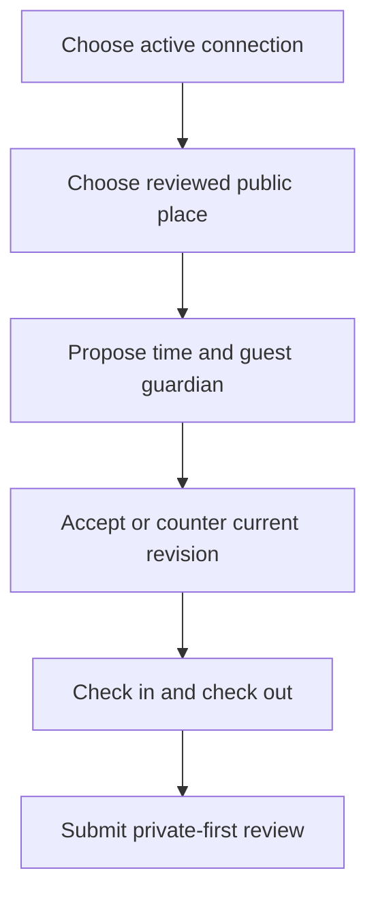

# M10 — Meetups and places

[Handover index](README.md) · [Shared client conventions](COMMON.md) · [OpenAPI](../openapi.yaml)

## Status

Two-guardian public-place meetups, attendance and delayed reviews implemented. Extensions, groups, video and operational safety response remain unavailable.

12 implemented operations. This document describes the checked-in backend, not a deployed environment.

## Screen flow

Current integration flow; readiness gates may stop progression.



## Wireframe

```text
+--------------------------------------------+
| Meetup                                     |
| Public place [ reviewed park ]             |
| Start / end [ local display ]              |
| [ Propose ]                                |
| Revision 2: [ Accept | Counter | Decline ] |
| [ Check in ] [ Check out ]                 |
| [ Review ] Private incident note           |
+--------------------------------------------+
```

## Client behavior and integration limits

- GET /places requires metroId and exposes reviewed approved public locations only. No reviewed locations are seeded. POST suggestions creates pending records (three/day/user), never approval. Exact coordinates are public-place coordinates, not guardian GPS; do not submit home locations.
- POST /meetups uses UUID Idempotency-Key, matchId, hostDogId, guestUserId, reviewed placeId, kind and ISO timestamps with offsets. Host/guest must be different current editors of the two connected dogs and original conversation members. Place must be in both households’ city. Two guardians only; no arbitrary participant list.
- Windows last 15 minutes to four hours and start 15 minutes to 30 days ahead. Store UTC, render locally. Maximum three active meetups per connection. Exact retries return the current meetup without another proposal; changed input/key returns idempotency-conflict.
- Every response/cancel/check-in/check-out supplies current revision. 409 revision-conflict: GET detail and ask the user to review current terms. The proposer cannot accept their own proposal. Counter keeps state proposed, changes proposer and terms, and requires the other guardian to accept the new revision.
- Pending proposals expire at their start on the next access and become cancelled with proposal_expired. No background expiry/reminder scheduler exists. Accept rechecks participants and the reviewed place. Terminal declined/cancelled/completed states cannot be reopened.
- Check-in is allowed from 30 minutes before start through end. It records a self-declared timestamp, not GPS presence. Check-out requires prior check-in. Both checkouts complete the meetup. Repeat attendance actions are idempotent. Extension/group/video endpoints are not available.
- Block/unmatch triggers cancel active meetups atomically with connection closure, reason connection_ended. The closed relationship hides meetup/history access. Account safety reporting must remain available separately; this is not an emergency service or staffed live monitoring.
- Reviews are accepted only after an accepted meeting window ends; one immutable review per guardian about the other dog. Until both submit or seven days after window end, each guardian sees only their own review. Responses never include incident flags/types or private notes. Private notes require configured encryption and remain awaiting_review; no response-time promise or reviewer queue is delivered here.
- Lists paginate by UUID and can be empty with nextCursor after live privacy filtering. Meetup notifications are generic conversation references; refetch meetups for details. Expired/abandoned accepted meetings and operations review require later cleanup workflow.

## Endpoint summary

| Method | Path | Access | Success |
| --- | --- | --- | --- |
| GET | `/v1/places` | Signed-in caller | 200 |
| GET | `/v1/places/{id}` | Signed-in caller | 200 |
| POST | `/v1/places/suggestions` | Signed-in caller | 201 |
| POST | `/v1/meetups` | Signed-in caller | 201 |
| GET | `/v1/meetups` | Signed-in caller | 200 |
| GET | `/v1/meetups/{id}` | Signed-in caller | 200 |
| POST | `/v1/meetups/{id}/respond` | Signed-in caller | 200 |
| POST | `/v1/meetups/{id}/cancel` | Signed-in caller | 200 |
| POST | `/v1/meetups/{id}/check-in` | Signed-in caller | 200 |
| POST | `/v1/meetups/{id}/check-out` | Signed-in caller | 200 |
| POST | `/v1/meetups/{id}/reviews` | Signed-in caller | 201 |
| GET | `/v1/meetups/{id}/reviews` | Signed-in caller | 200 |

## Examples

Illustrative data only. Replace IDs with returned resource IDs and token/checksum placeholders with real local values. Examples are not seeded records, legal text or evidence. For examples without a response block, use the exact response shape in the endpoint section below.

### Read reviewed places

```http
GET /v1/places?metroId=01920000-0000-7000-8000-0000000e0001
Authorization: Bearer <accessToken>
```

### Accept current terms

```http
POST /v1/meetups/77777777-7777-4777-8777-777777777777/respond
Authorization: Bearer <accessToken>
Content-Type: application/json

{
  "action": "accept",
  "revision": 1
}
```

### Check in

```http
POST /v1/meetups/77777777-7777-4777-8777-777777777777/check-in
Authorization: Bearer <accessToken>
Content-Type: application/json

{
  "revision": 2
}
```

## Module errors

Also handle the [shared error contract](COMMON.md#errors). These are module-level codes; applicability depends on the endpoint and current state. HTTP status alone is insufficient.

| HTTP | Code | Meaning | Client action |
| --- | --- | --- | --- |
| 400 | `invalid-meetup-window` | Choose 15 minutes to four hours, starting between 15 minutes and 30 days from now. | Show a contextual error using code; correct input/state or respect the documented limit before retrying. |
| 400 | `invalid-participants` | Choose the two connected dogs and different guardians. | Show a contextual error using code; correct input/state or respect the documented limit before retrying. |
| 404 | `not-found` | Meetup is unavailable. | Refresh the list/access state; avoid exposing whether another user owns the resource. |
| 409 | `check-in-required` | Check in before checking out. | Show a contextual error using code; correct input/state or respect the documented limit before retrying. |
| 409 | `check-in-window` | Check in from 30 minutes before the start until the end. | Show a contextual error using code; correct input/state or respect the documented limit before retrying. |
| 409 | `invalid-meetup-state` | Accept the meetup before checking in. | Show a contextual error using code; correct input/state or respect the documented limit before retrying. |
| 409 | `meetup-limit` | At most three active meetups per connection. | Show a contextual error using code; correct input/state or respect the documented limit before retrying. |
| 409 | `review-exists` | One review per participant is allowed. | Show a contextual error using code; correct input/state or respect the documented limit before retrying. |
| 409 | `review-unavailable` | Review after the accepted meetup window ends. | Show a contextual error using code; correct input/state or respect the documented limit before retrying. |
| 409 | `revision-conflict` | Refresh the meetup before changing it. | Show a contextual error using code; correct input/state or respect the documented limit before retrying. |
| 429 | `place-suggestion-limit` | Three suggestions per day are allowed. | Show a contextual error using code; correct input/state or respect the documented limit before retrying. |
| 503 | `private-note-unavailable` | Private note encryption is not configured. | Show a contextual error using code; correct input/state or respect the documented limit before retrying. |

## Detailed request and response contracts

Shapes below are **type notation**, not JSON to send: `?` means optional, `|` means alternatives, and comments show constraints/defaults. Requests reject unknown write fields. JSON uses actual values. Runtime cross-field/business rules are in the client guidance above. The linked OpenAPI is the machine-readable source.

### GET /v1/places

Operation: `listPlaces`. Access: Signed-in caller.

Parameters:

- `limit` (query, optional): ` integer /* minimum=1, maximum=50, default=20 */ `
- `cursor` (query, optional): ` string `
- `metroId` (query, required): ` string /* format="uuid" */ `

Request body: none.

Response HTTP 200:

```text
{
  items: Array<{
    id: string /* format="uuid" */
    name: string
    kind: "offleash_park" | "trail" | "fenced_area" | "venue" | "vet" | "other"
    latitude: number
    longitude: number
    address: string | null
    metroId: string /* format="uuid" */
    isFenced: boolean | null
    hasWater: boolean | null
  }>
  nextCursor: string | null
}
```

### GET /v1/places/{id}

Operation: `getPlace`. Access: Signed-in caller.

Parameters:

- `id` (path, required): ` string /* format="uuid" */ `

Request body: none.

Response HTTP 200:

```text
{
  id: string /* format="uuid" */
  name: string
  kind: "offleash_park" | "trail" | "fenced_area" | "venue" | "vet" | "other"
  latitude: number
  longitude: number
  address: string | null
  metroId: string /* format="uuid" */
  isFenced: boolean | null
  hasWater: boolean | null
}
```

### POST /v1/places/suggestions

Operation: `suggestPlace`. Access: Signed-in caller.

Request body (application/json, required):

```text
{
  name: string /* minLength=2, maxLength=120 */
  kind: "offleash_park" | "trail" | "fenced_area" | "venue" | "vet" | "other"
  latitude: number /* minimum=-90, maximum=90 */
  longitude: number /* minimum=-180, maximum=180 */
  address: string /* minLength=3, maxLength=300 */
  metroId: string /* format="uuid" */
  isFenced: boolean
  hasWater: boolean
}
```

Response HTTP 201:

```text
{
  id: string /* format="uuid" */
  state: "pending"
}
```

### POST /v1/meetups

Operation: `proposeMeetup`. Access: Signed-in caller.

Parameters:

- `Idempotency-Key` (header, required): ` string /* format="uuid" */ `

Request body (application/json, required):

```text
{
  matchId: string /* format="uuid" */
  hostDogId: string /* format="uuid" */
  guestUserId: string /* format="uuid" */
  kind: "parallel_walk" | "play" | "training" | "hike"
  placeId: string /* format="uuid" */
  windowStart: string /* format="date-time" */
  windowEnd: string /* format="date-time" */
}
```

Response HTTP 201:

```text
{
  id: string /* format="uuid" */
  matchId: string /* format="uuid" */
  placeId: string /* format="uuid" */
  kind: "parallel_walk" | "play" | "training" | "hike"
  windowStart: string /* format="date-time" */
  windowEnd: string /* format="date-time" */
  state: "proposed" | "accepted" | "declined" | "cancelled" | "in_progress" | "completed" | "no_show" | "incident"
  revision: integer /* minimum=1 */
  proposedBy: string /* format="uuid" */
  cancellationReason: string | null
}
```

### GET /v1/meetups

Operation: `listMeetups`. Access: Signed-in caller.

Parameters:

- `limit` (query, optional): ` integer /* minimum=1, maximum=50, default=20 */ `
- `cursor` (query, optional): ` string `

Request body: none.

Response HTTP 200:

```text
{
  items: Array<{
    id: string /* format="uuid" */
    matchId: string /* format="uuid" */
    placeId: string /* format="uuid" */
    kind: "parallel_walk" | "play" | "training" | "hike"
    windowStart: string /* format="date-time" */
    windowEnd: string /* format="date-time" */
    state: "proposed" | "accepted" | "declined" | "cancelled" | "in_progress" | "completed" | "no_show" | "incident"
    revision: integer /* minimum=1 */
    proposedBy: string /* format="uuid" */
    cancellationReason: string | null
  }>
  nextCursor: string | null
}
```

### GET /v1/meetups/{id}

Operation: `getMeetup`. Access: Signed-in caller.

Parameters:

- `id` (path, required): ` string /* format="uuid" */ `

Request body: none.

Response HTTP 200:

```text
{
  id: string /* format="uuid" */
  matchId: string /* format="uuid" */
  placeId: string /* format="uuid" */
  kind: "parallel_walk" | "play" | "training" | "hike"
  windowStart: string /* format="date-time" */
  windowEnd: string /* format="date-time" */
  state: "proposed" | "accepted" | "declined" | "cancelled" | "in_progress" | "completed" | "no_show" | "incident"
  revision: integer /* minimum=1 */
  proposedBy: string /* format="uuid" */
  cancellationReason: string | null
  participants: Array<{
    dogId: string /* format="uuid" */
    userId: string /* format="uuid" */
    rsvp: "pending" | "yes" | "no" | "maybe"
    checkedInAt: string /* format="date-time" */ | null
    checkedOutAt: string /* format="date-time" */ | null
  }>
}
```

### POST /v1/meetups/{id}/respond

Operation: `respondMeetup`. Access: Signed-in caller.

Parameters:

- `id` (path, required): ` string /* format="uuid" */ `

Request body (application/json, required):

```text
{
  action: "accept"
  revision: integer /* minimum=1 */
} | {
  action: "decline"
  revision: integer /* minimum=1 */
} | {
  action: "counter"
  revision: integer /* minimum=1 */
  placeId: string /* format="uuid" */
  windowStart: string /* format="date-time" */
  windowEnd: string /* format="date-time" */
}
```

Response HTTP 200:

```text
{
  id: string /* format="uuid" */
  matchId: string /* format="uuid" */
  placeId: string /* format="uuid" */
  kind: "parallel_walk" | "play" | "training" | "hike"
  windowStart: string /* format="date-time" */
  windowEnd: string /* format="date-time" */
  state: "proposed" | "accepted" | "declined" | "cancelled" | "in_progress" | "completed" | "no_show" | "incident"
  revision: integer /* minimum=1 */
  proposedBy: string /* format="uuid" */
  cancellationReason: string | null
}
```

### POST /v1/meetups/{id}/cancel

Operation: `cancelMeetup`. Access: Signed-in caller.

Parameters:

- `id` (path, required): ` string /* format="uuid" */ `

Request body (application/json, required):

```text
{
  revision: integer /* minimum=1 */
  reason: "schedule_changed" | "not_comfortable" | "other"
}
```

Response HTTP 200:

```text
{
  id: string /* format="uuid" */
  matchId: string /* format="uuid" */
  placeId: string /* format="uuid" */
  kind: "parallel_walk" | "play" | "training" | "hike"
  windowStart: string /* format="date-time" */
  windowEnd: string /* format="date-time" */
  state: "proposed" | "accepted" | "declined" | "cancelled" | "in_progress" | "completed" | "no_show" | "incident"
  revision: integer /* minimum=1 */
  proposedBy: string /* format="uuid" */
  cancellationReason: string | null
}
```

### POST /v1/meetups/{id}/check-in

Operation: `checkInMeetup`. Access: Signed-in caller.

Parameters:

- `id` (path, required): ` string /* format="uuid" */ `

Request body (application/json, required):

```text
{
  revision: integer /* minimum=1 */
}
```

Response HTTP 200:

```text
{
  id: string /* format="uuid" */
  matchId: string /* format="uuid" */
  placeId: string /* format="uuid" */
  kind: "parallel_walk" | "play" | "training" | "hike"
  windowStart: string /* format="date-time" */
  windowEnd: string /* format="date-time" */
  state: "proposed" | "accepted" | "declined" | "cancelled" | "in_progress" | "completed" | "no_show" | "incident"
  revision: integer /* minimum=1 */
  proposedBy: string /* format="uuid" */
  cancellationReason: string | null
}
```

### POST /v1/meetups/{id}/check-out

Operation: `checkOutMeetup`. Access: Signed-in caller.

Parameters:

- `id` (path, required): ` string /* format="uuid" */ `

Request body (application/json, required):

```text
{
  revision: integer /* minimum=1 */
}
```

Response HTTP 200:

```text
{
  id: string /* format="uuid" */
  matchId: string /* format="uuid" */
  placeId: string /* format="uuid" */
  kind: "parallel_walk" | "play" | "training" | "hike"
  windowStart: string /* format="date-time" */
  windowEnd: string /* format="date-time" */
  state: "proposed" | "accepted" | "declined" | "cancelled" | "in_progress" | "completed" | "no_show" | "incident"
  revision: integer /* minimum=1 */
  proposedBy: string /* format="uuid" */
  cancellationReason: string | null
}
```

### POST /v1/meetups/{id}/reviews

Operation: `reviewMeetup`. Access: Signed-in caller.

Parameters:

- `id` (path, required): ` string /* format="uuid" */ `

Request body (application/json, required):

```text
{
  showedUp: boolean
  onTime: boolean | null
  dogAsDescribed: integer /* minimum=1, maximum=5 */ | null
  humanRespectful: integer /* minimum=1, maximum=5 */ | null
  playCompatibility: integer /* minimum=1, maximum=5 */ | null
  wouldRepeat: boolean
  publicNote: string /* maxLength=500 */ | null
  incidentOccurred: boolean
  incidentType: "injury" | "harassment" | "unsafe_behavior" | "other" | null
  privateNote: string /* maxLength=2000 */ | null
}
```

Response HTTP 201:

```text
{
  id: string /* format="uuid" */
  safetyReviewStatus: "awaiting_review" | "not_requested"
}
```

### GET /v1/meetups/{id}/reviews

Operation: `meetupReviews`. Access: Signed-in caller.

Parameters:

- `id` (path, required): ` string /* format="uuid" */ `

Request body: none.

Response HTTP 200:

```text
{
  released: boolean
  reviews: Array<{
    id: string /* format="uuid" */
    reviewerUserId: string /* format="uuid" */
    subjectDogId: string /* format="uuid" */
    showedUp: boolean
    onTime: boolean | null
    dogAsDescribed: integer /* minimum=1, maximum=5 */ | null
    humanRespectful: integer /* minimum=1, maximum=5 */ | null
    playCompatibility: integer /* minimum=1, maximum=5 */ | null
    wouldRepeat: boolean
    publicNote: string /* maxLength=500 */ | null
    createdAt: string /* format="date-time" */
  }>
}
```

---

Maintained through `scripts/handover-notes.mjs`, `docs/API_PLAN.md`, OpenAPI and source error codes. Regenerate with `npm run docs:handovers`; verify with `npm run check:handovers`.
