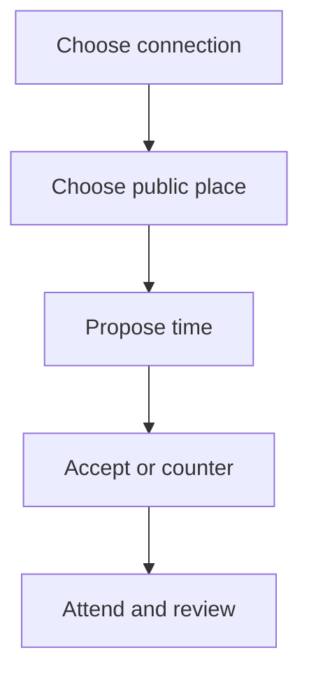

# M10 — Meetups and places

[Handover index](README.md) · [Shared client conventions](COMMON.md) · [OpenAPI](../openapi.yaml)

## Status

Not implemented. Design/reference only; no supported request/response or error contract.

0 implemented operations. This document describes the checked-in backend, not a deployed environment.

## Screen flow

Proposed flow only; no working API is implied.



## Wireframe

```text
+--------------------------+
| Meetup - planned         |
| Public place [         ] |
| Date/time [            ] |
| Dogs [ Ruby, Milo ]      |
| [ Propose ]              |
+--------------------------+
```

## Client behavior and integration limits

- Requires reviewed public places, participant authorization, revisions and explicit block/unmatch behavior. No emergency response or live-tracking feature is delivered.

## Request, response and error status

No supported contract yet. Do not call the planned paths or use fallback/mock success in production. Schemas, status codes, error codes, authentication and retry behavior will be added with implementation. Generic route/auth failures are not a feature contract.

## Planned scope

| Method + path | Access | Purpose |
| --- | --- | --- |
| GET `/places`; GET `/places/{id}`; POST `/places/suggestions` | U | Reviewed public dog-friendly locations and suggestions |
| POST/GET `/meetups`; GET `/meetups/{id}` | Participant | Proposed or scheduled meetings with selected owned dogs |
| POST `/meetups/{id}/respond`, `/cancel` | Participant | Accept/decline/counter with revision check; cancellation reason |
| POST `/meetups/{id}/check-in`, `/check-out`, `/extend` | Participant | Attendance timeline and reminder changes |
| POST `/meetups/{id}/reviews`; GET same | Participant | Structured review, private incident note and release timing |
| POST `/meetups/{id}/virtual-sniff` | Participant, G | Expiring video room token |
| POST `/groups`; POST `/groups/{id}/join-requests`; POST `/groups/{id}/join-requests/{id}/decide` | U, G | Capacity and organizer-controlled attendance |

States: proposed → accepted/countered/declined → completed/cancelled/expired. Review uniqueness per participant; reveal after both reviews or timeout. Concurrent accepts/counters use revision control. Block/unmatch cancellation policy must be explicit; users retain their own safety report path. First launch includes practical meeting guidance and incident reporting. Do not market an SOS/live-tracking service until separately staffed and tested.

---

Maintained through `scripts/handover-notes.mjs`, `docs/API_PLAN.md`, OpenAPI and source error codes. Regenerate with `npm run docs:handovers`; verify with `npm run check:handovers`.
