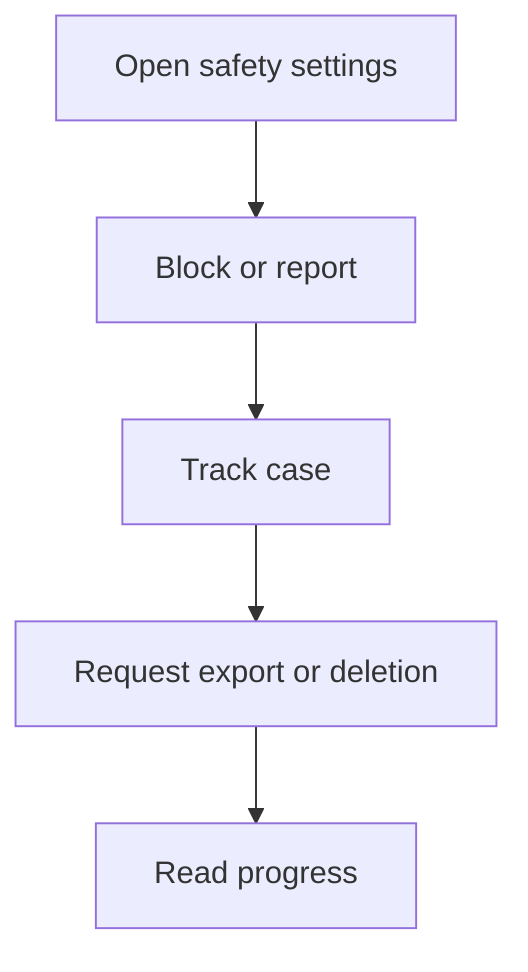

# M11 — Trust, safety, privacy and support

[Handover index](README.md) · [Shared client conventions](COMMON.md) · [OpenAPI](../openapi.yaml)

## Status

Not implemented. Design/reference only; no supported request/response or error contract.

0 implemented operations. This document describes the checked-in backend, not a deployed environment.

## Screen flow

Proposed flow only; no working API is implied.



## Wireframe

```text
+------------------------------+
| Safety and privacy - planned |
| [ Block / Report ]           |
| [ Support tickets ]          |
| [ Export my data ]           |
| [ Delete account ]           |
+------------------------------+
```

## Client behavior and integration limits

- Public launch is blocked on these flows. A photo/health-record DELETE is not account deletion; full erasure, support and report contracts are still pending.

## Request, response and error status

No supported contract yet. Do not call the planned paths or use fallback/mock success in production. Schemas, status codes, error codes, authentication and retry behavior will be added with implementation. Generic route/auth failures are not a feature contract.

## Planned scope

| Method + path | Access | Purpose |
| --- | --- | --- |
| POST/GET `/me/blocks`; DELETE `/me/blocks/{userId}` | U | Immediate cross-household discovery/contact suppression; unblock does not restore a match |
| POST `/reports`; GET `/reports/{id}` | U | Dog/user/media/message/meetup report; reporter identity private |
| GET `/me/safety-notices`; POST/GET `/me/appeals` | U | Enforcement explanations and review workflow |
| POST/GET `/support/tickets`; GET `/support/tickets/{id}`; POST `/support/tickets/{id}/messages` | U | Support and privacy grievances |
| POST `/me/data-exports`; GET `/me/data-exports/{id}` | U | Async export, short-lived download, recent reauthentication |
| POST `/me/deletion-requests`; GET `/me/deletion-requests/{id}` | U | Recent reauthentication, revoke discovery/sessions, tracked erasure |
| POST `/privacy/deletion/otp/request`, `/verify` | P | External deletion-page identity proof; restricted token, no account creation |
| GET `/help/articles?locale=` | P | Reviewed safety/support guidance and external deletion URL |

Deletion includes user rows, private media, messages as required by policy, vendor records, search/caches and backup expiry. Shared household dogs require transfer/remaining-owner rules. Legal holds are scoped, documented and excluded from normal access; communicate retained categories. Proposed operational target is completion within 30 days, subject to verified legal obligations; not a blanket statutory claim. Keep only necessary security/audit records under an explicit retention policy.

---

Maintained through `scripts/handover-notes.mjs`, `docs/API_PLAN.md`, OpenAPI and source error codes. Regenerate with `npm run docs:handovers`; verify with `npm run check:handovers`.
