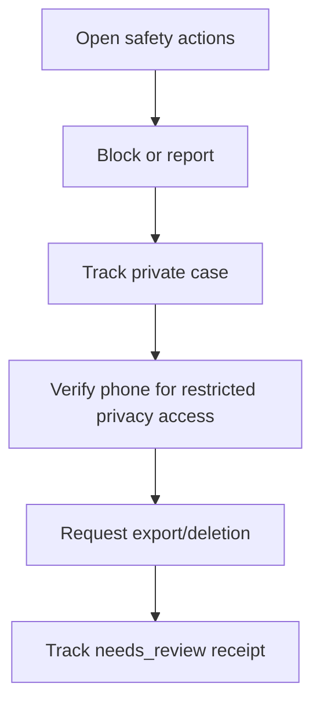

# M11 — Trust, safety, privacy and support

[Handover index](README.md) · [Shared client conventions](COMMON.md) · [OpenAPI](../openapi.yaml)

## Status

Blocking, private reports/support, notices/appeals and privacy request tracking implemented. Full export generation and erasure/vendor/backup processing remain unavailable.

18 implemented operations. This document describes the checked-in backend, not a deployed environment.

## Screen flow

Current integration flow; readiness gates may stop progression.



## Wireframe

```text
+-----------------------------------------+
| Safety and privacy                      |
| [ Block / Report ]                      |
| [ Support tickets ] [ Appeals ]         |
| [ Export request ] [ Deletion request ] |
| Status: needs_review, not completed     |
+-----------------------------------------+
```

## Client behavior and integration limits

- POST /me/blocks with userId returns 204; repeats are idempotent. Only your own block list is readable; the blocked user is not notified.
- A block is bilateral in effect and discovery must exclude both households using live accepted memberships, including co-guardians. Shared-household membership permissions are unchanged: blocking is not a household-removal action.
- Existing active cross-household matches become blocked and conversations close in the same transaction. Unblocking removes only your direction and never restores those connections.
- Maximum 500 outgoing blocks. Lists use limit/cursor. No guardian phone, email, location or private profile data is returned in the list.
- M06 feed and profile reads enforce live household-wide blocks in both directions. Future decisions/messages must recheck blocks at transaction time. Reports, appeals, support, export and account deletion are not implemented.
- POST /reports requires Idempotency-Key and a witnessed subject. Historical conversation membership permits reporting messages/users/dogs/media after block/unmatch without reopening content access. Meetups require recorded participation. Recent discovery snapshots permit dog/guardian reports. Guessed IDs return 404. Ten reports/day; reporters see only their own status.
- Report details, support messages and appeal statements are encrypted with the configured private storage adapter. With no MESSAGE_KEY they return 503 safety-storage-unavailable. Report status omits narrative, other reporters and enforcement internals. No staffed response-time promise is made.
- Support ticket creation/replies require stable UUID Idempotency-Key, max five tickets/day and twenty user messages/day. Detail returns paginated private messages; read createdAt for chronology because pagination uses UUIDs. Resolved tickets reject replies. No email/SMS delivery is implied.
- Safety notices expose only the caller’s user enforcement reasons and policy reference. Appeals deduplicate per user/action; the review must use a different staff reviewer. Dog-level appeals and other enforcement notices remain future extensions.
- POST /privacy/deletion/otp/request and /verify use a purpose-bound phone OTP. Unknown numbers never create accounts. The returned 30-minute token belongs only in Privacy-Token and works for reports/support/notices/appeals/privacy requests, including suspended accounts. It cannot access /me, discovery or chat. Delivery still uses the configured OTP adapter; production SMS remains unavailable.
- Export/deletion request creation accepts {} and returns 202 with statusToken. Regular sessions require the original family sign-in within 15 minutes; refresh does not reset this. Restricted privacy OTP is accepted for 30 minutes. Store the returned token securely; GET the matching request with Privacy-Status-Token after regular sessions are revoked. Repeating an open request rotates this tracking token.
- Deletion requests immediately pause publication/discovery, revoke sessions/devices and close connections/active meetups. They do not yet erase shared household records, media, vendor data or backups. Normal sign-in/refresh is blocked after requesting deletion; the separate privacy OTP path still supports case access.
- Both export and deletion currently enter needs_review with completed=false; downloadAvailable=false. No export file or completed erasure is fabricated. Privacy processing, retention/hold decisions, shared ownership transfer and vendor/backup workflows remain launch blockers. Status tokens authorize minimal request status only; never place them in URLs or analytics.

## Endpoint summary

| Method | Path | Access | Success |
| --- | --- | --- | --- |
| GET | `/v1/me/blocks` | Signed-in caller | 200 |
| POST | `/v1/me/blocks` | Signed-in caller | 204 |
| DELETE | `/v1/me/blocks/{userId}` | Signed-in caller | 204 |
| POST | `/v1/reports` | Signed-in caller | 201 |
| GET | `/v1/reports/{id}` | Signed-in caller | 200 |
| POST | `/v1/support/tickets` | Signed-in caller | 201 |
| GET | `/v1/support/tickets` | Signed-in caller | 200 |
| GET | `/v1/support/tickets/{id}` | Signed-in caller | 200 |
| POST | `/v1/support/tickets/{id}/messages` | Signed-in caller | 201 |
| GET | `/v1/me/safety-notices` | Signed-in caller | 200 |
| POST | `/v1/me/appeals` | Signed-in caller | 201 |
| GET | `/v1/me/appeals` | Signed-in caller | 200 |
| POST | `/v1/me/data-exports` | Signed-in caller | 202 |
| GET | `/v1/me/data-exports/{id}` | Signed-in caller | 200 |
| POST | `/v1/me/deletion-requests` | Signed-in caller | 202 |
| GET | `/v1/me/deletion-requests/{id}` | Signed-in caller | 200 |
| POST | `/v1/privacy/deletion/otp/request` | Public | 202 |
| POST | `/v1/privacy/deletion/otp/verify` | Public | 200 |

## Examples

Illustrative data only. Replace IDs with returned resource IDs and token/checksum placeholders with real local values. Examples are not seeded records, legal text or evidence. For examples without a response block, use the exact response shape in the endpoint section below.

### Block a user

```http
POST /v1/me/blocks
Authorization: Bearer <accessToken>
Content-Type: application/json

{
  "userId": "22222222-2222-4222-8222-222222222222"
}
```

### Read own blocks

```http
GET /v1/me/blocks
Authorization: Bearer <accessToken>
```

Response: HTTP 200

```json
{
  "blocks": [
    {
      "userId": "22222222-2222-4222-8222-222222222222",
      "createdAt": "2026-10-08T10:00:00.000Z"
    }
  ],
  "nextCursor": null
}
```

## Module errors

Also handle the [shared error contract](COMMON.md#errors). These are module-level codes; applicability depends on the endpoint and current state. HTTP status alone is insufficient.

| HTTP | Code | Meaning | Client action |
| --- | --- | --- | --- |
| 400 | `self-block` | You cannot block yourself. | Show a contextual error using code; correct input/state or respect the documented limit before retrying. |
| 401 | `invalid-status-token` | A request status token is required. | Show a contextual error using code; correct input/state or respect the documented limit before retrying. |
| 401 | `unauthenticated` | Authentication is required. | Show a contextual error using code; correct input/state or respect the documented limit before retrying. |
| 403 | `reauthentication-required` | Verify your phone again before this action. | Show a contextual error using code; correct input/state or respect the documented limit before retrying. |
| 404 | `not-found` | Action is unavailable. | Refresh the list/access state; avoid exposing whether another user owns the resource. |
| 409 | `block-limit` | The maximum of five hundred blocked users has been reached. | Show a contextual error using code; correct input/state or respect the documented limit before retrying. |
| 409 | `ticket-closed` | Create a new ticket for further help. | Show a contextual error using code; correct input/state or respect the documented limit before retrying. |
| 429 | `case-limit` | Daily case limit reached. | Show a contextual error using code; correct input/state or respect the documented limit before retrying. |
| 429 | `privacy-request-limit` | Daily privacy request limit reached. | Show a contextual error using code; correct input/state or respect the documented limit before retrying. |
| 429 | `support-message-limit` | Daily support message limit reached. | Show a contextual error using code; correct input/state or respect the documented limit before retrying. |
| 503 | `auth-unavailable` | Authentication is unavailable. | Show a contextual error using code; correct input/state or respect the documented limit before retrying. |
| 503 | `safety-storage-unavailable` | Private case storage is not configured. | Show a contextual error using code; correct input/state or respect the documented limit before retrying. |

## Detailed request and response contracts

Shapes below are **type notation**, not JSON to send: `?` means optional, `|` means alternatives, and comments show constraints/defaults. Requests reject unknown write fields. JSON uses actual values. Runtime cross-field/business rules are in the client guidance above. The linked OpenAPI is the machine-readable source.

### GET /v1/me/blocks

Operation: `listBlocks`. Access: Signed-in caller.

Parameters:

- `limit` (query, optional): ` integer /* minimum=1, maximum=50, default=20 */ `
- `cursor` (query, optional): ` string /* maxLength=400 */ `

Request body: none.

Response HTTP 200:

```text
{
  blocks: Array<{
    userId: string /* format="uuid" */
    createdAt: string /* format="date-time" */
  }>
  nextCursor: string | null
}
```

### POST /v1/me/blocks

Operation: `blockUser`. Access: Signed-in caller.

Request body (application/json, required):

```text
{
  userId: string /* format="uuid" */
}
```

Response HTTP 204:

No response body.

### DELETE /v1/me/blocks/{userId}

Operation: `unblockUser`. Access: Signed-in caller.

Parameters:

- `userId` (path, required): ` string /* format="uuid" */ `

Request body: none.

Response HTTP 204:

No response body.

### POST /v1/reports

Operation: `createReport`. Access: Signed-in caller.

Parameters:

- `Idempotency-Key` (header, required): ` string /* format="uuid" */ `

Request body (application/json, required):

```text
{
  subjectType: "user" | "dog" | "media" | "message" | "meetup"
  subjectId: string /* format="uuid" */
  category: "harassment" | "unsafe_behavior" | "fake_profile" | "animal_welfare" | "spam" | "other"
  details: string /* minLength=5, maxLength=2000 */
}
```

Response HTTP 201:

```text
{
  id: string /* format="uuid" */
  state: "queued" | "in_review" | "actioned" | "dismissed" | "escalated"
  createdAt: string /* format="date-time" */
}
```

### GET /v1/reports/{id}

Operation: `reportStatus`. Access: Signed-in caller.

Parameters:

- `id` (path, required): ` string /* format="uuid" */ `

Request body: none.

Response HTTP 200:

```text
{
  id: string /* format="uuid" */
  state: "queued" | "in_review" | "actioned" | "dismissed" | "escalated"
  createdAt: string /* format="date-time" */
  resolvedAt: string /* format="date-time" */ | null
}
```

### POST /v1/support/tickets

Operation: `createSupportTicket`. Access: Signed-in caller.

Parameters:

- `Idempotency-Key` (header, required): ` string /* format="uuid" */ `

Request body (application/json, required):

```text
{
  category: "account" | "technical" | "privacy" | "safety" | "other"
  message: string /* minLength=5, maxLength=4000 */
}
```

Response HTTP 201:

```text
{
  id: string /* format="uuid" */
  category: "account" | "technical" | "privacy" | "safety" | "other"
  state: "open" | "in_review" | "resolved"
  createdAt: string /* format="date-time" */
  updatedAt: string /* format="date-time" */
}
```

### GET /v1/support/tickets

Operation: `listSupportTickets`. Access: Signed-in caller.

Parameters:

- `limit` (query, optional): ` integer /* minimum=1, maximum=50, default=20 */ `
- `cursor` (query, optional): ` string `

Request body: none.

Response HTTP 200:

```text
{
  items: Array<{
    id: string /* format="uuid" */
    category: "account" | "technical" | "privacy" | "safety" | "other"
    state: "open" | "in_review" | "resolved"
    createdAt: string /* format="date-time" */
    updatedAt: string /* format="date-time" */
  }>
  nextCursor: string | null
}
```

### GET /v1/support/tickets/{id}

Operation: `supportTicket`. Access: Signed-in caller.

Parameters:

- `id` (path, required): ` string /* format="uuid" */ `
- `limit` (query, optional): ` integer /* minimum=1, maximum=50, default=20 */ `
- `cursor` (query, optional): ` string `

Request body: none.

Response HTTP 200:

```text
{
  ticket: {
    id: string /* format="uuid" */
    category: "account" | "technical" | "privacy" | "safety" | "other"
    state: "open" | "in_review" | "resolved"
    createdAt: string /* format="date-time" */
    updatedAt: string /* format="date-time" */
  }
  messages: Array<{
    id: string /* format="uuid" */
    author: "you" | "support"
    body: string
    createdAt: string /* format="date-time" */
  }>
  nextCursor: string | null
}
```

### POST /v1/support/tickets/{id}/messages

Operation: `replySupportTicket`. Access: Signed-in caller.

Parameters:

- `id` (path, required): ` string /* format="uuid" */ `
- `Idempotency-Key` (header, required): ` string /* format="uuid" */ `

Request body (application/json, required):

```text
{
  message: string /* minLength=1, maxLength=4000 */
}
```

Response HTTP 201:

```text
{
  id: string /* format="uuid" */
  createdAt: string /* format="date-time" */
}
```

### GET /v1/me/safety-notices

Operation: `safetyNotices`. Access: Signed-in caller.

Parameters:

- `limit` (query, optional): ` integer /* minimum=1, maximum=50, default=20 */ `
- `cursor` (query, optional): ` string `

Request body: none.

Response HTTP 200:

```text
{
  items: Array<{
    id: string /* format="uuid" */
    action: string
    reasonCode: string
    policyRef: string
    createdAt: string /* format="date-time" */
    expiresAt: string /* format="date-time" */ | null
    reversedAt: string /* format="date-time" */ | null
  }>
  nextCursor: string | null
}
```

### POST /v1/me/appeals

Operation: `createAppeal`. Access: Signed-in caller.

Request body (application/json, required):

```text
{
  actionId: string /* format="uuid" */
  statement: string /* minLength=5, maxLength=4000 */
}
```

Response HTTP 201:

```text
{
  id: string /* format="uuid" */
  state: string
}
```

### GET /v1/me/appeals

Operation: `listAppeals`. Access: Signed-in caller.

Parameters:

- `limit` (query, optional): ` integer /* minimum=1, maximum=50, default=20 */ `
- `cursor` (query, optional): ` string `

Request body: none.

Response HTTP 200:

```text
{
  items: Array<{
    id: string /* format="uuid" */
    actionId: string /* format="uuid" */
    state: string
    outcome: string | null
    createdAt: string /* format="date-time" */
    decidedAt: string /* format="date-time" */ | null
  }>
  nextCursor: string | null
}
```

### POST /v1/me/data-exports

Operation: `requestDataExport`. Access: Signed-in caller.

Request body (application/json, required):

```text
{}
```

Response HTTP 202:

```text
{
  id: string /* format="uuid" */
  kind: "export"
  state: string
  createdAt: string /* format="date-time" */
  statusToken: string
  nextAction: "awaiting_privacy_review"
  completed: false
}
```

### GET /v1/me/data-exports/{id}

Operation: `dataExportStatus`. Access: Signed-in caller.

Parameters:

- `id` (path, required): ` string /* format="uuid" */ `
- `Privacy-Status-Token` (header, required): ` string `

Request body: none.

Response HTTP 200:

```text
{
  id: string /* format="uuid" */
  kind: "export" | "deletion"
  state: string
  createdAt: string /* format="date-time" */
  updatedAt: string /* format="date-time" */
  errorCode: string | null
  downloadAvailable: false
}
```

### POST /v1/me/deletion-requests

Operation: `requestDeletion`. Access: Signed-in caller.

Request body (application/json, required):

```text
{}
```

Response HTTP 202:

```text
{
  id: string /* format="uuid" */
  kind: "deletion"
  state: string
  createdAt: string /* format="date-time" */
  statusToken: string
  nextAction: "awaiting_privacy_review"
  completed: false
}
```

### GET /v1/me/deletion-requests/{id}

Operation: `deletionStatus`. Access: Signed-in caller.

Parameters:

- `id` (path, required): ` string /* format="uuid" */ `
- `Privacy-Status-Token` (header, required): ` string `

Request body: none.

Response HTTP 200:

```text
{
  id: string /* format="uuid" */
  kind: "export" | "deletion"
  state: string
  createdAt: string /* format="date-time" */
  updatedAt: string /* format="date-time" */
  errorCode: string | null
  downloadAvailable: false
}
```

### POST /v1/privacy/deletion/otp/request

Operation: `requestPrivacyOtp`. Access: Public.

Request body (application/json, required):

```text
{
  phoneE164: string
  countryCode: "IN"
}
```

Response HTTP 202:

```text
{
  status: "accepted"
}
```

### POST /v1/privacy/deletion/otp/verify

Operation: `verifyPrivacyOtp`. Access: Public.

Request body (application/json, required):

```text
{
  phoneE164: string
  code: string /* pattern="^[0-9]{6}$" */
}
```

Response HTTP 200:

```text
{
  token: string
  expiresIn: 1800
}
```

---

Maintained through `scripts/handover-notes.mjs`, `docs/API_PLAN.md`, OpenAPI and source error codes. Regenerate with `npm run docs:handovers`; verify with `npm run check:handovers`.
