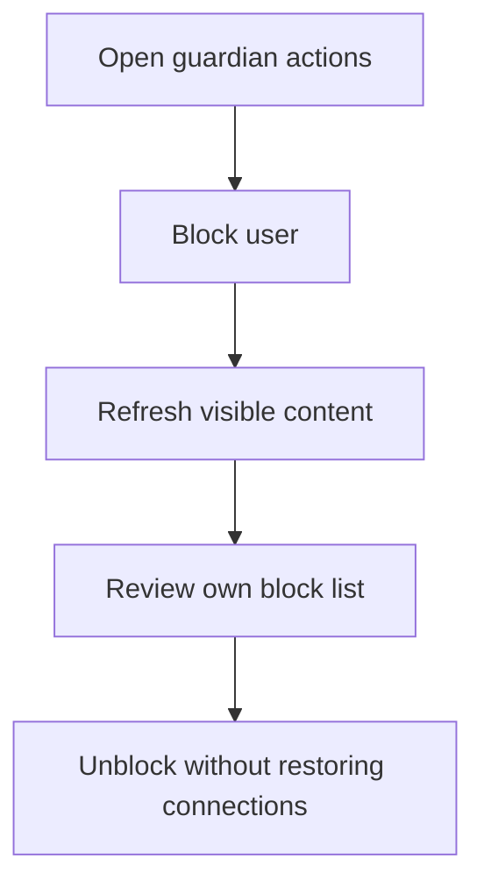

# M11 — Trust, safety, privacy and support

[Handover index](README.md) · [Shared client conventions](COMMON.md) · [OpenAPI](../openapi.yaml)

## Status

Blocking foundation implemented. Reports, appeals, support, exports and account erasure remain planned.

3 implemented operations. This document describes the checked-in backend, not a deployed environment.

## Screen flow

Current integration flow; readiness gates may stop progression.



## Wireframe

```text
+---------------------------------------+
| Blocked users                         |
| [ Guardian reference ] [ Unblock ]    |
| Blocking affects both households      |
| Old connections stay closed           |
| Reports and account deletion: planned |
+---------------------------------------+
```

## Client behavior and integration limits

- POST /me/blocks with userId returns 204; repeats are idempotent. Only your own block list is readable; the blocked user is not notified.
- A block is bilateral in effect and discovery must exclude both households using live accepted memberships, including co-guardians. Shared-household membership permissions are unchanged: blocking is not a household-removal action.
- Existing active cross-household matches become blocked and conversations close in the same transaction. Unblocking removes only your direction and never restores those connections.
- Maximum 500 outgoing blocks. Lists use limit/cursor. No guardian phone, email, location or private profile data is returned in the list.
- M06 feed and profile reads enforce live household-wide blocks in both directions. Future decisions/messages must recheck blocks at transaction time. Reports, appeals, support, export and account deletion are not implemented.

## Endpoint summary

| Method | Path | Access | Success |
| --- | --- | --- | --- |
| GET | `/v1/me/blocks` | Signed-in caller | 200 |
| POST | `/v1/me/blocks` | Signed-in caller | 204 |
| DELETE | `/v1/me/blocks/{userId}` | Signed-in caller | 204 |

## Examples

Illustrative data only. Replace IDs with returned resource IDs and token/checksum placeholders with real local values. Examples are not seeded records, legal text or evidence. For examples without a response block, use the exact response shape in the endpoint section below.

### Block a user

```http
POST /v1/me/blocks
Authorization: Bearer <accessToken>
Content-Type: application/json

{
  "userId": "22222222-2222-4222-8222-222222222222"
}
```

### Read own blocks

```http
GET /v1/me/blocks
Authorization: Bearer <accessToken>
```

Response: HTTP 200

```json
{
  "blocks": [
    {
      "userId": "22222222-2222-4222-8222-222222222222",
      "createdAt": "2026-10-08T10:00:00.000Z"
    }
  ],
  "nextCursor": null
}
```

## Module errors

Also handle the [shared error contract](COMMON.md#errors). These are module-level codes; applicability depends on the endpoint and current state. HTTP status alone is insufficient.

| HTTP | Code | Meaning | Client action |
| --- | --- | --- | --- |
| 400 | `self-block` | You cannot block yourself. | Show a contextual error using code; correct input/state or respect the documented limit before retrying. |
| 404 | `not-found` | User not found. | Refresh the list/access state; avoid exposing whether another user owns the resource. |
| 409 | `block-limit` | The maximum of five hundred blocked users has been reached. | Show a contextual error using code; correct input/state or respect the documented limit before retrying. |

## Detailed request and response contracts

Shapes below are **type notation**, not JSON to send: `?` means optional, `|` means alternatives, and comments show constraints/defaults. Requests reject unknown write fields. JSON uses actual values. Runtime cross-field/business rules are in the client guidance above. The linked OpenAPI is the machine-readable source.

### GET /v1/me/blocks

Operation: `listBlocks`. Access: Signed-in caller.

Parameters:

- `limit` (query, optional): ` integer /* minimum=1, maximum=50, default=20 */ `
- `cursor` (query, optional): ` string /* maxLength=400 */ `

Request body: none.

Response HTTP 200:

```text
{
  blocks: Array<{
    userId: string /* format="uuid" */
    createdAt: string /* format="date-time" */
  }>
  nextCursor: string | null
}
```

### POST /v1/me/blocks

Operation: `blockUser`. Access: Signed-in caller.

Request body (application/json, required):

```text
{
  userId: string /* format="uuid" */
}
```

Response HTTP 204:

No response body.

### DELETE /v1/me/blocks/{userId}

Operation: `unblockUser`. Access: Signed-in caller.

Parameters:

- `userId` (path, required): ` string /* format="uuid" */ `

Request body: none.

Response HTTP 204:

No response body.

---

Maintained through `scripts/handover-notes.mjs`, `docs/API_PLAN.md`, OpenAPI and source error codes. Regenerate with `npm run docs:handovers`; verify with `npm run check:handovers`.
