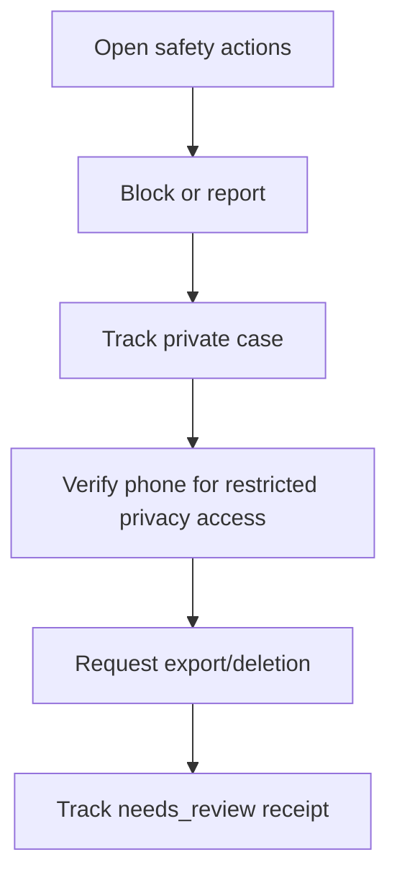

# M11 — Trust, safety, privacy and support

[Handover index](README.md) · [Shared client conventions](COMMON.md) · [OpenAPI](../openapi.yaml)

## Status

Blocking, private reports/support, notices/appeals, restricted privacy OTP and scoped account-data export/download implemented. Full erasure/vendor/backup processing remains unavailable.

19 implemented operations. This document describes the checked-in backend, not a deployed environment.

## Screen flow

Current integration flow; readiness gates may stop progression.



## Wireframe

```text
+-----------------------------------------+
| Safety and privacy                      |
| [ Block / Report ]                      |
| [ Support tickets ] [ Appeals ]         |
| [ Export request ] [ Deletion request ] |
| Status: needs_review, not completed     |
+-----------------------------------------+
```

## Client behavior and integration limits

- POST /me/blocks with userId returns 204; repeats are idempotent. Only your own block list is readable; the blocked user is not notified.
- A block is bilateral in effect and discovery must exclude both households using live accepted memberships, including co-guardians. Shared-household membership permissions are unchanged: blocking is not a household-removal action.
- Existing active cross-household matches become blocked and conversations close in the same transaction. Unblocking removes only your direction and never restores those connections.
- Maximum 500 outgoing blocks. Lists use limit/cursor. No guardian phone, email, location or private profile data is returned in the list.
- M06 feed and profile reads enforce live household-wide blocks in both directions. Future decisions/messages must recheck blocks at transaction time. Reports, appeals, support, export and account deletion are not implemented.
- POST /reports requires Idempotency-Key and a witnessed subject. Historical conversation membership permits reporting messages/users/dogs/media after block/unmatch without reopening content access. Meetups require recorded participation. Recent discovery snapshots permit dog/guardian reports. Guessed IDs return 404. Ten reports/day; reporters see only their own status.
- Report details, support messages and appeal statements are encrypted with the configured private storage adapter. With no MESSAGE_KEY they return 503 safety-storage-unavailable. Report status omits narrative, other reporters and enforcement internals. No staffed response-time promise is made.
- Support ticket creation/replies require stable UUID Idempotency-Key, max five tickets/day and twenty user messages/day. Detail returns paginated private messages; read createdAt for chronology because pagination uses UUIDs. Resolved tickets reject replies. No email/SMS delivery is implied.
- Safety notices expose only the caller’s user enforcement reasons and policy reference. Appeals deduplicate per user/action; the review must use a different staff reviewer. Dog-level appeals and other enforcement notices remain future extensions.
- POST /privacy/deletion/otp/request and /verify use a purpose-bound phone OTP. Unknown numbers never create accounts. The returned 30-minute token belongs only in Privacy-Token and works for reports/support/notices/appeals/privacy requests, including suspended accounts. It cannot access /me, discovery or chat. Delivery still uses the configured OTP adapter; production SMS remains unavailable.
- Export/deletion request creation accepts {} and returns 202 with statusToken. Regular sessions require the original family sign-in within 15 minutes; refresh does not reset this. Restricted privacy OTP is accepted for 30 minutes. Store the returned token securely; GET the matching request with Privacy-Status-Token after regular sessions are revoked. Repeating an open request rotates this tracking token.
- Deletion requests immediately pause publication/discovery, revoke sessions/devices and close connections/active meetups. They do not yet erase shared household records, media, vendor data or backups. Normal sign-in/refresh is blocked after requesting deletion; the separate privacy OTP path still supports case access.
- Deletion remains needs_review/completed=false until erasure processing is implemented. New scoped account exports enter queued, then ready after the export worker runs. Legacy needs_review exports remain for review. Status tokens authorize minimal tracking only and never download; keep tokens out of URLs/analytics.
- Account export scope is account_data_v1, explicitly not a complete legal-response archive. It includes the account profile/preferences/consents/membership references, session metadata, authored decisions/messages/support/health/reviews, reports/appeals, uploads metadata, notifications and attendance. Other people’s messages/profiles, photo file bytes, shared household documents, provider records and internal staff/security notes are excluded and listed in every artifact.
- Run npm run privacy:exports with private encryption configured to process up to ten queued requests. Each artifact is an encrypted PostgreSQL JSON snapshot, bounded to 10,000 rows per category and 20 MiB total. Exceeding either limit moves the whole request to needs_review with export-size-limit, never silently truncates. Other generation failures use export-generation-failed without logging content.
- GET /me/data-exports/{id}/download requires the owner’s regular bearer session with original sign-in within 15 minutes, or a current restricted Privacy-Token. Privacy-Status-Token cannot download. The JSON attachment is formatVersion=1 and is available for 24 hours. Downloads are audited without copying content; expired requests return 410 export-expired. The worker physically clears expired artifact ciphertext on subsequent runs. Scheduling remains an operations task.
- 403 reauthentication-required: complete phone proof again. 409 export-not-ready: poll status with backoff. When status.downloadAvailable=true, use the authenticated download route. A ready snapshot describes its generation time; it does not include later changes. No storage keys, access/refresh/OTP/device tokens or another person’s authored chat are included.

## Endpoint summary

| Method | Path | Access | Success |
| --- | --- | --- | --- |
| GET | `/v1/me/blocks` | Signed-in caller | 200 |
| POST | `/v1/me/blocks` | Signed-in caller | 204 |
| DELETE | `/v1/me/blocks/{userId}` | Signed-in caller | 204 |
| POST | `/v1/reports` | Own account: bearer session or restricted Privacy-Token | 201 |
| GET | `/v1/reports/{id}` | Own account: bearer session or restricted Privacy-Token | 200 |
| POST | `/v1/support/tickets` | Own account: bearer session or restricted Privacy-Token | 201 |
| GET | `/v1/support/tickets` | Own account: bearer session or restricted Privacy-Token | 200 |
| GET | `/v1/support/tickets/{id}` | Own account: bearer session or restricted Privacy-Token | 200 |
| POST | `/v1/support/tickets/{id}/messages` | Own account: bearer session or restricted Privacy-Token | 201 |
| GET | `/v1/me/safety-notices` | Own account: bearer session or restricted Privacy-Token | 200 |
| POST | `/v1/me/appeals` | Own account: bearer session or restricted Privacy-Token | 201 |
| GET | `/v1/me/appeals` | Own account: bearer session or restricted Privacy-Token | 200 |
| POST | `/v1/me/data-exports` | Own account: bearer session or restricted Privacy-Token | 202 |
| GET | `/v1/me/data-exports/{id}` | Request-specific Privacy-Status-Token | 200 |
| POST | `/v1/me/deletion-requests` | Own account: bearer session or restricted Privacy-Token | 202 |
| GET | `/v1/me/deletion-requests/{id}` | Request-specific Privacy-Status-Token | 200 |
| POST | `/v1/privacy/deletion/otp/request` | Public | 202 |
| POST | `/v1/privacy/deletion/otp/verify` | Public | 200 |
| GET | `/v1/me/data-exports/{id}/download` | Own account: bearer session or restricted Privacy-Token | 200 |

## Examples

Illustrative data only. Replace IDs with returned resource IDs and token/checksum placeholders with real local values. Examples are not seeded records, legal text or evidence. For examples without a response block, use the exact response shape in the endpoint section below.

### Block a user

```http
POST /v1/me/blocks
Authorization: Bearer <accessToken>
Content-Type: application/json

{
  "userId": "22222222-2222-4222-8222-222222222222"
}
```

### Read own blocks

```http
GET /v1/me/blocks
Authorization: Bearer <accessToken>
```

Response: HTTP 200

```json
{
  "blocks": [
    {
      "userId": "22222222-2222-4222-8222-222222222222",
      "createdAt": "2026-10-08T10:00:00.000Z"
    }
  ],
  "nextCursor": null
}
```

### Download a ready account-data export

```http
GET /v1/me/data-exports/77777777-7777-4777-8777-777777777777/download
Authorization: Bearer <accessToken>
```

## Module errors

Also handle the [shared error contract](COMMON.md#errors). These are module-level codes; applicability depends on the endpoint and current state. HTTP status alone is insufficient.

| HTTP | Code | Meaning | Client action |
| --- | --- | --- | --- |
| 400 | `self-block` | You cannot block yourself. | Show a contextual error using code; correct input/state or respect the documented limit before retrying. |
| 401 | `invalid-status-token` | A request status token is required. | Show a contextual error using code; correct input/state or respect the documented limit before retrying. |
| 401 | `unauthenticated` | Authentication is required. | Show a contextual error using code; correct input/state or respect the documented limit before retrying. |
| 403 | `reauthentication-required` | Verify your phone again before this action. | Show a contextual error using code; correct input/state or respect the documented limit before retrying. |
| 404 | `not-found` | Action is unavailable. | Refresh the list/access state; avoid exposing whether another user owns the resource. |
| 409 | `block-limit` | The maximum of five hundred blocked users has been reached. | Show a contextual error using code; correct input/state or respect the documented limit before retrying. |
| 409 | `export-not-ready` | Wait for export processing or privacy review. | Show a contextual error using code; correct input/state or respect the documented limit before retrying. |
| 409 | `ticket-closed` | Create a new ticket for further help. | Show a contextual error using code; correct input/state or respect the documented limit before retrying. |
| 410 | `export-expired` | Request a new export. | Show a contextual error using code; correct input/state or respect the documented limit before retrying. |
| 429 | `case-limit` | Daily case limit reached. | Show a contextual error using code; correct input/state or respect the documented limit before retrying. |
| 429 | `privacy-request-limit` | Daily privacy request limit reached. | Show a contextual error using code; correct input/state or respect the documented limit before retrying. |
| 429 | `support-message-limit` | Daily support message limit reached. | Show a contextual error using code; correct input/state or respect the documented limit before retrying. |
| 503 | `auth-unavailable` | Authentication is unavailable. | Show a contextual error using code; correct input/state or respect the documented limit before retrying. |
| 503 | `export-storage-unavailable` | Private export storage is not configured. | Show a contextual error using code; correct input/state or respect the documented limit before retrying. |
| 503 | `safety-storage-unavailable` | Private case storage is not configured. | Show a contextual error using code; correct input/state or respect the documented limit before retrying. |

## Detailed request and response contracts

Shapes below are **type notation**, not JSON to send: `?` means optional, `|` means alternatives, and comments show constraints/defaults. Requests reject unknown write fields. JSON uses actual values. Runtime cross-field/business rules are in the client guidance above. The linked OpenAPI is the machine-readable source.

### GET /v1/me/blocks

Operation: `listBlocks`. Access: Signed-in caller.

Parameters:

- `limit` (query, optional): ` integer /* minimum=1, maximum=50, default=20 */ `
- `cursor` (query, optional): ` string /* maxLength=400 */ `

Request body: none.

Response HTTP 200:

```text
{
  blocks: Array<{
    userId: string /* format="uuid" */
    createdAt: string /* format="date-time" */
  }>
  nextCursor: string | null
}
```

### POST /v1/me/blocks

Operation: `blockUser`. Access: Signed-in caller.

Request body (application/json, required):

```text
{
  userId: string /* format="uuid" */
}
```

Response HTTP 204:

No response body.

### DELETE /v1/me/blocks/{userId}

Operation: `unblockUser`. Access: Signed-in caller.

Parameters:

- `userId` (path, required): ` string /* format="uuid" */ `

Request body: none.

Response HTTP 204:

No response body.

### POST /v1/reports

Operation: `createReport`. Access: Own account: bearer session or restricted Privacy-Token.

Parameters:

- `Idempotency-Key` (header, required): ` string /* format="uuid" */ `

Request body (application/json, required):

```text
{
  subjectType: "user" | "dog" | "media" | "message" | "meetup"
  subjectId: string /* format="uuid" */
  category: "harassment" | "unsafe_behavior" | "fake_profile" | "animal_welfare" | "spam" | "other"
  details: string /* minLength=5, maxLength=2000 */
}
```

Response HTTP 201:

```text
{
  id: string /* format="uuid" */
  state: "queued" | "in_review" | "actioned" | "dismissed" | "escalated"
  createdAt: string /* format="date-time" */
}
```

### GET /v1/reports/{id}

Operation: `reportStatus`. Access: Own account: bearer session or restricted Privacy-Token.

Parameters:

- `id` (path, required): ` string /* format="uuid" */ `

Request body: none.

Response HTTP 200:

```text
{
  id: string /* format="uuid" */
  state: "queued" | "in_review" | "actioned" | "dismissed" | "escalated"
  createdAt: string /* format="date-time" */
  resolvedAt: string /* format="date-time" */ | null
}
```

### POST /v1/support/tickets

Operation: `createSupportTicket`. Access: Own account: bearer session or restricted Privacy-Token.

Parameters:

- `Idempotency-Key` (header, required): ` string /* format="uuid" */ `

Request body (application/json, required):

```text
{
  category: "account" | "technical" | "privacy" | "safety" | "other"
  message: string /* minLength=5, maxLength=4000 */
}
```

Response HTTP 201:

```text
{
  id: string /* format="uuid" */
  category: "account" | "technical" | "privacy" | "safety" | "other"
  state: "open" | "in_review" | "resolved"
  createdAt: string /* format="date-time" */
  updatedAt: string /* format="date-time" */
}
```

### GET /v1/support/tickets

Operation: `listSupportTickets`. Access: Own account: bearer session or restricted Privacy-Token.

Parameters:

- `limit` (query, optional): ` integer /* minimum=1, maximum=50, default=20 */ `
- `cursor` (query, optional): ` string `

Request body: none.

Response HTTP 200:

```text
{
  items: Array<{
    id: string /* format="uuid" */
    category: "account" | "technical" | "privacy" | "safety" | "other"
    state: "open" | "in_review" | "resolved"
    createdAt: string /* format="date-time" */
    updatedAt: string /* format="date-time" */
  }>
  nextCursor: string | null
}
```

### GET /v1/support/tickets/{id}

Operation: `supportTicket`. Access: Own account: bearer session or restricted Privacy-Token.

Parameters:

- `id` (path, required): ` string /* format="uuid" */ `
- `limit` (query, optional): ` integer /* minimum=1, maximum=50, default=20 */ `
- `cursor` (query, optional): ` string `

Request body: none.

Response HTTP 200:

```text
{
  ticket: {
    id: string /* format="uuid" */
    category: "account" | "technical" | "privacy" | "safety" | "other"
    state: "open" | "in_review" | "resolved"
    createdAt: string /* format="date-time" */
    updatedAt: string /* format="date-time" */
  }
  messages: Array<{
    id: string /* format="uuid" */
    author: "you" | "support"
    body: string
    createdAt: string /* format="date-time" */
  }>
  nextCursor: string | null
}
```

### POST /v1/support/tickets/{id}/messages

Operation: `replySupportTicket`. Access: Own account: bearer session or restricted Privacy-Token.

Parameters:

- `id` (path, required): ` string /* format="uuid" */ `
- `Idempotency-Key` (header, required): ` string /* format="uuid" */ `

Request body (application/json, required):

```text
{
  message: string /* minLength=1, maxLength=4000 */
}
```

Response HTTP 201:

```text
{
  id: string /* format="uuid" */
  createdAt: string /* format="date-time" */
}
```

### GET /v1/me/safety-notices

Operation: `safetyNotices`. Access: Own account: bearer session or restricted Privacy-Token.

Parameters:

- `limit` (query, optional): ` integer /* minimum=1, maximum=50, default=20 */ `
- `cursor` (query, optional): ` string `

Request body: none.

Response HTTP 200:

```text
{
  items: Array<{
    id: string /* format="uuid" */
    action: string
    reasonCode: string
    policyRef: string
    createdAt: string /* format="date-time" */
    expiresAt: string /* format="date-time" */ | null
    reversedAt: string /* format="date-time" */ | null
  }>
  nextCursor: string | null
}
```

### POST /v1/me/appeals

Operation: `createAppeal`. Access: Own account: bearer session or restricted Privacy-Token.

Request body (application/json, required):

```text
{
  actionId: string /* format="uuid" */
  statement: string /* minLength=5, maxLength=4000 */
}
```

Response HTTP 201:

```text
{
  id: string /* format="uuid" */
  state: string
}
```

### GET /v1/me/appeals

Operation: `listAppeals`. Access: Own account: bearer session or restricted Privacy-Token.

Parameters:

- `limit` (query, optional): ` integer /* minimum=1, maximum=50, default=20 */ `
- `cursor` (query, optional): ` string `

Request body: none.

Response HTTP 200:

```text
{
  items: Array<{
    id: string /* format="uuid" */
    actionId: string /* format="uuid" */
    state: string
    outcome: string | null
    createdAt: string /* format="date-time" */
    decidedAt: string /* format="date-time" */ | null
  }>
  nextCursor: string | null
}
```

### POST /v1/me/data-exports

Operation: `requestDataExport`. Access: Own account: bearer session or restricted Privacy-Token.

Request body (application/json, required):

```text
{}
```

Response HTTP 202:

```text
{
  id: string /* format="uuid" */
  kind: "export"
  state: string
  createdAt: string /* format="date-time" */
  statusToken: string
  nextAction: "awaiting_export_generation" | "awaiting_privacy_review"
  completed: false
  scope: "account_data_v1"
  excludedCategories: Array<string>
}
```

### GET /v1/me/data-exports/{id}

Operation: `dataExportStatus`. Access: Request-specific Privacy-Status-Token.

Parameters:

- `id` (path, required): ` string /* format="uuid" */ `
- `Privacy-Status-Token` (header, required): ` string `

Request body: none.

Response HTTP 200:

```text
{
  id: string /* format="uuid" */
  kind: "export" | "deletion"
  state: string
  createdAt: string /* format="date-time" */
  updatedAt: string /* format="date-time" */
  errorCode: string | null
  downloadAvailable: boolean
  expiresAt: string /* format="date-time" */ | null
  scope: "account_data_v1" | null
}
```

### POST /v1/me/deletion-requests

Operation: `requestDeletion`. Access: Own account: bearer session or restricted Privacy-Token.

Request body (application/json, required):

```text
{}
```

Response HTTP 202:

```text
{
  id: string /* format="uuid" */
  kind: "deletion"
  state: string
  createdAt: string /* format="date-time" */
  statusToken: string
  nextAction: "awaiting_privacy_review"
  completed: false
}
```

### GET /v1/me/deletion-requests/{id}

Operation: `deletionStatus`. Access: Request-specific Privacy-Status-Token.

Parameters:

- `id` (path, required): ` string /* format="uuid" */ `
- `Privacy-Status-Token` (header, required): ` string `

Request body: none.

Response HTTP 200:

```text
{
  id: string /* format="uuid" */
  kind: "export" | "deletion"
  state: string
  createdAt: string /* format="date-time" */
  updatedAt: string /* format="date-time" */
  errorCode: string | null
  downloadAvailable: boolean
  expiresAt: string /* format="date-time" */ | null
  scope: "account_data_v1" | null
}
```

### POST /v1/privacy/deletion/otp/request

Operation: `requestPrivacyOtp`. Access: Public.

Request body (application/json, required):

```text
{
  phoneE164: string
  countryCode: "IN"
}
```

Response HTTP 202:

```text
{
  status: "accepted"
}
```

### POST /v1/privacy/deletion/otp/verify

Operation: `verifyPrivacyOtp`. Access: Public.

Request body (application/json, required):

```text
{
  phoneE164: string
  code: string /* pattern="^[0-9]{6}$" */
}
```

Response HTTP 200:

```text
{
  token: string
  expiresIn: 1800
}
```

### GET /v1/me/data-exports/{id}/download

Operation: `downloadAccountExport`. Access: Own account: bearer session or restricted Privacy-Token.

Parameters:

- `id` (path, required): ` string /* format="uuid" */ `

Request body: none.

Response HTTP 200:

```text
{
  formatVersion: 1
  scope: "account_data_v1"
  generatedAt: string /* format="date-time" */
  excludedCategories: Array<string>
  data: {
    profile: Array<{
      id: string /* format="uuid" */
      phoneE164: string
      email: string | null
      displayName: string
      dateOfBirth: string | null
      isAdultVerified: boolean
      countryCode: string
      residencyRegion: string
      locale: string
      timezone: string
      status: string
      createdAt: string /* format="date-time" */
      deletionRequestedAt: string /* format="date-time" */ | null
    }>
    preferences: Array<{
      mode: string
      adultDeclared: boolean
      adultDeclaredAt: string /* format="date-time" */ | null
      activeDogId: string /* format="uuid" */ | null
      discoveryPaused: boolean
      readReceipts: boolean
      onboardingCompletedAt: string /* format="date-time" */ | null
    }>
    notificationPreferences: Array<{
      messages: boolean
      connections: boolean
      meetups: boolean
      pushEnabled: boolean
      timezone: string
      quietStart: integer | null
      quietEnd: integer | null
    }>
    consents: Array<{
      id: string
      action: string
      recordedAt: string /* format="date-time" */
      documentId: string /* format="uuid" */
      purpose: string
      version: string
      locale: string
      documentHash: string
    }>
    memberships: Array<{
      householdId: string /* format="uuid" */
      role: string
      acceptedAt: string /* format="date-time" */ | null
    }>
    sessions: Array<{
      deviceId: string /* format="uuid" */
      createdAt: string /* format="date-time" */
      expiresAt: string /* format="date-time" */
      revokedAt: string /* format="date-time" */ | null
      revokedReason: string | null
    }>
    waitlist: Array<{
      id: string /* format="uuid" */
      metroId: string /* format="uuid" */
      createdAt: string /* format="date-time" */
    }>
    decisions: Array<{
      id: string /* format="uuid" */
      actorDogId: string /* format="uuid" */
      targetDogId: string /* format="uuid" */
      mode: string
      verdict: string
      decidedAt: string /* format="date-time" */
      withdrawnAt: string /* format="date-time" */ | null
    }>
    attendance: Array<{
      meetupId: string /* format="uuid" */
      dogId: string /* format="uuid" */
      rsvp: string
      checkedInAt: string /* format="date-time" */ | null
      checkedOutAt: string /* format="date-time" */ | null
    }>
    uploads: Array<{
      mediaId: string /* format="uuid" */
      dogId: string /* format="uuid" */
      contentType: string
      state: string
      moderationState: string
      createdAt: string /* format="date-time" */
      completedAt: string /* format="date-time" */ | null
    }>
    verificationRequests: Array<{
      id: string /* format="uuid" */
      subjectType: string
      subjectId: string /* format="uuid" */
      targetTier: integer
      state: string
      reasonCode: string | null
      createdAt: string /* format="date-time" */
    }>
    authoredHealthRecords: Array<{
      id: string /* format="uuid" */
      dogId: string /* format="uuid" */
      recordType: string
      testedAt: string | null
      expiresAt: string | null
      resultCode: string | null
      verifiedAt: string /* format="date-time" */ | null
      deletedAt: string /* format="date-time" */ | null
    }>
    notifications: Array<{
      id: string /* format="uuid" */
      category: string
      conversationId: string /* format="uuid" */
      createdAt: string /* format="date-time" */
      readAt: string /* format="date-time" */ | null
    }>
    supportTickets: Array<{
      id: string /* format="uuid" */
      category: string
      state: string
      createdAt: string /* format="date-time" */
      updatedAt: string /* format="date-time" */
    }>
    safetyNotices: Array<{
      id: string /* format="uuid" */
      action: string
      reasonCode: string
      policyRef: string
      createdAt: string /* format="date-time" */
      expiresAt: string /* format="date-time" */ | null
      reversedAt: string /* format="date-time" */ | null
    }>
    authoredMessages: Array<{
      id: string /* format="uuid" */
      conversationId: string /* format="uuid" */
      seq: string
      kind: string
      body: string | null
      createdAt: string /* format="date-time" */
      deletedAt: string /* format="date-time" */ | null
    }>
    reports: Array<{
      id: string /* format="uuid" */
      subjectType: string
      subjectId: string /* format="uuid" */
      category: string
      state: string
      details: string | null
      createdAt: string /* format="date-time" */
    }>
    appeals: Array<{
      id: string /* format="uuid" */
      actionId: string /* format="uuid" */
      state: string
      statement: string | null
      outcome: string | null
      createdAt: string /* format="date-time" */
    }>
    authoredSupportMessages: Array<{
      id: string /* format="uuid" */
      ticketId: string /* format="uuid" */
      body: string
      createdAt: string /* format="date-time" */
    }>
    authoredReviews: Array<{
      id: string /* format="uuid" */
      meetupId: string /* format="uuid" */
      showedUp: boolean
      onTime: boolean | null
      dogAsDescribed: integer /* minimum=1, maximum=5 */ | null
      humanRespectful: integer /* minimum=1, maximum=5 */ | null
      playCompatibility: integer /* minimum=1, maximum=5 */ | null
      wouldRepeat: boolean
      incidentOccurred: boolean
      incidentType: string | null
      privateNote: string | null
      publicNote: string | null
      createdAt: string /* format="date-time" */
    }>
  }
}
```

---

Maintained through `scripts/handover-notes.mjs`, `docs/API_PLAN.md`, OpenAPI and source error codes. Regenerate with `npm run docs:handovers`; verify with `npm run check:handovers`.
