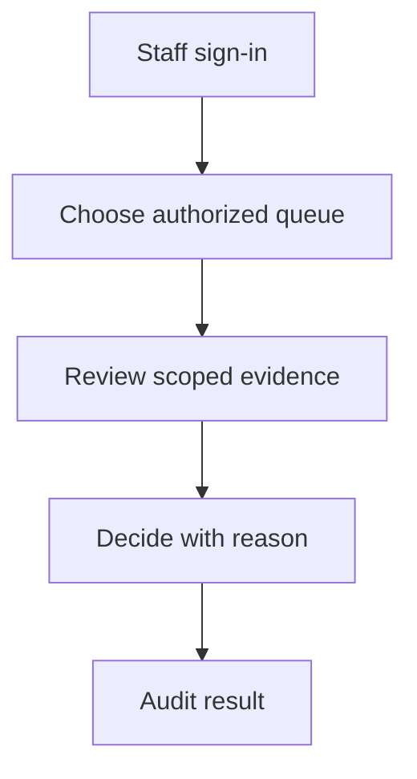

# M12 — Operations and staff

[Handover index](README.md) · [Shared client conventions](COMMON.md) · [OpenAPI](../openapi.yaml)

## Status

Not implemented. Design/reference only; no supported request/response or error contract.

0 implemented operations. This document describes the checked-in backend, not a deployed environment.

## Screen flow

Proposed flow only; no working API is implied.



## Wireframe

```text
+-------------------------------+
| Staff console - planned       |
| Reports | Verification | Jobs |
| [ Assigned case ]             |
| Reason [               ]      |
| [ Submit decision ]           |
+-------------------------------+
```

## Client behavior and integration limits

- Staff routes will use /admin/v1 and separate staff SSO/MFA. User bearer tokens must never be treated as reviewer authorization.

## Request, response and error status

No supported contract yet. Do not call the planned paths or use fallback/mock success in production. Schemas, status codes, error codes, authentication and retry behavior will be added with implementation. Generic route/auth failures are not a feature contract.

## Planned scope

Use `/admin/v1` (not `/v1/admin`) with staff SSO/MFA and role checks. Every sensitive read and action is audited.

| Methods + resource | Role | Purpose |
| --- | --- | --- |
| GET `/reports`; POST `/reports/{id}/claim`, `/decide` | Moderator | Queue ownership, evidence, reasons, escalation |
| GET `/verifications`; POST `/verifications/{id}/decide` | Reviewer | Manual evidence review, expiry and appeals |
| GET `/users/{id}`; POST `/users/{id}/actions` | Support/moderator | Minimal support projection, suspend/reinstate with reason |
| GET `/appeals`; POST `/appeals/{id}/decide` | Appeals | Different reviewer from original enforcement |
| GET/POST/PATCH `/places` and `/{id}` | City ops | Safe public-place registry |
| GET/PATCH `/countries/{code}`, `/app-releases/{platform}` | Release ops | Audit rollout/version changes; staged validation |
| GET `/jobs`, `/metrics`, `/audit-events` | Operations | Failed delivery/deletion, queue health, launch funnel |

Staff cannot retrieve raw household location or casually read private messages. Evidence access is case-scoped. Analytics initially covers onboarding funnel, eligible dogs by sufficiently large area, time to first match/conversation, meetup acceptance/completion, report resolution and crash/error rates. Never fabricate local supply counts.

---

Maintained through `scripts/handover-notes.mjs`, `docs/API_PLAN.md`, OpenAPI and source error codes. Regenerate with `npm run docs:handovers`; verify with `npm run check:handovers`.
