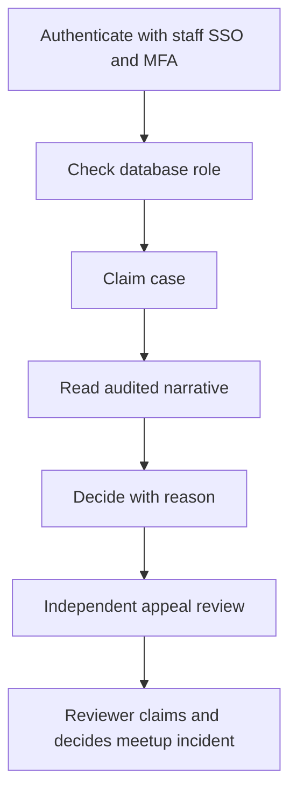

# M12 — Operations and staff

[Handover index](README.md) · [Shared client conventions](COMMON.md) · [OpenAPI](../openapi.yaml)

## Status

SSO/MFA-gated staff cases, exclusive meetup incident reviews, support, account actions/appeals, place reviews, release policy and reviewed legal publishing implemented. Real SSO provisioning and broader provider/privacy tooling remain pending.

29 implemented operations. This document describes the checked-in backend, not a deployed environment.

## Screen flow

Current integration flow; readiness gates may stop progression.



## Wireframe

```text
+-----------------------------------------------------------+
| Staff operations                                          |
| Reports | Support | Appeals | Places | Jobs               |
| [ Assigned case ]                                         |
| Reason / policy [       ]                                 |
| [ Submit reviewed decision ]                              |
| No raw guardian location or unrestricted chat search      |
| Incident queue [ claim ]                                  |
| Assigned incident [ private note ] [ escalate | dismiss ] |
+-----------------------------------------------------------+
```

## Client behavior and integration limits

- All /admin/v1 routes require separate OIDC staff bearer tokens. Configure STAFF_ISSUER, STAFF_JWKS_URL and STAFF_AUDIENCE together using HTTPS. RS256/ES256 signatures, issuer/audience/expiry, amr containing mfa and auth_time within 15 minutes are verified. No user token or role claim grants staff access. Unconfigured SSO returns 503 staff-auth-unavailable.
- Provision approved external subjects separately using npm run staff:provision -- <https-issuer> <subject> <comma-separated-roles>. This updates local staff roles and audits provisioning; it does not create an identity-provider user or bypass MFA. No staff account is seeded. Live active/roles are checked each request.
- Roles: moderator for report queues/claims/decisions and account actions; support for minimal account lookup and support messages; appeals for independent reviews; city_ops for public-place review; operations for job counts. Multiple roles require explicit provisioning. Reviewer role is reserved; verification approval endpoints are not implemented.
- Report narrative is readable only after exclusive claim. Concurrent claim losers receive 409 case-unavailable. Decisions support dismissal/escalation with a reason; user enforcement is a separate explicit action. There is no unrestricted message decryption endpoint. Every successful sensitive read/action writes a staff audit record without copying narrative.
- Suspend accepts reasonCode and policyRef, records previous account state, revokes sessions/devices, pauses published dogs and closes matches/meetups. Reinstate restores the stored prior state, never automatically promotes a pending account, republishes dogs or reopens relationships. Deletion-request accounts cannot be reinstated by this route.
- Appeal reads/decisions reject the original enforcement reviewer. Uphold records an outcome; overturn supports the current reversible suspension and restores its prior account state. Other action types or newer/previously reversed suspensions return 409 manual-review-required.
- City ops can inspect submitted public-place coordinates and approve/reject/close places. Approval is a deliberate staff review, not automated proof. Place creation still enters through suggestion intake. Full venue editing/country-release administration remains pending.
- Support reads decrypt only the requested ticket and are audited. Replies may resolve the ticket; resolved tickets reject new replies. Staff reply retries are not deduplicated yet: after a transport failure, reload history before resending. There is no external email/SMS reply delivery.
- GET jobs returns persisted push/privacy counts. It does not run those jobs or imply external delivery/erasure completion. Production KMS, reviewer evidence/provider callbacks, legal publishing/release tooling, full audit browsing and privacy processing remain separate launch dependencies.
- release_ops can GET/PATCH /admin/v1/app-releases. PATCH replaces the complete two-platform policy with expectedVersion and storeAvailabilityConfirmed=true. A stale version returns 409 release-version-conflict. Android URLs must use play.google.com and iOS apps.apple.com; minimum build must not exceed latest, and a forced update requires a store URL. Availability confirmation is the staff reviewer’s attestation, not automated store verification. Public product rollout flags remain disabled.
- legal_ops can list/read/create /admin/v1/legal/documents and publish /{id}/publish with reviewConfirmed=true. Draft creation requires a documented reviewReference and explicit India/en-IN purpose/version/body. No legal content is seeded or generated. Public reads and bootstrap hints see published versions only. Published rows are immutable; changes require a new version. Duplicate versions return 409 policy-version-exists. Publishing is idempotent and audited without copying body text.
- Provision release_ops/legal_ops only for approved reviewers through the existing staff provisioning process. Request bodies still have a global 64 KiB HTTP limit even where field character limits are larger. Country expansion and broader reviewer/provider tooling remain unavailable.
- operations can GET /admin/v1/notifications/jobs with state (default dead_letter) and UUID pagination, and POST /{id}/retry with {}. The list contains only job IDs/state/attempts/timing/redacted codes, not tokens or payloads. Retry resets exhausted attempts and queues for an available provider; it does not send synchronously. Non-dead-letter jobs return 409 push-job-not-retryable. Reads/retries are audited.
- reviewer can GET /admin/v1/meetup-incidents for metadata, POST /{id}/claim with {}, GET /{id} for the assigned private incident note, then POST /{id}/decide with dismissed/escalated and reasonCode. A competing reviewer gets 409 case-unavailable; unassigned detail returns 404. Decisions are terminal. Reads and actions are audited without copying the note. This queue does not automatically suspend an account or promise emergency response.
- Meetup incident queue entries are created transactionally for reviews with incidentOccurred=true or a privateNote. Existing eligible reviews are backfilled once. Provision reviewer only to approved trust staff; support and city_ops roles cannot read it.
- operations can GET /admin/v1/audit-events with a past from/to window of at most 31 days (default last seven days), exact actorKind/action/subjectType/subjectId filters, limit up to 50 and an opaque scoped cursor. Return only id, actor kind/id, action, subject type/id, requestId and createdAt; before/after JSON is never exposed. Reuse the returned from/to and identical filters with nextCursor. An invalid/changed cursor returns 400 invalid-cursor. Every browse is itself audited. This is metadata inspection only; downstream incident evidence requires its own role/claim.
- Run npm run maintenance:run from an external scheduler. One database-wide advisory lock prevents overlapping passes; an overlap returns status already_running. The pass provisions current/next audit partitions, removes expired discovery snapshots/exposure rows, old realtime tickets and privacy tokens, and processes up to 50 meetup reminders/expiries. Outputs are counts only. It does not delete audit evidence, run media cleanup/export processing, send push, or configure a scheduler. A failed pass exits nonzero and should be retried.
- maintenance:run now includes up to 100 expired verification grants per pass. The separate verification:expire command runs that sweep alone. Neither command creates reviewer grants or replaces the required provider evidence workflow.

## Endpoint summary

| Method | Path | Access | Success |
| --- | --- | --- | --- |
| GET | `/admin/v1/reports` | Provisioned staff SSO + recent MFA; endpoint role required | 200 |
| POST | `/admin/v1/reports/{id}/claim` | Provisioned staff SSO + recent MFA; endpoint role required | 200 |
| GET | `/admin/v1/reports/{id}` | Provisioned staff SSO + recent MFA; endpoint role required | 200 |
| POST | `/admin/v1/reports/{id}/decide` | Provisioned staff SSO + recent MFA; endpoint role required | 200 |
| GET | `/admin/v1/users/{id}` | Provisioned staff SSO + recent MFA; endpoint role required | 200 |
| POST | `/admin/v1/users/{id}/actions` | Provisioned staff SSO + recent MFA; endpoint role required | 200 |
| GET | `/admin/v1/appeals` | Provisioned staff SSO + recent MFA; endpoint role required | 200 |
| GET | `/admin/v1/appeals/{id}` | Provisioned staff SSO + recent MFA; endpoint role required | 200 |
| POST | `/admin/v1/appeals/{id}/decide` | Provisioned staff SSO + recent MFA; endpoint role required | 200 |
| GET | `/admin/v1/places` | Provisioned staff SSO + recent MFA; endpoint role required | 200 |
| GET | `/admin/v1/places/{id}` | Provisioned staff SSO + recent MFA; endpoint role required | 200 |
| PATCH | `/admin/v1/places/{id}` | Provisioned staff SSO + recent MFA; endpoint role required | 200 |
| GET | `/admin/v1/jobs` | Provisioned staff SSO + recent MFA; endpoint role required | 200 |
| GET | `/admin/v1/support/tickets` | Provisioned staff SSO + recent MFA; endpoint role required | 200 |
| GET | `/admin/v1/support/tickets/{id}` | Provisioned staff SSO + recent MFA; endpoint role required | 200 |
| POST | `/admin/v1/support/tickets/{id}/messages` | Provisioned staff SSO + recent MFA; endpoint role required | 201 |
| GET | `/admin/v1/app-releases` | Provisioned staff SSO + recent MFA; endpoint role required | 200 |
| PATCH | `/admin/v1/app-releases` | Provisioned staff SSO + recent MFA; endpoint role required | 200 |
| GET | `/admin/v1/legal/documents` | Provisioned staff SSO + recent MFA; endpoint role required | 200 |
| POST | `/admin/v1/legal/documents` | Provisioned staff SSO + recent MFA; endpoint role required | 201 |
| GET | `/admin/v1/legal/documents/{id}` | Provisioned staff SSO + recent MFA; endpoint role required | 200 |
| POST | `/admin/v1/legal/documents/{id}/publish` | Provisioned staff SSO + recent MFA; endpoint role required | 200 |
| GET | `/admin/v1/notifications/jobs` | Provisioned staff SSO + recent MFA; endpoint role required | 200 |
| POST | `/admin/v1/notifications/jobs/{id}/retry` | Provisioned staff SSO + recent MFA; endpoint role required | 200 |
| GET | `/admin/v1/meetup-incidents` | Provisioned staff SSO + recent MFA; endpoint role required | 200 |
| GET | `/admin/v1/meetup-incidents/{id}` | Provisioned staff SSO + recent MFA; endpoint role required | 200 |
| POST | `/admin/v1/meetup-incidents/{id}/claim` | Provisioned staff SSO + recent MFA; endpoint role required | 200 |
| POST | `/admin/v1/meetup-incidents/{id}/decide` | Provisioned staff SSO + recent MFA; endpoint role required | 200 |
| GET | `/admin/v1/audit-events` | Provisioned staff SSO + recent MFA; endpoint role required | 200 |

## Examples

Illustrative data only. Replace IDs with returned resource IDs and token/checksum placeholders with real local values. Examples are not seeded records, legal text or evidence. For examples without a response block, use the exact response shape in the endpoint section below.

### Read assigned report queue

```http
GET /admin/v1/reports?limit=20
Authorization: Bearer <staffSsoToken>
```

### Claim a report

```http
POST /admin/v1/reports/77777777-7777-4777-8777-777777777777/claim
Authorization: Bearer <staffSsoToken>
Content-Type: application/json

{}
```

### Review a public place

```http
PATCH /admin/v1/places/77777777-7777-4777-8777-777777777777
Authorization: Bearer <staffSsoToken>
Content-Type: application/json

{
  "state": "approved"
}
```

### Decide assigned meetup incident

```http
POST /admin/v1/meetup-incidents/77777777-7777-4777-8777-777777777777/decide
Authorization: Bearer <staffSsoToken>
Content-Type: application/json

{
  "decision": "escalated",
  "reasonCode": "needs_review"
}
```

### Browse audit event metadata

```http
GET /admin/v1/audit-events?limit=20&action=meetup_incident.claim
Authorization: Bearer <staffSsoToken>
```

## Module errors

Also handle the [shared error contract](COMMON.md#errors). These are module-level codes; applicability depends on the endpoint and current state. HTTP status alone is insufficient.

| HTTP | Code | Meaning | Client action |
| --- | --- | --- | --- |
| 400 | `invalid-audit-window` | Choose a past window of at most 31 days. | Show a contextual error using code; correct input/state or respect the documented limit before retrying. |
| 400 | `invalid-cursor` | The cursor is invalid for this audit window. | Show a contextual error using code; correct input/state or respect the documented limit before retrying. |
| 400 | `invalid-store-url` | Use the official store host for this platform. | Show a contextual error using code; correct input/state or respect the documented limit before retrying. |
| 401 | `staff-reauthentication-required` | Recent staff MFA is required. | Show a contextual error using code; correct input/state or respect the documented limit before retrying. |
| 401 | `staff-unauthenticated` | A valid staff SSO token is required. | Show a contextual error using code; correct input/state or respect the documented limit before retrying. |
| 403 | `independent-review-required` | Another staff member must decide this appeal. | Show a contextual error using code; correct input/state or respect the documented limit before retrying. |
| 403 | `staff-forbidden` | Staff access is not provisioned. | Show a contextual error using code; correct input/state or respect the documented limit before retrying. |
| 404 | `not-found` | Policy document is unavailable. | Refresh the list/access state; avoid exposing whether another user owns the resource. |
| 409 | `case-final` | Appeal is already decided. | Show a contextual error using code; correct input/state or respect the documented limit before retrying. |
| 409 | `case-unavailable` | Incident case is closed or claimed by another reviewer. | Show a contextual error using code; correct input/state or respect the documented limit before retrying. |
| 409 | `legal-review-required` | A documented review reference is required before publishing. | Show a contextual error using code; correct input/state or respect the documented limit before retrying. |
| 409 | `manual-review-required` | A newer suspension requires review. | Show a contextual error using code; correct input/state or respect the documented limit before retrying. |
| 409 | `policy-version-exists` | Use a new version for changed legal content. | Show a contextual error using code; correct input/state or respect the documented limit before retrying. |
| 409 | `privacy-request-active` | Account is in privacy processing. | Show a contextual error using code; correct input/state or respect the documented limit before retrying. |
| 409 | `push-job-not-retryable` | Only an existing dead-letter job can be retried. | Show a contextual error using code; correct input/state or respect the documented limit before retrying. |
| 409 | `release-version-conflict` | Refresh the current release policy. | Show a contextual error using code; correct input/state or respect the documented limit before retrying. |
| 409 | `ticket-closed` | Ticket is resolved. | Show a contextual error using code; correct input/state or respect the documented limit before retrying. |
| 409 | `user-state-conflict` | No reversible suspension exists. | Show a contextual error using code; correct input/state or respect the documented limit before retrying. |
| 503 | `case-decryption-unavailable` | Case decryption is not configured. | Show a contextual error using code; correct input/state or respect the documented limit before retrying. |
| 503 | `staff-auth-unavailable` | Staff SSO is not configured. | Show a contextual error using code; correct input/state or respect the documented limit before retrying. |

## Detailed request and response contracts

Shapes below are **type notation**, not JSON to send: `?` means optional, `|` means alternatives, and comments show constraints/defaults. Requests reject unknown write fields. JSON uses actual values. Runtime cross-field/business rules are in the client guidance above. The linked OpenAPI is the machine-readable source.

### GET /admin/v1/reports

Operation: `adminReports`. Access: Provisioned staff SSO + recent MFA; endpoint role required.

Parameters:

- `limit` (query, optional): ` integer /* minimum=1, maximum=50, default=20 */ `
- `cursor` (query, optional): ` string `

Request body: none.

Response HTTP 200:

```text
{
  items: Array<{
    id: string /* format="uuid" */
    subjectType: string
    category: string
    severity: integer
    state: string
    assignedStaffId: string /* format="uuid" */ | null
    createdAt: string /* format="date-time" */
  }>
  nextCursor: string | null
}
```

### POST /admin/v1/reports/{id}/claim

Operation: `claimReport`. Access: Provisioned staff SSO + recent MFA; endpoint role required.

Parameters:

- `id` (path, required): ` string /* format="uuid" */ `

Request body (application/json, required):

```text
{}
```

Response HTTP 200:

```text
{
  id: string /* format="uuid" */
  state: "in_review"
}
```

### GET /admin/v1/reports/{id}

Operation: `adminReport`. Access: Provisioned staff SSO + recent MFA; endpoint role required.

Parameters:

- `id` (path, required): ` string /* format="uuid" */ `

Request body: none.

Response HTTP 200:

```text
{
  id: string /* format="uuid" */
  subjectType: string
  subjectId: string /* format="uuid" */
  category: string
  state: string
  details: string | null
}
```

### POST /admin/v1/reports/{id}/decide

Operation: `decideReport`. Access: Provisioned staff SSO + recent MFA; endpoint role required.

Parameters:

- `id` (path, required): ` string /* format="uuid" */ `

Request body (application/json, required):

```text
{
  decision: "dismissed" | "escalated"
  reason: string /* minLength=5, maxLength=300 */
}
```

Response HTTP 200:

```text
{
  id: string /* format="uuid" */
  state: "dismissed" | "escalated"
}
```

### GET /admin/v1/users/{id}

Operation: `adminUser`. Access: Provisioned staff SSO + recent MFA; endpoint role required.

Parameters:

- `id` (path, required): ` string /* format="uuid" */ `

Request body: none.

Response HTTP 200:

```text
{
  id: string /* format="uuid" */
  status: string
  countryCode: string
  deletionRequestedAt: string /* format="date-time" */ | null
  createdAt: string /* format="date-time" */
}
```

### POST /admin/v1/users/{id}/actions

Operation: `adminUserAction`. Access: Provisioned staff SSO + recent MFA; endpoint role required.

Parameters:

- `id` (path, required): ` string /* format="uuid" */ `

Request body (application/json, required):

```text
{
  action: "suspend" | "reinstate"
  reasonCode: string /* pattern="^[a-z0-9_-]{3,60}$" */
  policyRef: string /* minLength=3, maxLength=120 */
}
```

Response HTTP 200:

```text
{
  id: string /* format="uuid" */
  status: string
  actionId: string /* format="uuid" */
}
```

### GET /admin/v1/appeals

Operation: `adminAppeals`. Access: Provisioned staff SSO + recent MFA; endpoint role required.

Parameters:

- `limit` (query, optional): ` integer /* minimum=1, maximum=50, default=20 */ `
- `cursor` (query, optional): ` string `

Request body: none.

Response HTTP 200:

```text
{
  items: Array<{
    id: string /* format="uuid" */
    actionId: string /* format="uuid" */
    state: string
    createdAt: string /* format="date-time" */
  }>
  nextCursor: string | null
}
```

### GET /admin/v1/appeals/{id}

Operation: `adminAppeal`. Access: Provisioned staff SSO + recent MFA; endpoint role required.

Parameters:

- `id` (path, required): ` string /* format="uuid" */ `

Request body: none.

Response HTTP 200:

```text
{
  id: string /* format="uuid" */
  state: string
  statement: string | null
  reasonCode: string
  policyRef: string
}
```

### POST /admin/v1/appeals/{id}/decide

Operation: `decideAppeal`. Access: Provisioned staff SSO + recent MFA; endpoint role required.

Parameters:

- `id` (path, required): ` string /* format="uuid" */ `

Request body (application/json, required):

```text
{
  decision: "uphold" | "overturn"
  outcome: string /* minLength=5, maxLength=300 */
}
```

Response HTTP 200:

```text
{
  id: string /* format="uuid" */
  state: "upheld" | "overturned"
}
```

### GET /admin/v1/places

Operation: `adminPlaces`. Access: Provisioned staff SSO + recent MFA; endpoint role required.

Parameters:

- `limit` (query, optional): ` integer /* minimum=1, maximum=50, default=20 */ `
- `cursor` (query, optional): ` string `

Request body: none.

Response HTTP 200:

```text
{
  items: Array<{
    id: string /* format="uuid" */
    name: string
    kind: string
    state: string
    metroId: string /* format="uuid" */ | null
    createdAt: string /* format="date-time" */
  }>
  nextCursor: string | null
}
```

### GET /admin/v1/places/{id}

Operation: `adminPlace`. Access: Provisioned staff SSO + recent MFA; endpoint role required.

Parameters:

- `id` (path, required): ` string /* format="uuid" */ `

Request body: none.

Response HTTP 200:

```text
{
  id: string /* format="uuid" */
  name: string
  kind: string
  latitude: number
  longitude: number
  address: string | null
  state: string
  metroId: string /* format="uuid" */ | null
  isFenced: boolean | null
  hasWater: boolean | null
}
```

### PATCH /admin/v1/places/{id}

Operation: `reviewPlace`. Access: Provisioned staff SSO + recent MFA; endpoint role required.

Parameters:

- `id` (path, required): ` string /* format="uuid" */ `

Request body (application/json, required):

```text
{
  state: "approved" | "rejected" | "closed"
}
```

Response HTTP 200:

```text
{
  id: string /* format="uuid" */
  state: "approved" | "rejected" | "closed"
}
```

### GET /admin/v1/jobs

Operation: `adminJobCounts`. Access: Provisioned staff SSO + recent MFA; endpoint role required.

Request body: none.

Response HTTP 200:

```text
{
  push: Array<{
    state: string
    count: integer
  }>
  privacy: Array<{
    kind: string
    state: string
    count: integer
  }>
}
```

### GET /admin/v1/support/tickets

Operation: `adminSupportTickets`. Access: Provisioned staff SSO + recent MFA; endpoint role required.

Parameters:

- `limit` (query, optional): ` integer /* minimum=1, maximum=50, default=20 */ `
- `cursor` (query, optional): ` string `

Request body: none.

Response HTTP 200:

```text
{
  items: Array<{
    id: string /* format="uuid" */
    category: string
    state: string
    createdAt: string /* format="date-time" */
  }>
  nextCursor: string | null
}
```

### GET /admin/v1/support/tickets/{id}

Operation: `adminSupportTicket`. Access: Provisioned staff SSO + recent MFA; endpoint role required.

Parameters:

- `id` (path, required): ` string /* format="uuid" */ `
- `limit` (query, optional): ` integer /* minimum=1, maximum=50, default=20 */ `
- `cursor` (query, optional): ` string `

Request body: none.

Response HTTP 200:

```text
{
  ticket: {
    id: string /* format="uuid" */
    state: string
    category: string
  }
  messages: Array<{
    id: string /* format="uuid" */
    author: "user" | "support"
    body: string
    createdAt: string /* format="date-time" */
  }>
  nextCursor: string | null
}
```

### POST /admin/v1/support/tickets/{id}/messages

Operation: `adminSupportReply`. Access: Provisioned staff SSO + recent MFA; endpoint role required.

Parameters:

- `id` (path, required): ` string /* format="uuid" */ `

Request body (application/json, required):

```text
{
  message: string /* minLength=1, maxLength=4000 */
  resolve: boolean
}
```

Response HTTP 201:

```text
{
  id: string /* format="uuid" */
  state: "resolved" | "in_review"
}
```

### GET /admin/v1/app-releases

Operation: `staffReleasePolicy`. Access: Provisioned staff SSO + recent MFA; endpoint role required.

Request body: none.

Response HTTP 200:

```text
{
  version: integer /* minimum=1 */
  policy: {
    revision: string
    maintenance: boolean
    android: {
      minimumBuild: integer /* minimum=1 */
      latestBuild: integer /* minimum=1 */
      storeUrl: string /* format="uri" */ | null
    }
    ios: {
      minimumBuild: integer /* minimum=1 */
      latestBuild: integer /* minimum=1 */
      storeUrl: string /* format="uri" */ | null
    }
  }
  updatedAt: string /* format="date-time" */
}
```

### PATCH /admin/v1/app-releases

Operation: `updateReleasePolicy`. Access: Provisioned staff SSO + recent MFA; endpoint role required.

Request body (application/json, required):

```text
{
  expectedVersion: integer /* minimum=1 */
  policy: {
    revision: string
    maintenance: boolean
    android: {
      minimumBuild: integer /* minimum=1 */
      latestBuild: integer /* minimum=1 */
      storeUrl: string /* format="uri" */ | null
    }
    ios: {
      minimumBuild: integer /* minimum=1 */
      latestBuild: integer /* minimum=1 */
      storeUrl: string /* format="uri" */ | null
    }
  }
  storeAvailabilityConfirmed: true
}
```

Response HTTP 200:

```text
{
  version: integer /* minimum=1 */
  policy: {
    revision: string
    maintenance: boolean
    android: {
      minimumBuild: integer /* minimum=1 */
      latestBuild: integer /* minimum=1 */
      storeUrl: string /* format="uri" */ | null
    }
    ios: {
      minimumBuild: integer /* minimum=1 */
      latestBuild: integer /* minimum=1 */
      storeUrl: string /* format="uri" */ | null
    }
  }
  updatedAt: string /* format="date-time" */
}
```

### GET /admin/v1/legal/documents

Operation: `staffLegalDocuments`. Access: Provisioned staff SSO + recent MFA; endpoint role required.

Parameters:

- `limit` (query, optional): ` integer /* minimum=1, maximum=50, default=20 */ `
- `cursor` (query, optional): ` string `

Request body: none.

Response HTTP 200:

```text
{
  items: Array<{
    id: string /* format="uuid" */
    purpose: string
    version: string
    countryCode: string
    locale: string
    publishedAt: string /* format="date-time" */ | null
    contentHash: string
  }>
  nextCursor: string | null
}
```

### POST /admin/v1/legal/documents

Operation: `createLegalDraft`. Access: Provisioned staff SSO + recent MFA; endpoint role required.

Request body (application/json, required):

```text
{
  purpose: "terms" | "privacy" | "community" | "location" | "marketing"
  version: string /* minLength=1, maxLength=60 */
  countryCode: "IN"
  locale: "en-IN"
  body: string /* minLength=30, maxLength=40000 */
  reviewReference: string /* minLength=5, maxLength=200 */
}
```

Response HTTP 201:

```text
{
  id: string /* format="uuid" */
  publishedAt: null
  contentHash: string
}
```

### GET /admin/v1/legal/documents/{id}

Operation: `staffLegalDocument`. Access: Provisioned staff SSO + recent MFA; endpoint role required.

Parameters:

- `id` (path, required): ` string /* format="uuid" */ `

Request body: none.

Response HTTP 200:

```text
{
  id: string /* format="uuid" */
  purpose: string
  version: string
  countryCode: string
  locale: string
  publishedAt: string /* format="date-time" */ | null
  contentHash: string
  body: string
  reviewReference: string | null
}
```

### POST /admin/v1/legal/documents/{id}/publish

Operation: `publishLegalDocument`. Access: Provisioned staff SSO + recent MFA; endpoint role required.

Parameters:

- `id` (path, required): ` string /* format="uuid" */ `

Request body (application/json, required):

```text
{
  reviewConfirmed: true
}
```

Response HTTP 200:

```text
{
  id: string /* format="uuid" */
  publishedAt: string /* format="date-time" */
}
```

### GET /admin/v1/notifications/jobs

Operation: `staffPushJobs`. Access: Provisioned staff SSO + recent MFA; endpoint role required.

Parameters:

- `limit` (query, optional): ` integer /* minimum=1, maximum=50, default=20 */ `
- `cursor` (query, optional): ` string `
- `state` (query, optional): ` "awaiting_provider" | "pending" | "delivered" | "suppressed" | "dead_letter" `

Request body: none.

Response HTTP 200:

```text
{
  items: Array<{
    id: string /* format="uuid" */
    state: "awaiting_provider" | "pending" | "delivered" | "suppressed" | "dead_letter"
    attempts: integer /* minimum=0 */
    availableAt: string /* format="date-time" */
    leaseUntil: string /* format="date-time" */ | null
    lastError: string | null
  }>
  nextCursor: string | null
}
```

### POST /admin/v1/notifications/jobs/{id}/retry

Operation: `retryPushJob`. Access: Provisioned staff SSO + recent MFA; endpoint role required.

Parameters:

- `id` (path, required): ` string /* format="uuid" */ `

Request body (application/json, required):

```text
{}
```

Response HTTP 200:

```text
{
  id: string /* format="uuid" */
  state: "awaiting_provider"
}
```

### GET /admin/v1/meetup-incidents

Operation: `adminMeetupIncidents`. Access: Provisioned staff SSO + recent MFA; endpoint role required.

Parameters:

- `limit` (query, optional): ` integer /* minimum=1, maximum=50, default=20 */ `
- `cursor` (query, optional): ` string `

Request body: none.

Response HTTP 200:

```text
{
  items: Array<{
    id: string /* format="uuid" */
    state: "queued" | "in_review" | "dismissed" | "escalated"
    assignedStaffId: string /* format="uuid" */ | null
    incidentOccurred: boolean
    incidentType: string | null
    createdAt: string /* format="date-time" */
  }>
  nextCursor: string | null
}
```

### GET /admin/v1/meetup-incidents/{id}

Operation: `adminMeetupIncident`. Access: Provisioned staff SSO + recent MFA; endpoint role required.

Parameters:

- `id` (path, required): ` string /* format="uuid" */ `

Request body: none.

Response HTTP 200:

```text
{
  id: string /* format="uuid" */
  state: "queued" | "in_review" | "dismissed" | "escalated"
  reviewId: string /* format="uuid" */
  meetupId: string /* format="uuid" */
  reporterUserId: string /* format="uuid" */
  incidentOccurred: boolean
  incidentType: string | null
  privateNote: string | null
}
```

### POST /admin/v1/meetup-incidents/{id}/claim

Operation: `adminClaimMeetupIncident`. Access: Provisioned staff SSO + recent MFA; endpoint role required.

Parameters:

- `id` (path, required): ` string /* format="uuid" */ `

Request body (application/json, required):

```text
{}
```

Response HTTP 200:

```text
{
  id: string /* format="uuid" */
  state: "in_review"
}
```

### POST /admin/v1/meetup-incidents/{id}/decide

Operation: `adminDecideMeetupIncident`. Access: Provisioned staff SSO + recent MFA; endpoint role required.

Parameters:

- `id` (path, required): ` string /* format="uuid" */ `

Request body (application/json, required):

```text
{
  decision: "dismissed" | "escalated"
  reasonCode: string /* pattern="^[a-z0-9_-]{3,60}$" */
}
```

Response HTTP 200:

```text
{
  id: string /* format="uuid" */
  state: "dismissed" | "escalated"
}
```

### GET /admin/v1/audit-events

Operation: `adminAuditEvents`. Access: Provisioned staff SSO + recent MFA; endpoint role required.

Parameters:

- `limit` (query, optional): ` integer /* minimum=1, maximum=50 */ `
- `cursor` (query, optional): ` string `
- `from` (query, optional): ` string /* format="date-time" */ `
- `to` (query, optional): ` string /* format="date-time" */ `
- `actorKind` (query, optional): ` string `
- `action` (query, optional): ` string `
- `subjectType` (query, optional): ` string `
- `subjectId` (query, optional): ` string /* format="uuid" */ `

Request body: none.

Response HTTP 200:

```text
{
  items: Array<{
    id: string /* pattern="^[0-9]+$" */
    actorKind: "user" | "staff" | "system"
    actorUserId: string /* format="uuid" */ | null
    action: string
    subjectType: string
    subjectId: string /* format="uuid" */ | null
    requestId: string /* format="uuid" */ | null
    createdAt: string /* format="date-time" */
  }>
  from: string /* format="date-time" */
  to: string /* format="date-time" */
  nextCursor: string | null
}
```

---

Maintained through `scripts/handover-notes.mjs`, `docs/API_PLAN.md`, OpenAPI and source error codes. Regenerate with `npm run docs:handovers`; verify with `npm run check:handovers`.
