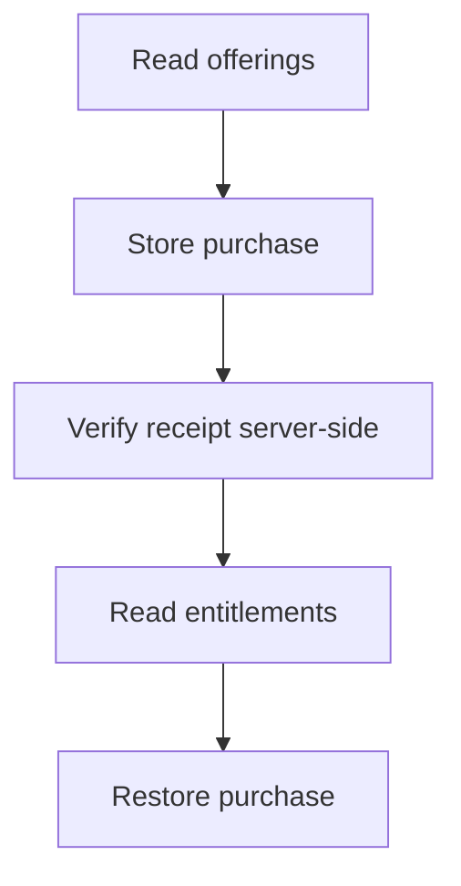

# M13 — Billing and growth

[Handover index](README.md) · [Shared client conventions](COMMON.md) · [OpenAPI](../openapi.yaml)

## Status

Not implemented. Design/reference only; no supported request/response or error contract.

0 implemented operations. This document describes the checked-in backend, not a deployed environment.

## Screen flow

Proposed flow only; no working API is implied.



## Wireframe

```text
+-------------------------+
| Subscriptions - planned |
| [ Offering and price ]  |
| [ Subscribe ]           |
| [ Restore purchases ]   |
| Manage in store         |
+-------------------------+
```

## Client behavior and integration limits

- Provider/store choice, receipt contracts and product approval are pending. Do not hard-code prices or unlock capabilities from client purchase callbacks alone.

## Request, response and error status

No supported contract yet. Do not call the planned paths or use fallback/mock success in production. Schemas, status codes, error codes, authentication and retry behavior will be added with implementation. Generic route/auth failures are not a feature contract.

## Planned scope

GET `/commerce/offerings`, POST `/commerce/receipts`, POST `/commerce/restore`, GET `/commerce/subscriptions`, POST `/commerce/cancel-intents`, signed POST `/webhooks/billing`. Provider-confirmed entitlements, renewal/cancellation/refund/grace-period rules and receipt replay protection are required. Start with one subscription only when product value is demonstrated. Digital subscriptions and any future animal-service payments have different policy reviews.

---

Maintained through `scripts/handover-notes.mjs`, `docs/API_PLAN.md`, OpenAPI and source error codes. Regenerate with `npm run docs:handovers`; verify with `npm run check:handovers`.
