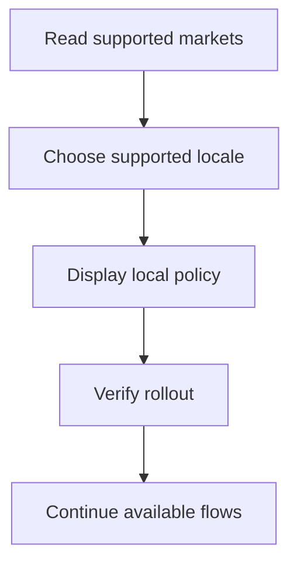

# M14 — Country expansion

[Handover index](README.md) · [Shared client conventions](COMMON.md) · [OpenAPI](../openapi.yaml)

## Status

Not implemented. Design/reference only; no supported request/response or error contract.

0 implemented operations. This document describes the checked-in backend, not a deployed environment.

## Screen flow

Proposed flow only; no working API is implied.



## Wireframe

```text
+-----------------------------+
| Country rollout - planned   |
| Country [       ]           |
| Locale [        ]           |
| Availability and support    |
| [ Continue when supported ] |
+-----------------------------+
```

## Client behavior and integration limits

- M01 supplies India development bootstrap only. Additional enrollment countries, local documents, support and providers are not enabled.

## Request, response and error status

No supported contract yet. Do not call the planned paths or use fallback/mock success in production. Schemas, status codes, error codes, authentication and retry behavior will be added with implementation. Generic route/auth failures are not a feature contract.

## Planned scope

Country policy has: launch state; supported phone regions; residency region; default/supported locales; timezone suggestions; currency/minor units; distance display units; minimum age policy; feature availability; policy document versions; SMS/verification providers; support hours and country contacts. APIs continue accepting ISO identifiers and UTC instants. Quotas use IANA zones and handle DST; changing timezone must not mint extra daily quota.

Opening a country requires local privacy/consumer/breeding review, processor and transfer assessment, localized documents/content, compatible payment/store configuration, moderation/support capacity, tested phone delivery and enough dog/venue supply in the first city. Users traveling abroad do not automatically migrate residency. Existing accounts remain manageable from unopened countries; country restrictions apply to new enrollment/discovery availability, not deletion/support access.

---

Maintained through `scripts/handover-notes.mjs`, `docs/API_PLAN.md`, OpenAPI and source error codes. Regenerate with `npm run docs:handovers`; verify with `npm run check:handovers`.
