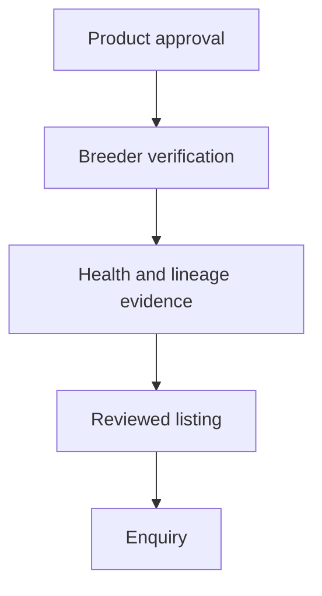

# M15 — Breeding introductions

[Handover index](README.md) · [Shared client conventions](COMMON.md) · [OpenAPI](../openapi.yaml)

## Status

Not implemented. Design/reference only; no supported request/response or error contract.

0 implemented operations. This document describes the checked-in backend, not a deployed environment.

## Screen flow

Proposed flow only; no working API is implied.



## Wireframe

```text
+------------------------------+
| Breeding - not enabled       |
| Verification prerequisites   |
| [ Reviewed listing concept ] |
| [ Enquiry concept ]          |
| No animal checkout           |
+------------------------------+
```

## Client behavior and integration limits

- This optional mode is not approved for launch. Inherited tables do not imply working APIs, legal approval or payment support.

## Request, response and error status

No supported contract yet. Do not call the planned paths or use fallback/mock success in production. Schemas, status codes, error codes, authentication and retry behavior will be added with implementation. Generic route/auth failures are not a feature contract.

## Planned scope

GET/POST/PATCH `/lineage/breeders/me`; GET/POST/PATCH `/lineage/listings` and `/{id}`; GET/PUT `/lineage/pedigree/{dogId}`; POST `/lineage/coi/preview`; POST/GET `/lineage/enquiries`; POST `/lineage/outcomes`; GET `/lineage/verify-lookup`. Registration verification, breed-specific health evidence, provenance, ancestry cycle prevention, COI completeness and jurisdiction-specific eligibility are prerequisites. No puppy checkout, escrow or breeding payment custody in this plan. Existing inherited lineage tables are not proof of correct current legal rules.

---

Maintained through `scripts/handover-notes.mjs`, `docs/API_PLAN.md`, OpenAPI and source error codes. Regenerate with `npm run docs:handovers`; verify with `npm run check:handovers`.
