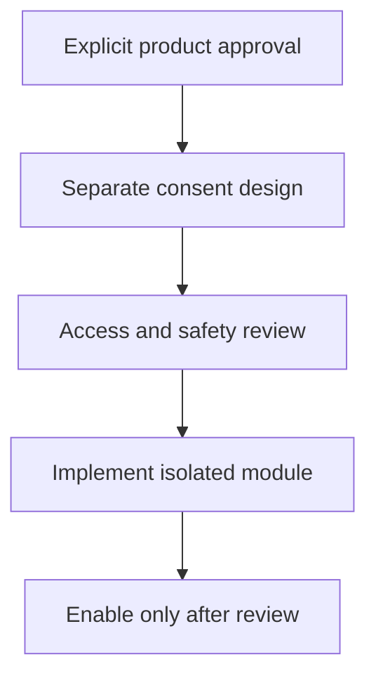

# M16 — Optional human dating and live safety

[Handover index](README.md) · [Shared client conventions](COMMON.md) · [OpenAPI](../openapi.yaml)

## Status

Not implemented. Design/reference only; no supported request/response or error contract.

0 implemented operations. This document describes the checked-in backend, not a deployed environment.

## Screen flow

Proposed flow only; no working API is implied.



## Wireframe

```text
+---------------------------------+
| Optional modes - not enabled    |
| Separate consent concept        |
| Privacy controls concept        |
| No live tracking or SOS service |
+---------------------------------+
```

## Client behavior and integration limits

- Requires explicit product approval and separate privacy/security design. No /spark or live-walk/SOS contracts or operational response exist.

## Request, response and error status

No supported contract yet. Do not call the planned paths or use fallback/mock success in production. Schemas, status codes, error codes, authentication and retry behavior will be added with implementation. Generic route/auth failures are not a feature contract.

## Planned scope

Human dating requires explicit product approval and separate consent/data access design before `/spark/*` endpoints. Precise live walk sharing, if approved, uses isolated short-lived storage and `/walk/sessions`, `/position`, `/revoke`, `/sos` with trusted-recipient access. No promised emergency dispatch or tracking service without a real operational response capability.

---

Maintained through `scripts/handover-notes.mjs`, `docs/API_PLAN.md`, OpenAPI and source error codes. Regenerate with `npm run docs:handovers`; verify with `npm run check:handovers`.
