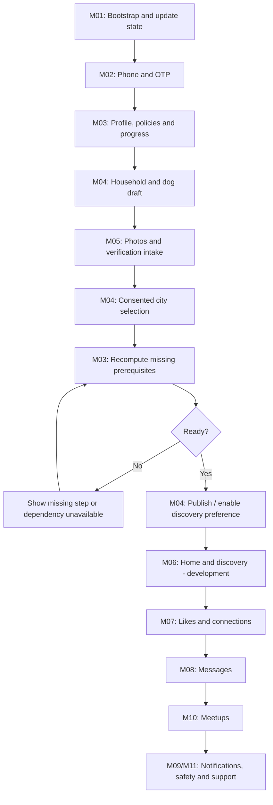

# Mobile and web developer handover

Start with [shared conventions](COMMON.md) and the module for your screen. Every planned module has a document, a flow diagram and a wireframe. **Implemented foundations do not imply production launch readiness.**

| Module | Handover | Status | APIs |
| --- | --- | --- | --- |
| M01 | [App lifecycle and reference data](M01.md) | Implemented foundation; see limitations | 9 |
| M02 | [Authentication and sessions](M02.md) | Implemented foundation; see limitations | 9 |
| M03 | [Guardian profile, consent and resumable onboarding](M03.md) | Implemented foundation; see limitations | 12 |
| M04 | [Households and dog profiles](M04.md) | Implemented foundation; see limitations | 29 |
| M05 | [Uploads and verification](M05.md) | Implemented foundation; see limitations | 14 |
| M06 | [Home and discovery](M06.md) | Implemented foundation; see limitations | 5 |
| M07 | [Likes, connections and entitlements](M07.md) | Implemented foundation; see limitations | 8 |
| M08 | [Messages and realtime](M08.md) | Implemented foundation; see limitations | 6 |
| M09 | [Notifications and devices](M09.md) | Implemented foundation; see limitations | 6 |
| M10 | [Meetups and places](M10.md) | Implemented foundation; see limitations | 14 |
| M11 | [Trust, safety, privacy and support](M11.md) | Implemented foundation; see limitations | 23 |
| M12 | [Operations and staff](M12.md) | Implemented foundation; see limitations | 34 |
| M13 | [Billing and growth](M13.md) | Not implemented | 0 |
| M14 | [Country expansion](M14.md) | Not implemented | 0 |
| M15 | [Breeding introductions](M15.md) | Not implemented | 0 |
| M16 | [Optional human dating and live safety](M16.md) | Not implemented | 0 |

## End-to-end wire diagram

Media approval, verification providers and reviewed legal documents are current onboarding blockers. Wireframes are integration sketches, not finished visual designs. Planned flows must remain disabled in public clients.

## Keeping the handover current

1. Update the implemented OpenAPI contract and module guidance in scripts/handover-notes.mjs.
2. Add/update relevant tests and HTTP examples.
3. Run npm run docs:handovers and npm run check:handovers. The check fails on missing or stale generated module docs.
4. Commit the module with its handover and implementation status.

Contract reference: [OpenAPI](../openapi.yaml). Runnable examples: [requests.http](../requests.http). Backend scope/status: [implementation ledger](../IMPLEMENTATION.md).
